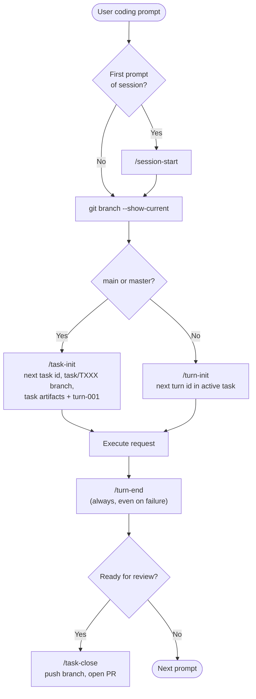

# coding-agents-config

Agentic pipeline configuration for Claude Code. Enforces a task/turn workflow with provenance tracking, branch protection, and governance rules.

## Setup

### 1. Clone the repo

```sh
git clone <repo-url> ~/coding-agents-config
```

### 2. Create symlinks (automated)

Run the setup script — it creates all symlinks and backs up any existing files:

```sh
bash scripts/setup.sh
```

<details>
<summary>Manual symlink commands</summary>

```sh
ln -s ~/coding-agents-config/skills ~/.claude/skills
ln -s ~/coding-agents-config/hooks ~/.claude/hooks
ln -s ~/coding-agents-config/agents ~/.claude/agents
ln -s ~/coding-agents-config/scripts ~/.claude/scripts
ln -s ~/coding-agents-config/CLAUDE.md ~/.claude/CLAUDE.md
ln -s ~/coding-agents-config/settings.json ~/.claude/settings.json
```

If any of these already exist, back them up first (`mv <target> <target>.bak`).
</details>

### 3. Verify

```sh
ls -la ~/.claude/skills        # should point to ~/coding-agents-config/skills
ls -la ~/.claude/hooks         # should point to ~/coding-agents-config/hooks
ls -la ~/.claude/agents        # should point to ~/coding-agents-config/agents
ls -la ~/.claude/CLAUDE.md     # should point to ~/coding-agents-config/CLAUDE.md
ls -la ~/.claude/settings.json # should point to ~/coding-agents-config/settings.json
```

## Structure

```
coding-agents-config/
├── CLAUDE.md           # Global instructions — task/turn protocol, branch rules
├── AGENTS.md           # Agent loader directive (loads ~/.claude/CLAUDE.md)
├── settings.json       # Claude Code settings (model, permissions, hooks, plugins)
├── agents/             # Subagent definitions
│   └── agent-architecture-planner.md
├── hooks/
│   └── branch-guard.sh # Auto-creates a task branch when on main/master
├── skills/             # Slash-command skills (see below)
├── scripts/
│   ├── setup.sh        # Symlinks the config into ~/.claude and ~/.codex
│   └── af-state.sh     # Helpers for .appfactory/memory/state.yaml
├── .appfactory/        # Task/turn tracking and specs
│   ├── tasks/          # task-XXX/ with turns/turn-XXX/
│   ├── tasks_index.csv # Registry of tasks
│   ├── specs/          # Specifications
│   ├── prompts/        # Prompt templates
│   └── memory/         # Pipeline state
├── docs/               # Reference documentation and migration notes
└── archive/            # Retired skills and legacy turns
```

## Task and Turn Model

- A **task** is the branch-scoped unit of work that becomes one pull request. Branch: `task/TXXX`.
- A **turn** is one AI execution cycle inside a task. Turn ids reset per task.
- Ids are zero-padded to 3 digits (`001`, `002`, ...).
- Never write code or commit on `main`/`master`.

## Execution Flow



### Artifacts

Per turn, in `.appfactory/tasks/task-XXX/turns/turn-XXX/`:
`turn_context.md`, `execution_trace.json`, `adr.md`, `manifest.json`.

Per task, in `.appfactory/tasks/task-XXX/`:
`task_context.md`, `task_status.json`, `task_summary.md`, `pull_request.md`.

`.appfactory/tasks_index.csv` gets one row per task, updated as status changes.

### Commit message format

```
AI Coding Agent Change:
- <imperative bullet>
- <imperative bullet>
```

## Skills

| Category | Skill | Description |
|----------|-------|-------------|
| **Workflow** | `session-start` | Load repo state and core pipeline context |
| | `task-init` | Create `task/TXXX` branch, task artifacts and turn-001 |
| | `turn-init` | Initialize the next turn in the active task |
| | `turn-end` | Finalize the turn (context, trace, ADR, manifest) |
| | `task-close` | Push the task branch and open a PR against main |
| | `branch-guard` | Create a task/turn branch if on main/master |
| **App Factory** | `af-orchestrator` | Orchestrate the App Factory SDLC |
| | `af-project-init` | Initialize an AppFactory project |
| | `af-memory` | CRUD for pipeline state in `.appfactory/memory/state.yaml` |
| | `af-be-prd-build` | Build a backend PRD |
| | `af-be-ddd-orchestrator` | Run the DDD build, analyze, refactor, test loop |
| | `af-be-ddd-build` | Generate a DDD document from a PRD |
| | `af-be-ddd-analysis` | Analyze a DDD document |
| | `af-be-ddd-refactor` | Refactor a DDD document from analysis findings |
| | `af-be-ddd-tests` | Generate Gherkin BDD feature specs |
| | `af-be-ddd-dsl` | Generate a domain DSL YAML from a DDD document |
| | `af-be-plan` | Build an execution plan from a DSL and tech stack profile |
| | `af-be-implementation` | Generate the backend from a tech stack implementation |
| | `af-app-check` | Production-readiness audit |
| **Utility** | `dsl-utils`, `ui-utils`, `unit-tests`, `e2e-tests` | Supporting utilities and test helpers |
| | `eval-labeler` | Label model response evaluations |

Retired skills live in `archive/`.

## Hooks

| Hook | Trigger | Purpose |
|------|---------|---------|
| `branch-guard.sh` | PreToolUse(Bash) | Auto-create a task branch instead of working on main/master |

## Adding a new skill

Each skill lives in its own directory under `skills/` with a `SKILL.md` file (YAML frontmatter with `name` and `description`):

```
skills/my-skill/
└── SKILL.md
```

## Syncing across machines

```sh
cd ~/coding-agents-config && git pull
```

The symlinks mean changes are picked up immediately — no reinstall needed.
