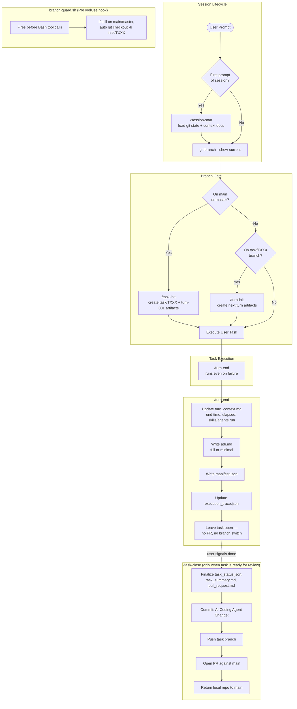

# coding-agents-config

Agentic pipeline configuration for Claude Code. Enforces turn-based workflow with provenance tracking, branch protection, and governance rules.

## Setup

### 1. Clone the repo

```sh
git clone <repo-url> ~/coding-agents-config
```

### 2. Create symlinks (automated)

Run the setup script — it creates all symlinks and backs up any existing files:

```sh
bash scripts/setup.sh
```

It links `skills/`, `agents/`, `rules/`, `hooks/`, `context/`, `scripts/`, `plugins/`, `CLAUDE.md`, and `settings.json` into `~/.claude/`; `agents/` and `AGENTS.md` into `~/.codex/`; and `CLAUDE.md` into a repo-local `.claude/`. Any target not present in this repo (e.g. `rules/`, `context/`, `plugins/`) is simply skipped downstream.

<details>
<summary>Manual symlink commands</summary>

```sh
ln -s ~/coding-agents-config/skills ~/.claude/skills
ln -s ~/coding-agents-config/agents ~/.claude/agents
ln -s ~/coding-agents-config/hooks ~/.claude/hooks
ln -s ~/coding-agents-config/scripts ~/.claude/scripts
ln -s ~/coding-agents-config/CLAUDE.md ~/.claude/CLAUDE.md
ln -s ~/coding-agents-config/settings.json ~/.claude/settings.json
ln -s ~/coding-agents-config/agents ~/.codex/agents
ln -s ~/coding-agents-config/AGENTS.md ~/.codex/AGENTS.md
```

If any of these already exist, back them up first (`mv <target> <target>.bak`).
</details>

### 3. Verify

```sh
ls -la ~/.claude/skills        # should point to ~/coding-agents-config/skills
ls -la ~/.claude/hooks         # should point to ~/coding-agents-config/hooks
ls -la ~/.claude/CLAUDE.md     # should point to ~/coding-agents-config/CLAUDE.md
ls -la ~/.claude/settings.json # should point to ~/coding-agents-config/settings.json
```

## Structure

```
coding-agents-config/
├── CLAUDE.md           # Global instructions — turn protocol, branch rules
├── AGENTS.md           # Agent loader directive
├── settings.json       # Claude Code settings (model, permissions, hooks)
├── agents/             # Standalone agent definitions (e.g. agent-architecture-planner.md)
├── hooks/              # Shell hooks triggered by Claude Code events
│   └── branch-guard.sh # Auto-creates a task/TXXX branch when on main/master
├── skills/             # Slash-command skills (24 skill directories)
│   ├── session-start/  # Load repo state and context at session start
│   ├── task-init/      # Create a task branch + task/turn-001 artifacts
│   ├── task-close/     # Finalize a task, push, and open a PR
│   ├── turn-init/      # Create the next turn directory and artifacts
│   ├── turn-end/       # Finalize the active turn
│   ├── branch-guard/   # Skill form of the branch-guard hook
│   ├── af-*/           # AppFactory backend DDD/PRD/plan/build pipeline skills
│   ├── dsl-utils/      # Nested: dsl-model-interpreter
│   ├── e2e-tests/      # Nested: http-test-artifacts
│   ├── ui-utils/       # Nested: ui-implementation-language
│   ├── unit-tests/     # Nested: test-implementation-sync
│   └── eval-labeler/   # Label/compare model responses for eval runs
├── scripts/             # Automation scripts
│   ├── setup.sh          # Creates the symlinks above
│   └── af-state.sh       # Helpers for reading/writing .appfactory/memory/state.yaml
├── .appfactory/         # Task/turn tracking and specs
│   ├── tasks/            # Task branches with turns (task_context.md, task_status.json, ...)
│   ├── tasks_index.csv   # Registry of all tasks
│   ├── specs/            # Specifications
│   ├── prompts/          # Prompt drafts and notes
│   └── memory/           # Project memory / pipeline state
├── docs/                # Reference documentation (migration notes, plans, skill summary)
├── archive/             # Legacy skill library, superseded by skills/ (kept for reference)
└── .github/             # Issue templates and PR template
```

## Execution Flow

The agentic pipeline enforces a strict turn-based workflow for all coding tasks:



### Turn Protocol Summary

| Phase | Trigger | Outputs |
|-------|---------|---------|
| **Session Start** | First prompt of session | Git state + 4 context docs loaded, session banner |
| **Task Init** | Current branch is `main`/`master` | `task/TXXX` branch, task artifacts, `turn-001` |
| **Turn Init** | Current branch is `task/TXXX` | Next `turn-XXX` directory, `turn_context.md`, `execution_trace.json` |
| **Branch Guard** | Any Bash tool call while on `main`/`master` (hook) | Auto-created `task/TXXX` branch |
| **Execution** | Every coding prompt | Modified files |
| **Turn End** | After every execution, even on failure | Updated `turn_context.md`, `adr.md`, `manifest.json`, `execution_trace.json` |
| **Task Close** | User signals the task is ready for review | `pull_request.md`, pushed branch, open PR, `tasks_index.csv` updated |

## Skills (24)

| Category | Skill | Description |
|----------|-------|--------------|
| **Session / Task / Turn** | `session-start` | Load repository state and core pipeline context at session start |
| | `task-init` | Initialize a new task branch and create task + turn-001 artifacts |
| | `task-close` | Finalize the active task branch, push it, and open a PR against main |
| | `turn-init` | Initialize the next turn within the active task branch |
| | `turn-end` | Finalize the active turn after execution, even on failure |
| | `branch-guard` | Create a turn-scoped/task branch if on main or master |
| **AppFactory: Backend DDD Pipeline** | `af-be-prd-build` | Build a backend PRD from an intake worksheet or discovery notes |
| | `af-be-ddd-build` | Generate a backend DDD document from an approved PRD |
| | `af-be-ddd-analysis` | Audit a generated DDD document for quality, completeness, and PRD alignment |
| | `af-be-ddd-refactor` | Apply targeted patches to a DDD document from analysis findings |
| | `af-be-ddd-dsl` | Generate a backend application DSL YAML from a DDD document |
| | `af-be-plan` | Generate a backend execution plan from a DSL and tech stack profile |
| | `af-be-implementation` | Copy a tech stack implementation and generate domain code from the plan + BDD specs |
| | `af-be-ddd-tests` | Generate Gherkin/BDD feature files from DDD and PRD specifications |
| | `af-be-ddd-orchestrator` | Orchestrate the DDD build → analyze → refactor → test loop |
| **AppFactory: Project & Ops** | `af-project-init` | Orchestrate AppFactory project initialization (env vars + helper script) |
| | `af-orchestrator` | Orchestrate the App Factory software development lifecycle |
| | `af-memory` | CRUD operations for AppFactory pipeline state (`state.yaml`) |
| | `af-app-check` | Audit an application for production readiness before release |
| **Utility (nested skills)** | `dsl-utils/dsl-model-interpreter` | Parse and validate app-dsl YAML specifications |
| | `e2e-tests/http-test-artifacts` | Generate `.http` request files for API endpoint testing |
| | `ui-utils/ui-implementation-language` | Declarative YAML language for UI pages, layouts, and widgets |
| | `unit-tests/test-implementation-sync` | Keep generated unit tests synchronized with implementations |
| **Eval** | `eval-labeler` | Label and compare model responses (Response A vs B) in eval runs |

Turn/task artifact templates (e.g. `task_context.md`, `turn_context.md`) live inside each skill's own `templates/` subdirectory (see `skills/task-init/templates/`, `skills/turn-init/templates/`) rather than a shared top-level `templates/` folder. Older, superseded skill implementations and their templates are kept under `archive/` for reference.

## Hooks

| Hook | Trigger | Purpose |
|------|---------|---------|
| `branch-guard.sh` | `PreToolUse` on `Bash` | If still on `main`/`master`, auto-creates and switches to the next `task/TXXX` branch instead of blocking the call |

## Adding a new skill

Each skill lives in its own directory under `skills/` with a `SKILL.md` file:

```
skills/my-skill/
└── SKILL.md
```

## Syncing across machines

Since this is a standard git repo, pull on any machine to stay current:

```sh
cd ~/coding-agents-config && git pull
```

The symlinks mean changes are picked up immediately — no reinstall needed.
