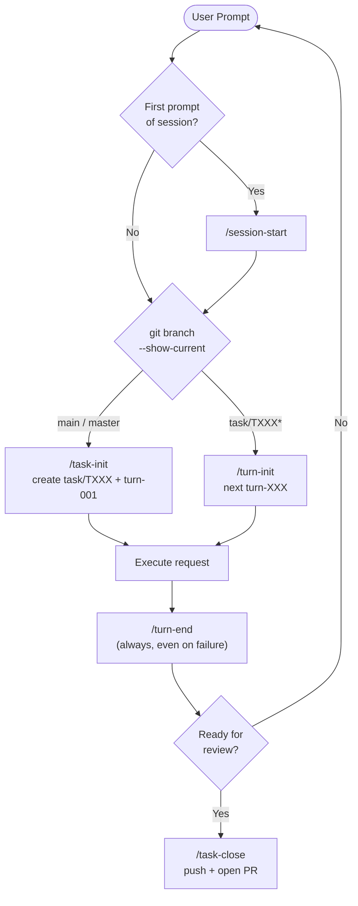

# coding-agents-config

Agentic pipeline configuration for Claude Code. Enforces turn-based workflow with provenance tracking, branch protection, and governance rules.

## Setup

### 1. Clone the repo

```sh
git clone <repo-url> ~/coding-agents-config
```

### 2. Create symlinks (automated)

Run the setup script — it creates all symlinks and backs up any existing files:

```sh
bash scripts/setup.sh
```

It links `skills`, `agents`, `rules`, `hooks`, `context`, `scripts`, `plugins`, `CLAUDE.md` and `settings.json` into `~/.claude/` (items missing from the repo are skipped), and `agents` and `AGENTS.md` into `~/.codex/`.

<details>
<summary>Manual symlink commands</summary>

```sh
ln -s ~/coding-agents-config/skills ~/.claude/skills
ln -s ~/coding-agents-config/agents ~/.claude/agents
ln -s ~/coding-agents-config/hooks ~/.claude/hooks
ln -s ~/coding-agents-config/scripts ~/.claude/scripts
ln -s ~/coding-agents-config/CLAUDE.md ~/.claude/CLAUDE.md
ln -s ~/coding-agents-config/settings.json ~/.claude/settings.json
```

If any of these already exist, back them up first (`mv <target> <target>.bak`).
</details>

### 3. Verify

```sh
ls -la ~/.claude/skills        # should point to ~/coding-agents-config/skills
ls -la ~/.claude/agents        # should point to ~/coding-agents-config/agents
ls -la ~/.claude/hooks         # should point to ~/coding-agents-config/hooks
ls -la ~/.claude/CLAUDE.md     # should point to ~/coding-agents-config/CLAUDE.md
ls -la ~/.claude/settings.json # should point to ~/coding-agents-config/settings.json
```

## Structure

```
coding-agents-config/
├── CLAUDE.md           # Global instructions — task/turn protocol, branch rules
├── AGENTS.md           # Agent loader directive
├── settings.json       # Claude Code settings (model, permissions, hooks, plugins)
├── agents/             # Subagent definitions (agent-architecture-planner)
├── hooks/
│   └── branch-guard.sh # Blocks writes while on main/master
├── skills/             # Slash-command skills (see below)
│   └── .system/        # Meta-skills (skill-creator, skill-installer, plugin-creator, imagegen, openai-docs)
├── scripts/
│   ├── setup.sh        # Creates symlinks into ~/.claude and ~/.codex
│   └── af-state.sh     # AppFactory pipeline state helper
├── .appfactory/        # Task/turn tracking and specs
│   ├── tasks/          # task-XXX/ with turns/turn-XXX/ artifacts
│   ├── tasks_index.csv # Task registry
│   ├── specs/          # Specifications
│   ├── prompts/        # Prompt templates
│   └── memory/         # Project memory
├── docs/               # Reference documentation (skill-summary.md, migration notes, plans)
└── archive/            # Retired skills and legacy turns
```

## Execution Flow

All coding work is organized into **tasks** (one branch, one pull request) made of **turns** (one AI execution cycle). Ids are zero-padded and global for tasks (`001`) and reset per task for turns.



Writing code on `main` or `master` is blocked: `/task-init` must succeed first, and `hooks/branch-guard.sh` enforces it.

### Artifacts

| Scope | Location | Files |
|-------|----------|-------|
| Turn | `.appfactory/tasks/task-XXX/turns/turn-XXX/` | `turn_context.md`, `execution_trace.json`, `adr.md`, `manifest.json` |
| Task | `.appfactory/tasks/task-XXX/` | `task_context.md`, `task_status.json`, `task_summary.md`, `pull_request.md` |
| Registry | `.appfactory/tasks_index.csv` | One row per task, updated as status changes |

Commits use the format `AI Coding Agent Change:` followed by imperative bullets.

## Skills

### Workflow

| Skill | Description |
|-------|-------------|
| `session-start` | Load repository state and core pipeline context |
| `task-init` | Create `task/TXXX` branch with task and turn-001 artifacts |
| `turn-init` | Initialize the next turn inside the active task |
| `turn-end` | Finalize the turn: ADR, manifest, trace, commit |
| `task-close` | Finalize the task, push, and open a PR against main |
| `branch-guard` | Create a branch if on main/master |

### AppFactory pipeline

See `docs/skill-summary.md` for the full phase table.

| Phase | Skill | Description |
|-------|-------|-------------|
| Orchestration | `af-orchestrator` | Orchestrates the App Factory SDLC |
| Init | `af-project-init` | Export environment variables and initialize the project |
| Requirements | `af-be-prd-build` | Build a business-facing PRD |
| DDD | `af-be-ddd-orchestrator` | Build, analyze, refactor loop and tests |
| | `af-be-ddd-build` | Generate the DDD document from the PRD |
| | `af-be-ddd-analysis` | Analyze the DDD for quality and PRD alignment |
| | `af-be-ddd-refactor` | Refactor the DDD from analysis findings |
| Testing | `af-be-ddd-tests` | Generate Gherkin BDD feature specs |
| Planning | `af-be-plan` | Execution plan from domain DSL and tech stack profile |
| DSL | `af-be-ddd-dsl` | Generate backend application DSL YAML from the DDD |
| Implementation | `af-be-implementation` | Copy a tech stack implementation into the target project |
| Validation | `af-app-check` | Production-readiness audit |
| State | `af-memory` | Read/write pipeline `state.yaml` in `.appfactory/` |

### Utility

`dsl-utils`, `ui-utils`, `unit-tests`, `e2e-tests`, `eval-labeler`

### Meta-skills (`.system`)

| Skill | Description |
|-------|-------------|
| `skill-creator` | Create new skills with SKILL.md |
| `skill-installer` | Install skills from marketplaces |
| `plugin-creator` | Scaffold plugins |
| `imagegen`, `openai-docs` | Image generation and OpenAI docs helpers |

Retired skills (schema-to-database, nestjs-*, etc.) live in `archive/`.

## Hooks

| Hook | Trigger | Purpose |
|------|---------|---------|
| `branch-guard.sh` | PreToolUse(Bash) | Block writes on main/master |

## Adding a new skill

Each skill lives in its own directory under `skills/` with a `SKILL.md` file:

```
skills/my-skill/
└── SKILL.md
```

The `.system/skill-creator` meta-skill can guide you through creating one — invoke it from Claude Code.

## Syncing across machines

Since this is a standard git repo, pull on any machine to stay current:

```sh
cd ~/coding-agents-config && git pull
```

The symlinks mean changes are picked up immediately — no reinstall needed.
