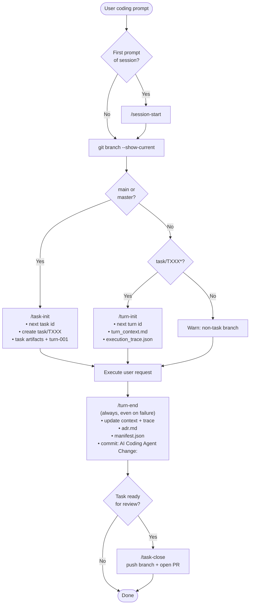

# coding-agents-config

Agentic pipeline configuration for Claude Code (and Codex). Enforces a task/turn workflow with provenance tracking, branch protection, and governance rules, and ships the App Factory (`af-*`) skills.

## Setup

### 1. Clone the repo

```sh
git clone <repo-url> ~/coding-agents-config
```

### 2. Create symlinks (automated)

```sh
bash scripts/setup.sh
```

The script backs up any existing files (`<name>.bak`) and creates:

| Target | Links |
|--------|-------|
| `~/.claude/` | `skills`, `agents`, `rules`, `hooks`, `context`, `scripts`, `plugins`, `CLAUDE.md`, `settings.json` |
| `~/.codex/` | `agents`, `AGENTS.md` |
| `./.claude/` (repo-local) | `CLAUDE.md` |

### 3. Verify

```sh
ls -la ~/.claude/skills        # -> ~/coding-agents-config/skills
ls -la ~/.claude/hooks         # -> ~/coding-agents-config/hooks
ls -la ~/.claude/CLAUDE.md     # -> ~/coding-agents-config/CLAUDE.md
ls -la ~/.claude/settings.json # -> ~/coding-agents-config/settings.json
```

## Structure

```
coding-agents-config/
├── CLAUDE.md           # Global instructions — task/turn protocol, branch rules
├── AGENTS.md           # Agent loader directive (Codex)
├── settings.json       # Claude Code settings (env, permissions, hooks, status line)
├── agents/             # Subagent definitions
│   └── agent-architecture-planner.md
├── hooks/
│   └── branch-guard.sh # PreToolUse hook: auto-creates a task branch on main/master
├── skills/             # Slash-command skills (see below)
├── scripts/
│   ├── setup.sh        # Symlink installer
│   └── af-state.sh     # State helpers for .appfactory/memory/state.yaml
├── .appfactory/        # Task/turn tracking
│   ├── tasks/          # task-XXX/ with turns/turn-XXX/ artifacts
│   ├── tasks_index.csv # Task registry
│   ├── changelog.md
│   ├── specs/          # Specifications
│   ├── prompts/        # Prompt templates
│   └── memory/         # Pipeline state
├── docs/               # Reference documentation and migration notes
├── archive/            # Retired skills and legacy turn history
└── .github/            # PR and issue templates
```

## Task / Turn Model

- A **task** is the branch-scoped unit of work (`task/TXXX`) that becomes one pull request.
- A **turn** is one AI execution cycle within the task branch. Turn ids reset per task.
- Ids are zero-padded to 3 digits.



**Hard gate:** no code is written on `main` or `master`; `/task-init` must succeed first. `hooks/branch-guard.sh` backs this up at the tool level.

### Artifacts

Per turn, under `.appfactory/tasks/task-XXX/turns/turn-XXX/`:
`turn_context.md`, `execution_trace.json`, `adr.md`, `manifest.json`

Per task, under `.appfactory/tasks/task-XXX/`:
`task_context.md`, `task_status.json`, `task_summary.md`, `pull_request.md`

Registry: `.appfactory/tasks_index.csv` (one row per task, updated as status changes).

### Commit message format

```
AI Coding Agent Change:
- <imperative bullet>
- <imperative bullet>
```

## Skills

### Pipeline

| Skill | Description |
|-------|-------------|
| `session-start` | Load repo state and core pipeline context |
| `task-init` | Create `task/TXXX` branch, task artifacts, and turn-001 |
| `task-close` | Finalize the task, push, and open a PR against main |
| `turn-init` | Initialize the next turn in the active task |
| `turn-end` | Finalize the turn: context, trace, ADR, manifest, commit |
| `branch-guard` | Create a branch if on main/master |

### App Factory (`af-*`)

| Skill | Description |
|-------|-------------|
| `af-orchestrator` | Orchestrate the App Factory SDLC |
| `af-project-init` | Initialize an AppFactory project |
| `af-memory` | CRUD on pipeline state (`.appfactory/memory/state.yaml`) |
| `af-be-prd-build` | Build a backend PRD |
| `af-be-ddd-build` | Generate a DDD document from an approved PRD |
| `af-be-ddd-analysis` | Analyze a DDD document |
| `af-be-ddd-refactor` | Refactor a DDD document from analysis findings |
| `af-be-ddd-tests` | Generate Gherkin BDD feature files from DDD and PRD |
| `af-be-ddd-dsl` | Generate domain DSL YAML from a DDD document |
| `af-be-ddd-orchestrator` | Run build → analyze → refactor loop → tests |
| `af-be-plan` | Generate a backend execution plan from DSL + tech stack profile |
| `af-be-implementation` | Copy a tech stack implementation and generate the app |
| `af-app-check` | Production-readiness audit (security, database, deployment, quality) |

### Utility groups and others

| Skill | Description |
|-------|-------------|
| `dsl-utils` | Contains `dsl-model-interpreter` |
| `ui-utils` | Contains `ui-implementation-language` |
| `unit-tests` | Contains `test-implementation-sync` |
| `e2e-tests` | Contains `http-test-artifacts` |
| `eval-labeler` | Label model-response evaluation (Eval.md) files |

### Meta-skills (`skills/.system`)

`skill-creator`, `skill-installer`, `plugin-creator`, `imagegen`, `openai-docs`

Retired skills live in `archive/` (see `archive/README.md`).

## Agents

| Agent | Purpose |
|-------|---------|
| `agent-architecture-planner` | Read-only planner: aligns PRD/DDD/DSL with the repo and produces architecture decisions and task plans |

## Hooks

| Hook | Trigger | Purpose |
|------|---------|---------|
| `branch-guard.sh` | PreToolUse(Bash) | Auto-create a task branch when on main/master |

## Adding a new skill

Each skill lives in its own directory under `skills/` with a `SKILL.md` file:

```
skills/my-skill/
└── SKILL.md
```

The `.system/skill-creator` meta-skill can guide you through creating one.

## Syncing across machines

```sh
cd ~/coding-agents-config && git pull
```

The symlinks mean changes are picked up immediately — no reinstall needed.
