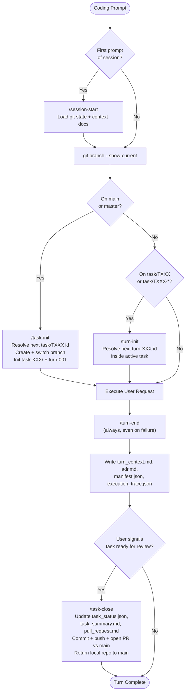

# coding-agents-config

Agentic pipeline configuration for Claude Code. Enforces a task/turn-based workflow with provenance tracking, branch protection, and governance rules, plus the App Factory (`af-*`) skill library for DSL-driven application generation.

## Setup

### 1. Clone the repo

```sh
git clone <repo-url> ~/coding-agents-config
```

### 2. Create symlinks (automated)

Run the setup script — it creates all symlinks and backs up any existing files:

```sh
bash scripts/setup.sh
```

<details>
<summary>Manual symlink commands</summary>

```sh
# Into ~/.claude/
ln -s ~/coding-agents-config/skills ~/.claude/skills
ln -s ~/coding-agents-config/agents ~/.claude/agents
ln -s ~/coding-agents-config/hooks ~/.claude/hooks
ln -s ~/coding-agents-config/scripts ~/.claude/scripts
ln -s ~/coding-agents-config/CLAUDE.md ~/.claude/CLAUDE.md
ln -s ~/coding-agents-config/settings.json ~/.claude/settings.json

# Into ~/.codex/
ln -s ~/coding-agents-config/agents ~/.codex/agents
ln -s ~/coding-agents-config/AGENTS.md ~/.codex/AGENTS.md

# Into repo-local ./.claude/
ln -s ~/coding-agents-config/CLAUDE.md ./.claude/CLAUDE.md
```

If any of these already exist, back them up first (`mv <target> <target>.bak`). `scripts/setup.sh` also links `rules/`, `context/`, and `plugins/` when those directories are present in the repo.
</details>

### 3. Verify

```sh
ls -la ~/.claude/skills        # should point to ~/coding-agents-config/skills
ls -la ~/.claude/agents        # should point to ~/coding-agents-config/agents
ls -la ~/.claude/hooks         # should point to ~/coding-agents-config/hooks
ls -la ~/.claude/CLAUDE.md     # should point to ~/coding-agents-config/CLAUDE.md
ls -la ~/.claude/settings.json # should point to ~/coding-agents-config/settings.json
```

## Structure

```
coding-agents-config/
├── CLAUDE.md           # Global instructions — task/turn protocol, branch rules
├── AGENTS.md           # Codex loader directive (points at ~/.claude/CLAUDE.md)
├── settings.json       # Claude Code settings (model, permissions, hooks, plugins)
├── package.json        # npm dependency: caveman
├── hooks/
│   └── branch-guard.sh # PreToolUse(Bash) hook — auto-creates a task/TXXX branch if on main/master
├── agents/
│   └── agent-architecture-planner.md # Sonnet subagent: PRD/DDD/DSL-driven architecture & task planning
├── skills/              # Slash-command skills (19 top-level, 4 hold nested reference skills)
│   ├── session-start/, task-init/, turn-init/, turn-end/, task-close/, branch-guard/
│   ├── af-orchestrator/, af-project-init/
│   ├── af-be-prd-build/, af-be-ddd-orchestrator/, af-be-ddd-build/,
│   │   af-be-ddd-analysis/, af-be-ddd-refactor/, af-be-ddd-tests/, af-be-ddd-dsl/
│   ├── af-be-plan/, af-be-implementation/, af-app-check/, af-memory/
│   ├── dsl-utils/dsl-model-interpreter/
│   ├── e2e-tests/http-test-artifacts/
│   ├── ui-utils/ui-implementation-language/
│   ├── unit-tests/test-implementation-sync/
│   └── eval-labeler/
├── scripts/
│   ├── setup.sh         # Creates ~/.claude, ~/.codex, ./.claude symlinks
│   └── af-state.sh      # state.yaml helpers sourced by af-* skills
├── .appfactory/          # Task/turn tracking and App Factory pipeline state
│   ├── tasks/            # task-XXX/ dirs — task + turn artifacts (see CLAUDE.md)
│   ├── specs/             # PRD / DDD / DSL specification documents
│   ├── prompts/           # Prompt templates for App Factory skills
│   ├── memory/            # state.yaml — pipeline progress and context
│   ├── changelog.md
│   └── tasks_index.csv
├── archive/               # Retired skills and templates kept for reference
│   └── templates/         # adr_template.md, pull_request_template.md,
│                           # manifest.schema.json, metadata_header.txt,
│                           # branch_naming.md, commit_message.md, tech-stack.template.md
├── docs/                  # Reference docs (skill-summary.md, migration notes, plans)
└── .github/               # Issue templates (bug, task, epic) and PR template
```

## Execution Flow

The agentic pipeline enforces a task/turn-based workflow for all coding prompts, defined in `CLAUDE.md`:



### Task/Turn Protocol Summary

| Phase | Skill | Trigger | Outputs |
|-------|-------|---------|---------|
| **Session Start** | `session-start` | First prompt of the session | Git state and context docs loaded |
| **Task Init** | `task-init` | Current branch is `main`/`master` | `task/TXXX` branch, `task-XXX/` dir, `turn-001` initialized |
| **Turn Init** | `turn-init` | Current branch is `task/TXXX` or `task/TXXX-*` | Next `turn-XXX` initialized inside the active task |
| **Execution** | — | Every coding prompt | Modified files |
| **Turn End** | `turn-end` | After every coding prompt, even on failure | `turn_context.md`, `adr.md`, `manifest.json`, `execution_trace.json` |
| **Task Close** | `task-close` | User indicates the task is ready for review | `task_status.json`, `task_summary.md`, `pull_request.md`; branch pushed and PR opened against `main`; local repo returned to `main` |

### Hard Gate

Never write code while on `main` or `master`. `hooks/branch-guard.sh` (a `PreToolUse` hook on `Bash`) auto-creates the next `task/TXXX` branch as a backstop, but `/task-init` must still run before any write or edit action per `CLAUDE.md`.

## Skills

### Task/Turn Governance

| Skill | Description |
|-------|-------------|
| `session-start` | Load repository state and core pipeline context. Run at the start of every session. |
| `task-init` | Initialize a new task branch (`task/TXXX`) and create task + `turn-001` artifacts. Run when on `main`/`master`. |
| `turn-init` | Initialize the next turn within the active task branch. Run when already on a task branch. |
| `turn-end` | Finalize the active turn (context, ADR, manifest, execution trace) after every coding prompt, even on failure. |
| `task-close` | Finalize the active task branch, push it, and open a pull request against `main`. |
| `branch-guard` | Check current git branch and create a turn-scoped branch if on `main`/`master`. |

### App Factory (`af-*`) — PRD → DDD → DSL → Code

| Skill | Description |
|-------|-------------|
| `af-orchestrator` | Orchestrates the App Factory software development lifecycle end to end. |
| `af-project-init` | Orchestrate AppFactory project initialization by exporting required environment variables and invoking the helper script. |
| `af-be-prd-build` | Build a business-facing backend PRD from a completed intake worksheet, questionnaire, or discovery notes. |
| `af-be-ddd-orchestrator` | Orchestrate the backend Domain-Driven Design workflow through build, analyze, refactor loop, and test phases. |
| `af-be-ddd-build` | Generate a human-readable backend DDD document from an approved PRD. |
| `af-be-ddd-analysis` | Audit a generated DDD spec for quality, completeness, and alignment with PRD requirements. |
| `af-be-ddd-refactor` | Refactor a DDD spec using the findings from `af-be-ddd-analysis`. |
| `af-be-ddd-tests` | Generate Gherkin-style BDD scenarios from DDD and PRD specifications. |
| `af-be-ddd-dsl` | Generate a backend application DSL YAML document from the DDD document. |
| `af-be-plan` | Generate a backend execution plan from a domain DSL and a selected tech stack profile. |
| `af-be-implementation` | Generate backend domain code from the execution plan and BDD feature specs into the target project. |
| `af-app-check` | Audit an application for production readiness across security, database, deployment, and code quality. |
| `af-memory` | CRUD operations for AppFactory pipeline state management (`state.yaml`). |

See `docs/skill-summary.md` for the full phase-ordered pipeline reference table.

### Reference / DSL & UI Utilities

| Skill | Description |
|-------|-------------|
| `dsl-utils/dsl-model-interpreter` | Parse and validate app-dsl YAML specifications before downstream generation. |
| `e2e-tests/http-test-artifacts` | Generate `.http` request files for REST client testing of backend endpoints. |
| `ui-utils/ui-implementation-language` | Declarative YAML language for UI pages, layouts, widgets, forms, and API interactions. |
| `unit-tests/test-implementation-sync` | Ensure generated unit tests stay synchronized with their target implementations. |

### Utility

| Skill | Description |
|-------|-------------|
| `eval-labeler` | Process `Eval.md` files to label and compare model responses (Response A vs. Response B) for coding tasks. |

## Agents

| Agent | Description |
|-------|-------------|
| `agent-architecture-planner` | Reads PRD, DDD, and DSL specs plus the existing repo to produce architecture decisions, module maps, task plans, and review artifacts for downstream coding agents. |

## Hooks

| Hook | Trigger | Purpose |
|------|---------|---------|
| `branch-guard.sh` | `PreToolUse` on `Bash` | If on `main`/`master`, auto-creates and switches to the next `task/TXXX` branch instead of blocking the call. |

## Required Task and Turn Artifacts

Every task requires `task_context.md`, `task_status.json`, `task_summary.md`, and `pull_request.md` under `.appfactory/tasks/task-XXX/`. Every turn requires `turn_context.md`, `execution_trace.json`, `adr.md`, and `manifest.json` under `.appfactory/tasks/task-XXX/turns/turn-XXX/`. See `CLAUDE.md` for the full directory layout and registry rules (`tasks_index.csv`).

## Templates

Turn/task lifecycle templates (`adr_template.md`, `pull_request_template.md`, `manifest.schema.json`, `metadata_header.txt`, `branch_naming.md`, `commit_message.md`, `tech-stack.template.md`) live under `archive/templates/`.

## Commit Message Format

```text
AI Coding Agent Change:
- <imperative bullet>
- <imperative bullet>
- <imperative bullet>
```

## Adding a new skill

Each skill lives in its own directory under `skills/` with a `SKILL.md` file:

```
skills/my-skill/
└── SKILL.md
```

## Syncing across machines

Since this is a standard git repo, pull on any machine to stay current:

```sh
cd ~/coding-agents-config && git pull
```

The symlinks mean changes are picked up immediately — no reinstall needed.
