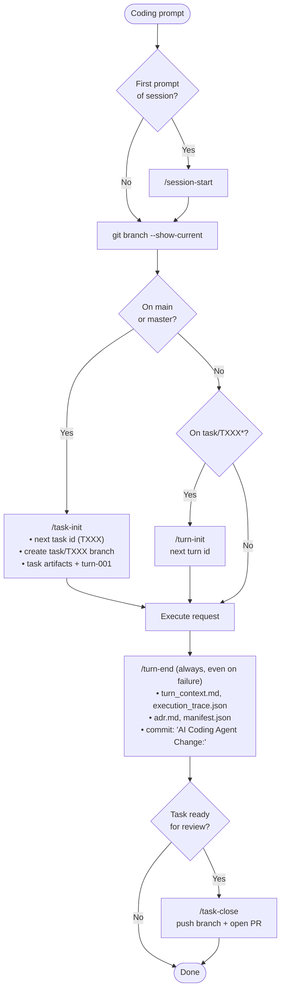

# coding-agents-config

Agentic pipeline configuration for Claude Code. Enforces a task/turn-based workflow with provenance tracking, branch protection, and governance rules.

## Setup

### 1. Clone the repo

```sh
git clone <repo-url> ~/coding-agents-config
```

### 2. Create symlinks (automated)

Run the setup script — it creates all symlinks and backs up any existing files:

```sh
bash scripts/setup.sh
```

<details>
<summary>Manual symlink commands</summary>

```sh
ln -s ~/coding-agents-config/skills ~/.claude/skills
ln -s ~/coding-agents-config/hooks ~/.claude/hooks
ln -s ~/coding-agents-config/agents ~/.claude/agents
ln -s ~/coding-agents-config/scripts ~/.claude/scripts
ln -s ~/coding-agents-config/CLAUDE.md ~/.claude/CLAUDE.md
ln -s ~/coding-agents-config/settings.json ~/.claude/settings.json
```

If any of these already exist, back them up first (`mv <target> <target>.bak`).
</details>

### 3. Verify

```sh
ls -la ~/.claude/skills        # should point to ~/coding-agents-config/skills
ls -la ~/.claude/hooks         # should point to ~/coding-agents-config/hooks
ls -la ~/.claude/agents        # should point to ~/coding-agents-config/agents
ls -la ~/.claude/CLAUDE.md     # should point to ~/coding-agents-config/CLAUDE.md
ls -la ~/.claude/settings.json # should point to ~/coding-agents-config/settings.json
```

## Structure

```
coding-agents-config/
├── CLAUDE.md           # Global instructions — task/turn protocol, branch rules
├── AGENTS.md           # Agent loader directive (points at ~/.claude/CLAUDE.md)
├── settings.json       # Claude Code settings (model, permissions, hooks)
├── agents/             # Subagent definitions
│   └── agent-architecture-planner.md
├── hooks/              # Shell hooks triggered by Claude Code events
│   └── branch-guard.sh # Auto-creates a task branch when on main/master
├── skills/             # Slash-command skills (see below)
│   └── .system/        # Meta-skills (skill-creator, skill-installer, ...)
├── scripts/            # Automation scripts
│   ├── setup.sh        # Creates symlinks into ~/.claude and ~/.codex
│   └── af-state.sh     # AppFactory pipeline state helper
├── .appfactory/        # Task/turn tracking and specs
│   ├── tasks/          # task-XXX/ with turns/turn-XXX/ artifacts
│   ├── specs/          # Specifications
│   ├── prompts/        # Prompt templates
│   └── memory/         # Project memory
├── .github/            # PR template and issue templates (bug, epic, task)
├── docs/               # Reference documentation and migration notes
└── archive/            # Retired skills and legacy turn history
```

## Execution Flow

Every coding prompt follows the task/turn workflow defined in `CLAUDE.md`:



Hard gate: no code is written on `main`/`master`; `/task-init` must succeed first.

### Concepts

| Term | Meaning |
|------|---------|
| **Task** | Branch-scoped unit of work (`task/TXXX`) that becomes one pull request. IDs are global, zero-padded. |
| **Turn** | One AI execution cycle inside a task. IDs reset per task. |

### Artifacts

Under `.appfactory/tasks/task-XXX/`:

| Level | Files |
|-------|-------|
| Task | `task_context.md`, `task_status.json`, `task_summary.md`, `pull_request.md` |
| Turn (`turns/turn-XXX/`) | `turn_context.md`, `execution_trace.json`, `adr.md`, `manifest.json` |

Registry: `.appfactory/tasks_index.csv` (one row per task).

## Skills

| Category | Skill | Description |
|----------|-------|-------------|
| **Session** | `session-start` | Load repo state and core pipeline context |
| **Task / Turn** | `task-init` | Create `task/TXXX` branch with task + turn-001 artifacts |
| | `turn-init` | Initialize the next turn in the active task |
| | `turn-end` | Finalize the turn (trace, ADR, manifest, commit) |
| | `task-close` | Push the task branch and open a PR against main |
| | `branch-guard` | Create a task/turn branch if on main/master |
| **AppFactory pipeline** | `af-orchestrator` | Orchestrate the App Factory SDLC |
| | `af-project-init` | Initialize a project and export required env vars |
| | `af-memory` | Read/write pipeline state in `.appfactory/state.yaml` |
| | `af-be-prd-build` | Build a backend PRD from a completed worksheet |
| | `af-be-ddd-orchestrator` | Run the DDD workflow: build, analyze, refactor loop, tests |
| | `af-be-ddd-build` | Generate a DDD document from an approved PRD |
| | `af-be-ddd-analysis` | Analyze a DDD document for gaps and issues |
| | `af-be-ddd-refactor` | Refactor the DDD document from analysis findings |
| | `af-be-ddd-dsl` | Generate a backend application DSL (YAML) from the DDD |
| | `af-be-ddd-tests` | Generate Gherkin BDD feature files from DDD and PRD |
| | `af-be-plan` | Produce a backend execution plan from DSL + tech stack profile |
| | `af-be-implementation` | Generate the backend from a tech stack implementation, plan, and BDD specs |
| | `af-app-check` | Production-readiness audit (security, DB, deployment, quality) |
| **Utility** | `dsl-utils`, `ui-utils` | DSL and UI helper skills |
| | `unit-tests`, `e2e-tests` | Test generation skills |
| | `eval-labeler` | Label and compare model responses from Eval.md files |

### Meta-Skills (.system)

| Skill | Description |
|-------|-------------|
| `skill-creator` | Create new skills with SKILL.md |
| `skill-installer` | Install skills from a curated list or GitHub |
| `plugin-creator` | Scaffold plugin directories |
| `imagegen` | Generate or edit raster images |
| `openai-docs` | Look up current OpenAI documentation |

## Agents

| Agent | Purpose |
|-------|---------|
| `agent-architecture-planner` | Reads PRD, DDD, DSL, and repo structure to produce architecture decisions, module maps, and task plans for downstream coding agents |

## Hooks

| Hook | Trigger | Purpose |
|------|---------|---------|
| `branch-guard.sh` | PreToolUse(Bash) | Auto-create a task branch when on main/master |

## Adding a new skill

Each skill lives in its own directory under `skills/` with a `SKILL.md` file:

```
skills/my-skill/
└── SKILL.md
```

The `.system/skill-creator` meta-skill can guide you through creating one — invoke it from Claude Code.

## Syncing across machines

Since this is a standard git repo, pull on any machine to stay current:

```sh
cd ~/coding-agents-config && git pull
```

The symlinks mean changes are picked up immediately — no reinstall needed.
