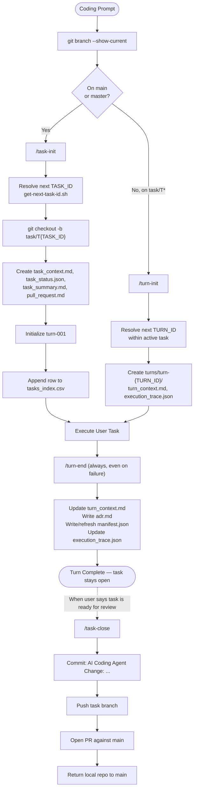

# coding-agents-config

Shared agentic pipeline configuration for Claude Code (and Codex): App Factory
skills for spec-to-code generation, plus a task/turn workflow that enforces
branch protection, provenance tracking, and governance rules.

## Setup

### 1. Clone the repo

```sh
git clone <repo-url> ~/coding-agents-config
```

### 2. Create symlinks (automated)

Run the setup script — it creates all symlinks and backs up any existing files:

```sh
bash scripts/setup.sh
```

It links `skills/`, `agents/`, `hooks/`, `scripts/`, `CLAUDE.md`, and
`settings.json` into `~/.claude/`, links `agents/` and `AGENTS.md` into
`~/.codex/`, and links `CLAUDE.md` into a repo-local `./.claude/`. (`rules/`,
`context/`, and `plugins/` are also linked into `~/.claude/` if present, but
don't currently exist in this repo.)

<details>
<summary>Manual symlink commands</summary>

```sh
ln -s ~/coding-agents-config/skills ~/.claude/skills
ln -s ~/coding-agents-config/agents ~/.claude/agents
ln -s ~/coding-agents-config/hooks ~/.claude/hooks
ln -s ~/coding-agents-config/scripts ~/.claude/scripts
ln -s ~/coding-agents-config/CLAUDE.md ~/.claude/CLAUDE.md
ln -s ~/coding-agents-config/settings.json ~/.claude/settings.json

ln -s ~/coding-agents-config/agents ~/.codex/agents
ln -s ~/coding-agents-config/AGENTS.md ~/.codex/AGENTS.md
```

If any of these already exist, back them up first (`mv <target> <target>.bak`).
</details>

### 3. Verify

```sh
ls -la ~/.claude/skills        # should point to ~/coding-agents-config/skills
ls -la ~/.claude/agents        # should point to ~/coding-agents-config/agents
ls -la ~/.claude/hooks         # should point to ~/coding-agents-config/hooks
ls -la ~/.claude/CLAUDE.md     # should point to ~/coding-agents-config/CLAUDE.md
ls -la ~/.claude/settings.json # should point to ~/coding-agents-config/settings.json
```

## Structure

```
coding-agents-config/
├── CLAUDE.md           # Global instructions — task/turn protocol, branch rules
├── AGENTS.md           # Codex loader directive (reads ~/.claude/CLAUDE.md)
├── settings.json       # Claude Code settings (model, permissions, hooks, plugins)
├── hooks/              # Shell hooks triggered by Claude Code events
│   └── branch-guard.sh # Auto-creates task/T{NNN} branch when on main/master
├── skills/             # Slash-command skills (see below)
├── agents/             # Subagent definitions
│   └── agent-architecture-planner.md
├── scripts/            # Automation scripts
│   ├── setup.sh        # Creates the symlinks above
│   └── af-state.sh     # AppFactory state helpers
├── docs/                    # Reference documentation (skill summary, migration notes, plans)
├── archive/                  # Superseded skills and templates kept for reference
│   ├── app-from-dsl, schema-to-database, nestjs-crud-resource, ...
│   └── templates/            # Legacy ADR/PR/manifest templates
├── .github/                   # Issue and PR templates
├── .appfactory/                # Task/turn tracking and pipeline state
│   ├── tasks/                  # task-XXX/ directories, one per task branch
│   │   └── task-XXX/turns/turn-XXX/  # Per-turn artifacts
│   ├── tasks_index.csv         # Registry of all tasks and their status
│   ├── specs/                  # Specifications
│   ├── prompts/                # Prompt templates
│   ├── memory/                 # Project/pipeline memory (state.yaml)
│   └── changelog.md
└── node_modules/, package.json # `caveman` plugin dependency
```

## Execution Flow

Every coding prompt runs through a task/turn lifecycle so that all work is
branch-isolated and every change is traceable to a task and turn:



A `PreToolUse` hook (`hooks/branch-guard.sh`) is a safety net that auto-creates
the next `task/T{NNN}` branch if a tool is invoked while still on `main`/`master`.

### Task/Turn Protocol Summary

| Phase | Trigger | Skill | Outputs |
|-------|---------|-------|---------|
| **Session Start** | First prompt of session | `session-start` | Git state + pipeline context loaded |
| **Task Init** | Current branch is `main`/`master` | `task-init` | `task/T{NNN}` branch, task artifacts, turn-001 |
| **Turn Init** | Already on a `task/T{NNN}` branch | `turn-init` | Next `turns/turn-{NNN}/` directory + artifacts |
| **Turn End** | After every coding prompt, even on failure | `turn-end` | `adr.md`, `manifest.json`, updated context/trace |
| **Task Close** | User says the task is ready for review | `task-close` | Commit, push, PR against `main`, status → `pr-open` |

Task ids are global and zero-padded (`001`, `002`, ...); turn ids reset per
task and are also zero-padded (`turn-001`, `turn-002`, ...).

## Skills

The App Factory (`af-*`) skills implement a spec-to-code pipeline, orchestrated
top to bottom:

| # | Phase | Skill | Invoked By | Description |
|---|-------|-------|------------|--------------|
| 1 | Initialization | `af-project-init` | `af-orchestrator` | Export required env vars and invoke the AppFactory init helper script |
| 2 | Requirements | `af-be-prd-build` | `af-orchestrator` | Build a business-facing PRD from worksheets/discovery notes |
| 3 | Domain-Driven Design | `af-be-ddd-orchestrator` | `af-orchestrator` | Orchestrate the backend DDD build → analyze → refactor loop |
| 4 | | `af-be-ddd-build` | `af-be-ddd-orchestrator` | Generate a human-readable DDD document from an approved PRD |
| 5 | | `af-be-ddd-analysis` | `af-be-ddd-orchestrator` | Audit a DDD document for quality, completeness, and PRD alignment |
| 6 | | `af-be-ddd-refactor` | `af-be-ddd-orchestrator` | Apply targeted patches to the DDD document based on analysis findings |
| 7 | Testing | `af-be-ddd-tests` | `af-be-ddd-orchestrator` | Generate Gherkin/BDD feature files from the DDD and PRD |
| 8 | Planning | `af-be-plan` | `af-orchestrator` | Generate a backend execution plan from a DSL + tech-stack profile |
| 9 | DSL Generation | `af-be-ddd-dsl` | `af-be-implementation` | Generate a backend domain DSL (YAML) from the DDD document |
| 10 | Implementation | `af-be-implementation` | `af-orchestrator` | Copy the target tech-stack implementation and generate domain code |
| 11 | Validation | `af-app-check` | `af-orchestrator` | Audit an app for production readiness (security, DB, deployment, quality) |
| 12 | Utility (cross-cutting) | `af-memory` | All skills | CRUD operations against `.appfactory/memory/state.yaml` |

### Task/Turn Lifecycle Skills

| Skill | Description |
|-------|-------------|
| `session-start` | Load repo state and core pipeline context; runs at the start of every session |
| `task-init` | Create a new `task/T{NNN}` branch and its task + turn-001 artifacts |
| `turn-init` | Create the next turn directory and artifacts within the active task |
| `turn-end` | Finalize the active turn (ADR, manifest, updated trace) after every prompt |
| `task-close` | Finalize the task, commit, push, and open a PR against `main` |
| `branch-guard` | Skill-level branch check/creation counterpart to `hooks/branch-guard.sh` |

### Other Skills

| Skill | Description |
|-------|-------------|
| `eval-labeler` | Process `Eval.md` files to label/score/compare model responses in run directories |

`skills/dsl-utils/`, `skills/ui-utils/`, `skills/e2e-tests/`, and
`skills/unit-tests/` are category folders holding further sub-skills
(e.g. `dsl-model-interpreter`, `ui-implementation-language`,
`http-test-artifacts`, `test-implementation-sync`).

See `docs/skill-summary.md` for the canonical AppFactory phase/step reference.

## Agents

| Agent | Description |
|-------|-------------|
| `agent-architecture-planner` | Reads PRD/DDD/DSL and repo structure to produce architecture decisions, module maps, task plans, and review artifacts for downstream coding agents |

## Archive

`archive/` holds an earlier generation of DSL-driven scaffolding skills
(`app-from-dsl`, `schema-to-database`, `nestjs-crud-resource`,
`prisma-persistence`, `react-form-page`, `field-mapper-generator`,
`http-test-artifacts`, and others) plus the legacy ADR/PR/manifest
`templates/`. They're superseded by the `af-*` App Factory pipeline but kept
for reference — see `archive/README.md` and `archive/SUMMARY.md`.

## Hooks

| Hook | Trigger | Purpose |
|------|---------|---------|
| `branch-guard.sh` | `PreToolUse` (Bash/write tools) | Auto-create the next `task/T{NNN}` branch when on `main`/`master` |

## Adding a new skill

Each skill lives in its own directory under `skills/` with a `SKILL.md` file:

```
skills/my-skill/
└── SKILL.md
```

## Syncing across machines

Since this is a standard git repo, pull on any machine to stay current:

```sh
cd ~/coding-agents-config && git pull
```

The symlinks mean changes are picked up immediately — no reinstall needed.
