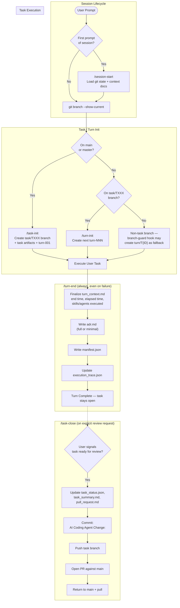

# coding-agents-config

Agentic pipeline configuration for Claude Code and Codex. Enforces a task/turn-based
workflow with provenance tracking, branch protection, governance rules, and a
library of App Factory (AppFactory) skills for generating full-stack applications
from DSL specifications.

## Setup

### 1. Clone the repo

```sh
git clone <repo-url> ~/coding-agents-config
```

### 2. Create symlinks (automated)

Run the setup script — it creates all symlinks and backs up any existing files:

```sh
bash scripts/setup.sh
```

<details>
<summary>Manual symlink commands</summary>

```sh
# ~/.claude/
ln -s ~/coding-agents-config/skills ~/.claude/skills
ln -s ~/coding-agents-config/agents ~/.claude/agents
ln -s ~/coding-agents-config/hooks ~/.claude/hooks
ln -s ~/coding-agents-config/scripts ~/.claude/scripts
ln -s ~/coding-agents-config/CLAUDE.md ~/.claude/CLAUDE.md
ln -s ~/coding-agents-config/settings.json ~/.claude/settings.json

# ~/.codex/
ln -s ~/coding-agents-config/agents ~/.codex/agents
ln -s ~/coding-agents-config/AGENTS.md ~/.codex/AGENTS.md

# repo-local ./.claude/
ln -s ~/coding-agents-config/CLAUDE.md ./.claude/CLAUDE.md
```

If any of these already exist, back them up first (`mv <target> <target>.bak`).
</details>

### 3. Verify

```sh
ls -la ~/.claude/skills        # should point to ~/coding-agents-config/skills
ls -la ~/.claude/agents        # should point to ~/coding-agents-config/agents
ls -la ~/.claude/hooks         # should point to ~/coding-agents-config/hooks
ls -la ~/.claude/CLAUDE.md     # should point to ~/coding-agents-config/CLAUDE.md
ls -la ~/.claude/settings.json # should point to ~/coding-agents-config/settings.json
```

## Structure

```
coding-agents-config/
├── CLAUDE.md           # Global instructions — task/turn protocol, branch rules
├── AGENTS.md           # Codex loader directive (points at ~/.claude/CLAUDE.md)
├── settings.json        # Claude Code settings (model, permissions, hooks)
├── agents/              # Subagent definitions
│   └── agent-architecture-planner.md
├── hooks/               # Shell hooks triggered by Claude Code events
│   └── branch-guard.sh  # Auto-creates a turn branch when on main/master
├── scripts/              # Automation scripts
│   ├── setup.sh          # Create ~/.claude and ~/.codex symlinks
│   └── af-state.sh        # AppFactory state helpers (.appfactory/memory/state.yaml)
├── skills/               # Slash-command skills
│   ├── .system/           # Vendored meta-skills (skill-creator, skill-installer, ...)
│   ├── session-start/      # Load repo state and pipeline context at session start
│   ├── task-init/          # Create a task/TXXX branch and task-001 artifacts
│   ├── turn-init/          # Create the next turn within the active task
│   ├── turn-end/           # Finalize a turn (ADR, manifest, execution trace)
│   ├── task-close/         # Push the task branch and open a pull request
│   ├── branch-guard/       # Hook-invoked fallback branch guard
│   ├── af-*/               # App Factory SDLC pipeline skills (see below)
│   ├── dsl-utils/, e2e-tests/, ui-utils/, unit-tests/  # Category folders holding
│   │                        # nested skills (e.g. dsl-utils/dsl-model-interpreter)
│   └── eval-labeler/       # Model response evaluation/labeling
├── .appfactory/          # Task/turn tracking, specs, prompts, memory
│   ├── tasks/             # task-XXX/ directories with turns/turn-XXX artifacts
│   ├── tasks_index.csv    # Registry of all tasks and their status
│   ├── specs/
│   ├── prompts/
│   └── memory/
├── archive/              # Deprecated skills, templates, and legacy turn artifacts
├── docs/                 # Reference documentation (pipeline plans, skill summary)
├── .github/              # Issue templates and pull request template
└── package.json
```

## Execution Flow

The agentic pipeline enforces a strict task/turn-based workflow for all coding tasks:



### Task / Turn Protocol Summary

| Phase | Trigger | Skill | Outputs |
|-------|---------|-------|---------|
| **Session Start** | First prompt of session | `session-start` | Git state + 4 context docs loaded |
| **Task Init** | Current branch is `main`/`master` | `task-init` | `task/TXXX` branch, `task_context.md`, `task_status.json`, `task_summary.md`, `pull_request.md`, `turn-001/` |
| **Turn Init** | Current branch is `task/TXXX[-*]` | `turn-init` | Next `turn-NNN/` directory, `turn_context.md`, `execution_trace.json` |
| **Execution** | Every coding prompt | — | Modified files |
| **Turn End** | After every prompt, even on failure | `turn-end` | `adr.md`, `manifest.json`, updated `execution_trace.json` |
| **Task Close** | User indicates task is ready for review | `task-close` | Commit, pushed branch, pull request against `main` |

Task ids and turn ids are both zero-padded to 3 digits (`001`, `002`, ...). Task ids
are global; turn ids reset per task. See `CLAUDE.md` for the full governance rules.

## Skills

### Pipeline / Governance

| Skill | Description |
|-------|-------------|
| `session-start` | Load repo state and core pipeline context at the start of every session |
| `task-init` | Initialize a new `task/TXXX` branch and create task + turn-001 artifacts (run when on `main`/`master`) |
| `turn-init` | Initialize the next turn within the active task branch |
| `turn-end` | Finalize the active turn (ADR, manifest, execution trace) after every prompt |
| `task-close` | Finalize the active task, push it, and open a pull request against `main` |
| `branch-guard` | Hook-invoked fallback: creates a `turn/T{ID}` branch if still on `main`/`master` |

### App Factory SDLC Pipeline (`af-*`)

End-to-end pipeline for generating backend applications from a PRD through DSL to
implementation. See `docs/skill-summary.md` for the full phase-by-phase reference.

| Skill | Description |
|-------|-------------|
| `af-orchestrator` | Orchestrates the full App Factory software development lifecycle |
| `af-project-init` | Orchestrate AppFactory project initialization (env vars + helper script) |
| `af-be-prd-build` | Build a business-facing backend PRD from an intake worksheet |
| `af-be-ddd-orchestrator` | Orchestrate the backend DDD build → analyze → refactor → test loop |
| `af-be-ddd-build` | Generate a human-readable backend DDD document from an approved PRD |
| `af-be-ddd-analysis` | Analyze a DDD specification for quality, completeness, and PRD alignment |
| `af-be-ddd-refactor` | Refactor a DDD specification using analysis findings |
| `af-be-ddd-tests` | Generate Gherkin-style BDD feature files from DDD and PRD specifications |
| `af-be-plan` | Generate a backend execution plan from a domain DSL and tech-stack profile |
| `af-be-ddd-dsl` | Generate a backend DSL YAML document from a DDD document |
| `af-be-implementation` | Execute backend code generation from the execution plan and BDD specs |
| `af-app-check` | Audit an application for production readiness (security, DB, deployment, quality) |
| `af-memory` | CRUD operations for `.appfactory/memory/state.yaml` pipeline state |

### Utility (category folders with nested skills)

| Category | Nested Skill | Description |
|----------|--------------|--------------|
| `dsl-utils/` | `dsl-model-interpreter` | Parse and validate app-dsl YAML specifications |
| `e2e-tests/` | `http-test-artifacts` | Generate `.http` request files for API endpoint testing |
| `ui-utils/` | `ui-implementation-language` | Declarative YAML language for framework-neutral UI page definitions |
| `unit-tests/` | `test-implementation-sync` | Keep generated unit tests synchronized with implementations |
| `eval-labeler` | — | Label and compare model responses (Response A vs. B) for coding tasks |

### Meta-Skills (`.system/`)

Vendored skills (skill-creator, skill-installer, plugin-creator, imagegen, openai-docs)
used to author and install further skills — not part of the App Factory pipeline.

## Agents

| Agent | Description |
|-------|-------------|
| `agent-architecture-planner` | Reads PRD/DDD/DSL and repo structure to produce architecture decisions, module maps, task plans, and review artifacts for downstream coding agents |

## Hooks

| Hook | Trigger | Purpose |
|------|---------|---------|
| `branch-guard.sh` | `PreToolUse` (Write/Edit/Bash) | Auto-creates a `turn/T{TURN_ID}` branch if still on `main`/`master` |

## Scripts

| Script | Purpose |
|--------|---------|
| `setup.sh` | Create the `~/.claude`, `~/.codex`, and repo-local `.claude` symlinks |
| `af-state.sh` | Helpers for reading/writing `.appfactory/memory/state.yaml`, sourced by `af-*` skills |

## Docs

Reference material under `docs/`:

- `skill-summary.md` — full AppFactory skill reference table (phase, step, invoker)
- `appFactory-plan.md` — AppFactory implementation plan
- `app-nextjs-nestjs-prisma.md` — Next.js + NestJS + Prisma generation pipeline
- `migration-ai-to-appfactory.md`, `ai-to-appfactory-migration-analysis.md` — migration notes from the legacy `ai/` layout to `.appfactory/`

## Archive

`archive/` holds retired skills, templates, and legacy turn artifacts that predate
the current task/turn model (e.g. `nestjs-crud-resource`, `schema-to-database`,
`shadcn`, `prisma-persistence`). See `archive/README.md` and `archive/SUMMARY.md`
for what moved and why.

## Adding a new skill

Each skill lives in its own directory under `skills/` with a `SKILL.md` file:

```
skills/my-skill/
└── SKILL.md
```

The `.system/skill-creator` meta-skill can guide you through creating one — invoke it from Claude Code.

## Syncing across machines

Since this is a standard git repo, pull on any machine to stay current:

```sh
cd ~/coding-agents-config && git pull
```

The symlinks mean changes are picked up immediately — no reinstall needed.
