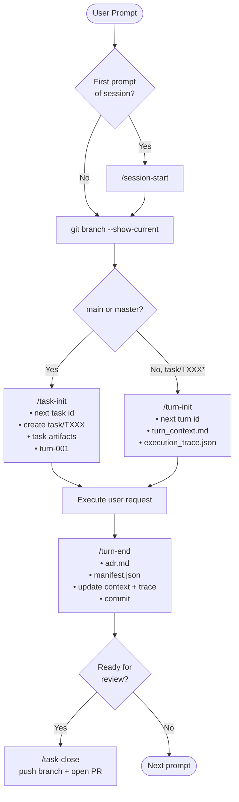

# coding-agents-config

Agentic pipeline configuration for Claude Code. Enforces a task/turn workflow with provenance tracking, branch protection, and governance rules, and ships the App Factory (`af-*`) skills for generating backend applications from PRDs and DDD documents.

## Setup

### 1. Clone the repo

```sh
git clone <repo-url> ~/coding-agents-config
```

### 2. Create symlinks (automated)

Run the setup script — it creates all symlinks and backs up any existing files (`<target>.bak`):

```sh
bash scripts/setup.sh
```

It links the following:

| Destination | Items |
|-------------|-------|
| `~/.claude/` | `skills`, `agents`, `rules`, `hooks`, `context`, `scripts`, `plugins`, `CLAUDE.md`, `settings.json` |
| `~/.codex/` | `agents`, `AGENTS.md` |
| `./.claude/` (repo-local) | `CLAUDE.md` |

Items that do not exist in the repo are skipped.

### 3. Verify

```sh
ls -la ~/.claude/skills        # -> ~/coding-agents-config/skills
ls -la ~/.claude/hooks         # -> ~/coding-agents-config/hooks
ls -la ~/.claude/CLAUDE.md     # -> ~/coding-agents-config/CLAUDE.md
ls -la ~/.claude/settings.json # -> ~/coding-agents-config/settings.json
```

## Structure

```
coding-agents-config/
├── CLAUDE.md           # Global instructions — task/turn protocol, branch rules
├── AGENTS.md           # Agent loader directive (points at ~/.claude/CLAUDE.md)
├── settings.json       # Claude Code settings (models, permissions, hooks)
├── agents/             # Subagent definitions (agent-architecture-planner)
├── hooks/
│   └── branch-guard.sh # PreToolUse hook: auto-creates a task branch when on main/master
├── skills/             # Active skills (see below)
│   └── .system/        # Meta-skills (skill-creator, skill-installer, plugin-creator, ...)
├── scripts/
│   ├── setup.sh        # Symlink installer
│   └── af-state.sh     # AppFactory state helpers for af-* skills
├── .appfactory/        # Task/turn tracking, specs, prompts, memory, tasks_index.csv
├── archive/            # Retired skills and the former turn templates
├── docs/               # Reference documentation and migration notes
└── .github/            # Issue and PR templates
```

## Execution Flow

Every coding prompt runs inside a **task** (one branch, one pull request) made of **turns** (one AI execution cycle each). Task ids (`T001`) are global; turn ids (`turn-001`) reset per task.



**Hard gate:** no code is written on `main`/`master`; `/task-init` must succeed first. `/turn-end` always runs, even on failure.

### Protocol Summary

| Phase | Skill | Outputs |
|-------|-------|---------|
| Session start | `session-start` | Git state and context loaded |
| Task init (on main) | `task-init` | `task/TXXX` branch, task artifacts, `tasks_index.csv` row, turn-001 |
| Turn init (on task branch) | `turn-init` | `turn_context.md`, `execution_trace.json` |
| Turn end | `turn-end` | `adr.md`, `manifest.json`, updated context/trace, commit |
| Task close | `task-close` | Pushed branch and pull request |

### Artifacts

```
.appfactory/
├── tasks_index.csv
└── tasks/task-XXX/
    ├── task_context.md  task_status.json  task_summary.md  pull_request.md
    └── turns/turn-XXX/
        └── turn_context.md  execution_trace.json  adr.md  manifest.json
```

Commits use the format `AI Coding Agent Change:` followed by imperative bullets.

## Skills

### Pipeline (task/turn lifecycle)

| Skill | Description |
|-------|-------------|
| `session-start` | Load repository state and core pipeline context |
| `task-init` | Create task branch and task + turn-001 artifacts |
| `turn-init` | Initialize the next turn in the active task |
| `turn-end` | Finalize the turn (ADR, manifest, commit) |
| `task-close` | Push the task branch and open a PR against main |
| `branch-guard` | Create a branch if on main/master |

### App Factory (`af-*`)

| Skill | Description |
|-------|-------------|
| `af-orchestrator` | Orchestrate the App Factory SDLC |
| `af-project-init` | Initialize an AppFactory project |
| `af-memory` | Read/write pipeline state in `.appfactory/memory/state.yaml` |
| `af-be-prd-build` | Build a business-facing backend PRD |
| `af-be-ddd-build` | Generate a Domain-Driven Design document from a PRD |
| `af-be-ddd-analysis` | Analyze a DDD document |
| `af-be-ddd-refactor` | Refactor a DDD document from analysis findings |
| `af-be-ddd-orchestrator` | Run build → analyze → refactor loop → tests |
| `af-be-ddd-tests` | Generate Gherkin BDD feature files |
| `af-be-ddd-dsl` | Generate a backend DSL YAML from a DDD document |
| `af-be-plan` | Create a backend execution plan from DSL + tech stack profile |
| `af-be-implementation` | Generate the backend from a tech stack implementation |
| `af-app-check` | Audit production readiness (security, DB, deployment, quality) |

### Utilities

| Skill | Description |
|-------|-------------|
| `dsl-utils` | Contains `dsl-model-interpreter` |
| `ui-utils` | Contains `ui-implementation-language` |
| `unit-tests` | Contains `test-implementation-sync` |
| `e2e-tests` | Contains `http-test-artifacts` |
| `eval-labeler` | Label model response evaluations from `Eval.md` files |

### Meta-Skills (`skills/.system`)

`skill-creator`, `skill-installer`, `plugin-creator`, `imagegen`, `openai-docs`.

Retired skills (NestJS/Prisma scaffolding, `schema-to-database`, etc.) live in `archive/`.

## Hooks

| Hook | Trigger | Purpose |
|------|---------|---------|
| `branch-guard.sh` | PreToolUse(Bash) | Auto-create a task branch when on main/master |

## Adding a new skill

Each skill lives in its own directory under `skills/` with a `SKILL.md` file:

```
skills/my-skill/
└── SKILL.md
```

The `.system/skill-creator` meta-skill can guide you through creating one.

## Syncing across machines

```sh
cd ~/coding-agents-config && git pull
```

The symlinks mean changes are picked up immediately — no reinstall needed.
