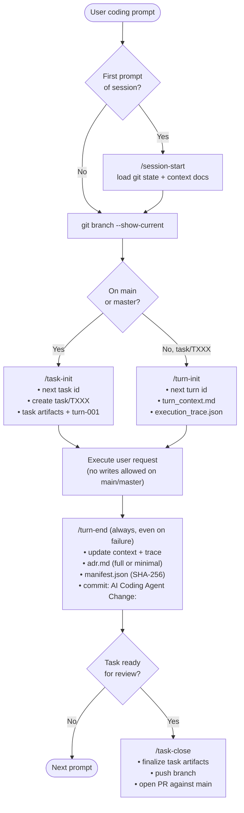

# coding-agents-config

Agentic pipeline configuration for Claude Code. Enforces turn-based workflow with provenance tracking, branch protection, and governance rules.

## Setup

### 1. Clone the repo

```sh
git clone <repo-url> ~/coding-agents-config
```

### 2. Create symlinks (automated)

Run the setup script. It creates the symlinks and backs up any existing files:

```sh
bash scripts/setup.sh
```

It links `skills`, `agents`, `rules`, `hooks`, `context`, `scripts`, `plugins`, `CLAUDE.md` and `settings.json` into `~/.claude/`, `agents` and `AGENTS.md` into `~/.codex/`, and `CLAUDE.md` into the repo-local `.claude/`. Targets that don't exist in the repo are skipped.

### 3. Verify

```sh
ls -la ~/.claude/skills        # should point to ~/coding-agents-config/skills
ls -la ~/.claude/hooks         # should point to ~/coding-agents-config/hooks
ls -la ~/.claude/agents        # should point to ~/coding-agents-config/agents
ls -la ~/.claude/CLAUDE.md     # should point to ~/coding-agents-config/CLAUDE.md
ls -la ~/.claude/settings.json # should point to ~/coding-agents-config/settings.json
```

## Structure

```
coding-agents-config/
├── CLAUDE.md           # Global instructions: task/turn protocol, branch rules, constants
├── AGENTS.md           # Agent loader directive (points at ~/.claude/CLAUDE.md)
├── settings.json       # Claude Code settings (model, permissions, hooks, plugins)
├── agents/             # Subagent definitions
│   └── agent-architecture-planner.md
├── hooks/              # Shell hooks triggered by Claude Code events
│   └── branch-guard.sh # Auto-creates a task branch when on main/master
├── skills/             # Slash-command skills (see below)
├── scripts/            # Automation scripts
│   ├── setup.sh        # Creates symlinks into ~/.claude and ~/.codex
│   └── af-state.sh     # AppFactory pipeline state helper
├── .appfactory/        # Task/turn tracking and specs
│   ├── tasks/          # task-XXX/ with turns/turn-XXX/ artifacts
│   ├── tasks_index.csv # Registry of tasks
│   ├── specs/          # Specifications
│   ├── prompts/        # Prompt templates
│   └── memory/         # Project memory
├── .github/            # PR template and issue templates (bug, epic, task)
├── archive/            # Retired skills and legacy turns
└── docs/               # Reference documentation
```

## Execution Flow

The pipeline enforces a strict task- and turn-based workflow for all coding prompts. A task is a branch (`task/TXXX`) that becomes one pull request; a turn is one AI execution cycle within that task.



### Protocol Summary

| Phase | Steps | Outputs |
|-------|-------|---------|
| **Session Start** | Load git state, load context docs, display banner | Context loaded |
| **Branch Gate** | Check branch; on `main`/`master` run `/task-init` | Safe `task/TXXX` branch |
| **Task Init** | Resolve task id, create branch, create task dir, append `tasks_index.csv` | `task_context.md`, `task_status.json`, turn-001 |
| **Turn Init** | Resolve next turn id inside the active task | `turn_context.md`, `execution_trace.json` |
| **Execution** | Execute the request | Modified files |
| **Turn End** | Update context and trace, write ADR and manifest, commit | `adr.md`, `manifest.json` |
| **Task Close** | Write summary and PR description, push, open PR | `task_summary.md`, `pull_request.md` |

### Artifacts

```
.appfactory/tasks/task-XXX/
├── task_context.md
├── task_status.json
├── task_summary.md
├── pull_request.md
└── turns/turn-XXX/
    ├── turn_context.md
    ├── execution_trace.json
    ├── adr.md
    └── manifest.json
```

Task ids are global and zero-padded (`001`); turn ids reset per task. Commits use the format `AI Coding Agent Change:` followed by imperative bullets.

## Skills

### Pipeline lifecycle

| Skill | Description |
|-------|-------------|
| `session-start` | Load repository state and core pipeline context at the start of a session |
| `task-init` | Create the `task/TXXX` branch plus task and turn-001 artifacts (from main/master) |
| `turn-init` | Initialize the next turn within the active task branch |
| `turn-end` | Finalize the turn: ADR, manifest, trace, commit; runs even on failure |
| `task-close` | Finalize the task, push the branch, open a PR against main |
| `branch-guard` | Check the current branch and create a scoped branch if on main/master |

### App Factory (`af-*`)

| Skill | Description |
|-------|-------------|
| `af-orchestrator` | Orchestrate the App Factory software development lifecycle |
| `af-project-init` | Initialize a project by exporting required environment variables and invoking the helper script |
| `af-be-prd-build` | Build a business-facing backend PRD from a completed worksheet |
| `af-be-ddd-orchestrator` | Run the DDD workflow: build, analyze, refactor loop, tests |
| `af-be-ddd-build` | Generate a Domain-Driven Design document from an approved PRD |
| `af-be-ddd-analysis` | Analyze the DDD for quality, completeness and PRD alignment |
| `af-be-ddd-refactor` | Refactor the DDD based on analysis findings |
| `af-be-ddd-tests` | Generate Gherkin BDD feature files from the DDD and PRD |
| `af-be-ddd-dsl` | Generate a backend application DSL YAML from the DDD |
| `af-be-plan` | Generate a backend execution plan from a domain DSL and tech stack profile |
| `af-be-implementation` | Copy the selected tech stack implementation and generate domain code from the plan and BDD features |
| `af-app-check` | Audit production readiness: security, database, deployment, code quality |
| `af-memory` | Read and write pipeline state (`state.yaml`) in `.appfactory/` |

See `docs/skill-summary.md` for the phase-by-phase pipeline table.

### Utility

| Skill | Description |
|-------|-------------|
| `dsl-utils`, `ui-utils` | Shared DSL and UI helpers |
| `unit-tests`, `e2e-tests` | Test generation and execution helpers |
| `eval-labeler` | Label and compare model responses from `Eval.md` files |

Retired skills (for example `nestjs-crud-resource`, `schema-to-database`, `shadcn`) live in `archive/`.

## Agents

| Agent | Description |
|-------|-------------|
| `agent-architecture-planner` | Reads the PRD, DDD, DSL and repo structure to produce architecture decisions, module maps and task plans for downstream coding agents |

## Hooks

| Hook | Trigger | Purpose |
|------|---------|---------|
| `branch-guard.sh` | PreToolUse(Bash) | Auto-create a task branch when on main/master instead of allowing writes |

## Adding a new skill

Each skill lives in its own directory under `skills/` with a `SKILL.md` file:

```
skills/my-skill/
└── SKILL.md
```

Include `name` and `description` in the SKILL.md frontmatter.

## Syncing across machines

Since this is a standard git repo, pull on any machine to stay current:

```sh
cd ~/coding-agents-config && git pull
```

The symlinks mean changes are picked up immediately, with no reinstall needed.
