# coding-agents-config

Agentic pipeline configuration for Claude Code. Enforces turn-based workflow with provenance tracking, branch protection, and governance rules, plus a library of AppFactory (`af-*`) skills for generating backend applications end-to-end.

## Setup

### 1. Clone the repo

```sh
git clone <repo-url> ~/coding-agents-config
```

### 2. Create symlinks (automated)

Run the setup script — it creates all symlinks and backs up any existing files:

```sh
bash scripts/setup.sh
```

<details>
<summary>Manual symlink commands</summary>

```sh
# ~/.claude/
ln -s ~/coding-agents-config/skills ~/.claude/skills
ln -s ~/coding-agents-config/agents ~/.claude/agents
ln -s ~/coding-agents-config/hooks ~/.claude/hooks
ln -s ~/coding-agents-config/scripts ~/.claude/scripts
ln -s ~/coding-agents-config/CLAUDE.md ~/.claude/CLAUDE.md
ln -s ~/coding-agents-config/settings.json ~/.claude/settings.json

# ~/.codex/
ln -s ~/coding-agents-config/agents ~/.codex/agents
ln -s ~/coding-agents-config/AGENTS.md ~/.codex/AGENTS.md

# repo-local ./.claude/
ln -s ~/coding-agents-config/CLAUDE.md ./.claude/CLAUDE.md
```

If any of these already exist, `scripts/setup.sh` backs them up automatically (`<target>.bak`).
</details>

### 3. Verify

```sh
ls -la ~/.claude/skills        # should point to ~/coding-agents-config/skills
ls -la ~/.claude/agents        # should point to ~/coding-agents-config/agents
ls -la ~/.claude/hooks         # should point to ~/coding-agents-config/hooks
ls -la ~/.claude/CLAUDE.md     # should point to ~/coding-agents-config/CLAUDE.md
ls -la ~/.claude/settings.json # should point to ~/coding-agents-config/settings.json
```

## Structure

```
coding-agents-config/
├── CLAUDE.md           # Global instructions — turn protocol, branch rules
├── AGENTS.md           # Codex agent loader directive (points to ~/.claude/CLAUDE.md)
├── settings.json       # Claude Code settings (model, permissions, hooks, plugins)
├── hooks/              # Shell hooks triggered by Claude Code events
│   └── branch-guard.sh # Prevents edits on main/master
├── agents/             # Standalone agent definitions
│   └── agent-architecture-planner.md
├── skills/             # Slash-command skills (see below)
├── scripts/            # Automation scripts
│   ├── setup.sh         # Creates ~/.claude and ~/.codex symlinks
│   └── af-state.sh      # AppFactory state.yaml helper functions
├── docs/                # Reference documentation and migration notes
├── archive/             # Deprecated skills and superseded templates
│   └── templates/       # Legacy ADR / PR / manifest templates
├── .appfactory/         # Task/turn tracking and specs (this repo's own pipeline state)
│   ├── tasks/            # Task branches with turns
│   ├── specs/            # Specifications
│   ├── prompts/          # Prompt templates
│   ├── memory/           # Project memory
│   └── tasks_index.csv   # Registry of all tasks
├── .github/             # Issue templates and PR template
└── package.json         # Node dependency (caveman) used by tooling
```

## Execution Flow

The agentic pipeline enforces a strict turn-based workflow for all coding tasks:

```mermaid
flowchart TB
    subgraph SESSION["Session Lifecycle"]
        START([User Prompt]) --> SS{First prompt<br/>of session?}
        SS -->|Yes| SESSION_START["/session-start"]
        SS -->|No| BRANCH_CHECK

        SESSION_START --> LOAD_GIT["Load Git State<br/>• git branch<br/>• git status<br/>• git log"]
        LOAD_GIT --> LOAD_CTX["Load Context Docs<br/>• adr-context.md<br/>• governance-context.md<br/>• tech-standards-context.md<br/>• turn-tracking-context.md"]
        LOAD_CTX --> BANNER["Display Session Banner"]
        BANNER --> BRANCH_CHECK
    end

    subgraph BRANCH_GATE["Branch Protection Gate"]
        BRANCH_CHECK["git branch --show-current"] --> IS_MAIN{On main<br/>or master?}
        IS_MAIN -->|Yes| TASK_INIT["/task-init<br/>resolve TASK_ID, create task/TXXX,<br/>init task + turn-001"]
        IS_MAIN -->|No| IS_TASK{On task/TXXX<br/>branch?}
        IS_TASK -->|Yes| TURN_INIT["/turn-init<br/>resolve next TURN_ID within task"]
        TASK_INIT --> EXEC
        TURN_INIT --> EXEC
    end

    subgraph EXECUTION["Task Execution"]
        EXEC["Execute User Task"] --> ADD_HEADERS["Add Metadata Headers<br/>to all modified files"]
        ADD_HEADERS --> BUMP_VERSION["Bump File Versions<br/>SemVer"]
    end

    subgraph POST_EXEC["Post-Execution (/turn-end)"]
        BUMP_VERSION --> TURN_END["/turn-end"]
        TURN_END --> WRITE_ADR["Write adr.md<br/>Full or Minimal"]
        WRITE_ADR --> WRITE_MANIFEST["Write manifest.json"]
        WRITE_MANIFEST --> UPDATE_INDEX["Update tasks_index.csv"]
        UPDATE_INDEX --> CHECK_UNCOMMITTED{Uncommitted<br/>changes?}
        CHECK_UNCOMMITTED -->|Yes| COMMIT["Commit with format:<br/>AI Coding Agent Change:"]
        CHECK_UNCOMMITTED -->|No| COMPLETE
        COMMIT --> COMPLETE["Turn Complete"]
    end

    subgraph CLOSE["On Task Completion"]
        COMPLETE --> READY{User signals<br/>task ready<br/>for review?}
        READY -->|Yes| TASK_CLOSE["/task-close<br/>push branch, open PR"]
        READY -->|No| DONE([Await next prompt])
    end

    subgraph ARTIFACTS["Required Turn Artifacts"]
        direction LR
        A1["turn_context.md"]
        A2["execution_trace.json"]
        A3["adr.md"]
        A4["manifest.json"]
    end
```



### Turn Protocol Summary

| Phase | Steps | Outputs |
|-------|-------|---------|
| **Session Start** | Load git state → Load 4 context docs → Display banner | Context loaded |
| **Branch Gate** | Check branch → `/task-init` if main/master → `/turn-init` if on `task/TXXX` | Task/turn directories created |
| **Execution** | Execute task → Add headers → Bump versions | Modified files |
| **Turn End** | Write `adr.md` → `manifest.json` → update `tasks_index.csv` → commit | Turn artifacts complete |
| **Task Close** | (On request) push branch → open PR | Pull request opened |

## Skills

Skills live under `skills/`, one directory per skill with a `SKILL.md` file (a few categories nest a single skill one level deeper, e.g. `dsl-utils/dsl-model-interpreter`).

### Pipeline lifecycle

| Skill | Description |
|-------|--------------|
| `session-start` | Load repository state and core pipeline context at the start of every session |
| `task-init` | Initialize a new task branch and create task plus turn-001 artifacts (run when on main/master) |
| `turn-init` | Initialize the next turn within the active task branch |
| `turn-end` | Finalize the active turn after execution — runs after every coding prompt, even on failure |
| `task-close` | Finalize the active task branch, push it, and open a pull request against main |
| `branch-guard` | Check current git branch and create a turn-scoped branch if on main or master |

### AppFactory (`af-*`) — backend application generation

| Skill | Description |
|-------|--------------|
| `af-orchestrator` | Orchestrates the App Factory software development lifecycle |
| `af-project-init` | Orchestrate AppFactory project initialization by exporting required environment variables |
| `af-memory` | CRUD operations for AppFactory pipeline state management (`state.yaml`) |
| `af-app-check` | Audit an application for production readiness — security, database, deployment, code quality |
| `af-be-prd-build` | Build a business-facing PRD for a backend application from an intake worksheet |
| `af-be-ddd-build` | Generate a backend Domain-Driven Design document from an approved PRD |
| `af-be-ddd-analysis` | Analyze a generated DDD spec for quality, completeness, and PRD alignment |
| `af-be-ddd-refactor` | Refactor a DDD spec using findings from `af-be-ddd-analysis` |
| `af-be-ddd-dsl` | Generate a backend application DSL YAML document from a DDD document |
| `af-be-ddd-orchestrator` | Orchestrate the backend DDD workflow: build → analyze → refactor loop → test |
| `af-be-ddd-tests` | Generate Gherkin-style BDD scenarios from DDD and PRD specifications |
| `af-be-plan` | Generate a backend execution plan from a domain DSL and a tech stack profile |
| `af-be-implementation` | Execute backend application generation from the execution plan and BDD specs |

### Utilities

| Skill | Description |
|-------|--------------|
| `dsl-utils/dsl-model-interpreter` | Parse and validate app-dsl YAML specifications |
| `e2e-tests/http-test-artifacts` | Generate `.http` request files for API endpoint testing |
| `ui-utils/ui-implementation-language` | Declarative YAML language standard for UI pages, layouts, widgets, and forms |
| `unit-tests/test-implementation-sync` | Ensure unit tests are synchronized with actual service/DTO implementations |
| `eval-labeler` | Process `Eval.md` files to label and compare Response A vs Response B model outputs |

### Archived skills

`archive/` holds skills and templates superseded by the AppFactory pipeline above (e.g. `schema-to-database`, `nestjs-crud-resource`, `react-form-page`, `project-init`, `legacy-turns`) — kept for reference, not symlinked into `~/.claude/`.

## Agents

| Agent | Purpose |
|-------|---------|
| `agent-architecture-planner.md` | Standalone agent definition for architecture planning |

## Hooks

| Hook | Trigger | Purpose |
|------|---------|---------|
| `branch-guard.sh` | `PreToolUse(Bash)` | Block edits on main/master |

## Adding a new skill

Each skill lives in its own directory under `skills/` with a `SKILL.md` file:

```
skills/my-skill/
└── SKILL.md
```

## Syncing across machines

Since this is a standard git repo, pull on any machine to stay current:

```sh
cd ~/coding-agents-config && git pull
```

The symlinks mean changes are picked up immediately — no reinstall needed.
