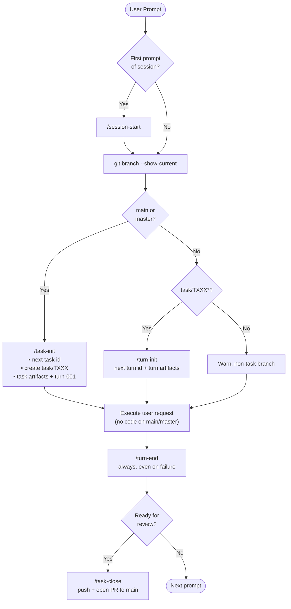

# coding-agents-config

Agentic pipeline configuration for Claude Code. Enforces turn-based workflow with provenance tracking, branch protection, and governance rules.

## Setup

### 1. Clone the repo

```sh
git clone https://github.com/bobwares/coding-agents-config ~/coding-agents-config
```

### 2. Create symlinks (automated)

Run the setup script — it creates all symlinks and backs up any existing files:

```sh
bash scripts/setup.sh
```

The script links these items into `~/.claude/`: `skills`, `agents`, `rules`, `hooks`, `context`, `scripts`, `plugins`, `CLAUDE.md`, `settings.json`. It links `agents` and `AGENTS.md` into `~/.codex/`, and `CLAUDE.md` into the repo-local `.claude/`. Items missing from the repo are skipped.

<details>
<summary>Manual symlink commands</summary>

```sh
ln -s ~/coding-agents-config/skills ~/.claude/skills
ln -s ~/coding-agents-config/agents ~/.claude/agents
ln -s ~/coding-agents-config/hooks ~/.claude/hooks
ln -s ~/coding-agents-config/scripts ~/.claude/scripts
ln -s ~/coding-agents-config/CLAUDE.md ~/.claude/CLAUDE.md
ln -s ~/coding-agents-config/settings.json ~/.claude/settings.json
```

If any of these already exist, back them up first (`mv <target> <target>.bak`).
</details>

### 3. Verify

```sh
ls -la ~/.claude/skills        # -> ~/coding-agents-config/skills
ls -la ~/.claude/agents        # -> ~/coding-agents-config/agents
ls -la ~/.claude/hooks         # -> ~/coding-agents-config/hooks
ls -la ~/.claude/CLAUDE.md     # -> ~/coding-agents-config/CLAUDE.md
ls -la ~/.claude/settings.json # -> ~/coding-agents-config/settings.json
```

## Structure

```
coding-agents-config/
├── CLAUDE.md           # Global instructions — task/turn protocol, branch rules
├── AGENTS.md           # Agent loader directive (points to CLAUDE.md)
├── settings.json       # Claude Code settings (model, permissions, hooks, plugins)
├── agents/             # Subagent definitions
│   └── agent-architecture-planner.md
├── hooks/              # Shell hooks triggered by Claude Code events
│   └── branch-guard.sh # Auto-creates a task branch when on main/master
├── skills/             # Slash-command skills (see below)
├── scripts/            # Automation scripts
│   ├── setup.sh        # Symlink installer
│   └── af-state.sh     # AppFactory state.yaml helpers
├── archive/            # Retired skills and legacy turn artifacts
├── docs/               # Reference documentation and migration notes
├── .github/            # PR and issue templates
└── .appfactory/        # Task/turn tracking
    ├── tasks/          # task-XXX/ with task artifacts and turns/turn-XXX/
    ├── tasks_index.csv # Registry of tasks
    ├── specs/          # Specifications
    ├── prompts/        # Prompt templates
    ├── memory/         # Project memory / pipeline state
    └── changelog.md
```

## Execution Flow

Work is organised into **tasks** (one branch `task/TXXX` = one pull request) made of **turns** (one AI execution cycle). Task ids are global and zero-padded; turn ids reset per task.



### Protocol summary

| Phase | Skill | Outputs |
|-------|-------|---------|
| Session start (first prompt only) | `session-start` | Git state and context loaded |
| New task (on main/master) | `task-init` | `task/TXXX` branch, task artifacts, `turn-001`, row in `tasks_index.csv` |
| New turn (on task branch) | `turn-init` | Next `turn-XXX` directory |
| Execution | — | Modified files (never on main/master) |
| Turn end | `turn-end` | `turn_context.md`, `execution_trace.json`, `adr.md`, `manifest.json`, commit |
| Task close (on request) | `task-close` | Pushed branch, PR against main, updated task status |

Artifacts live under `.appfactory/tasks/task-XXX/`:

- Task: `task_context.md`, `task_status.json`, `task_summary.md`, `pull_request.md`
- Turn (`turns/turn-XXX/`): `turn_context.md`, `execution_trace.json`, `adr.md`, `manifest.json`

Commits use the format:

```
AI Coding Agent Change:
- <imperative bullet>
- <imperative bullet>
```

## Skills

### Task / turn lifecycle

| Skill | Description |
|-------|-------------|
| `session-start` | Load repository state and core pipeline context |
| `task-init` | Create task branch plus task and turn-001 artifacts |
| `turn-init` | Initialize the next turn within the active task |
| `turn-end` | Finalize the turn (artifacts, ADR, manifest, commit) |
| `task-close` | Finalize the task, push, and open a pull request |
| `branch-guard` | Create a scoped branch if on main/master |

### AppFactory pipeline (`af-*`)

| Skill | Description |
|-------|-------------|
| `af-orchestrator` | Orchestrate the App Factory SDLC end to end |
| `af-project-init` | Initialize an AppFactory project |
| `af-memory` | Read/write pipeline state in `.appfactory/memory/state.yaml` |
| `af-be-prd-build` | Build a business-facing PRD |
| `af-be-ddd-build` | Generate a Domain-Driven Design document from an approved PRD |
| `af-be-ddd-analysis` | Analyze the DDD document |
| `af-be-ddd-refactor` | Refactor the DDD document from analysis findings |
| `af-be-ddd-tests` | Generate Gherkin BDD scenarios from DDD and PRD |
| `af-be-ddd-orchestrator` | Run build → analyze → refactor loop → tests (`max_ddd_tries = 3`) |
| `af-be-ddd-dsl` | Generate the application DSL YAML from the DDD document |
| `af-be-plan` | Generate an execution plan from the DSL and tech stack profile |
| `af-be-implementation` | Copy a tech stack implementation and generate the backend |
| `af-app-check` | Production-readiness audit (security, database, deployment, code quality) |

### Utilities

| Skill | Description |
|-------|-------------|
| `dsl-utils` | DSL model interpreter |
| `ui-utils` | UI implementation language |
| `unit-tests` | Test/implementation sync |
| `e2e-tests` | HTTP test artifacts |
| `eval-labeler` | Label and evaluate model responses from `Eval.md` files |

Retired skills (e.g. `nestjs-crud-resource`, `prisma-persistence`, `schema-to-database`) are kept in `archive/`.

## Agents

| Agent | Purpose |
|-------|---------|
| `agent-architecture-planner` | Reads PRD, DDD, DSL, and repo structure to produce architecture decisions, module maps, and task plans |

## Hooks

| Hook | Trigger | Purpose |
|------|---------|---------|
| `branch-guard.sh` | PreToolUse(Bash) | On main/master, auto-create the next `task/TXXX` branch instead of allowing writes there |

## Adding a new skill

Each skill lives in its own directory under `skills/` with a `SKILL.md` file:

```
skills/my-skill/
└── SKILL.md
```

The `.system/skill-creator` meta-skill can guide you through creating one — invoke it from Claude Code.

## Syncing across machines

Since this is a standard git repo, pull on any machine to stay current:

```sh
cd ~/coding-agents-config && git pull
```

The symlinks mean changes are picked up immediately — no reinstall needed.
