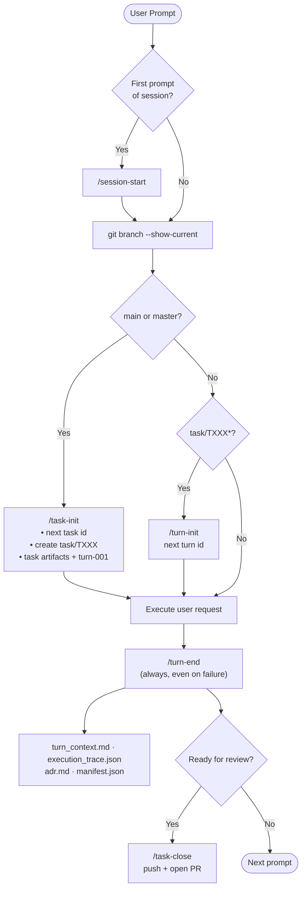

# coding-agents-config

Agentic pipeline configuration for Claude Code (and Codex). Enforces a task/turn-based workflow with provenance tracking, branch protection, and governance rules, plus the App Factory skills for generating backend applications from PRDs and DDD specs.

## Setup

### 1. Clone the repo

```sh
git clone <repo-url> ~/coding-agents-config
```

### 2. Create symlinks (automated)

```sh
bash scripts/setup.sh
```

The script backs up any existing targets (`<target>.bak`) and links:

| Destination | Linked items |
|-------------|--------------|
| `~/.claude/` | `skills`, `agents`, `rules`, `hooks`, `context`, `scripts`, `plugins`, `CLAUDE.md`, `settings.json` |
| `~/.codex/` | `agents`, `AGENTS.md` |
| `./.claude/` (repo-local) | `CLAUDE.md` |

### 3. Verify

```sh
ls -la ~/.claude/skills        # -> ~/coding-agents-config/skills
ls -la ~/.claude/hooks         # -> ~/coding-agents-config/hooks
ls -la ~/.claude/CLAUDE.md     # -> ~/coding-agents-config/CLAUDE.md
ls -la ~/.claude/settings.json # -> ~/coding-agents-config/settings.json
```

## Structure

```
coding-agents-config/
├── CLAUDE.md           # Global instructions — task/turn protocol, branch rules
├── AGENTS.md           # Agent loader directive (points at ~/.claude/CLAUDE.md)
├── settings.json       # Claude Code settings (model, permissions, hooks, plugins)
├── agents/             # Subagent definitions (agent-architecture-planner)
├── hooks/
│   └── branch-guard.sh # Blocks writes while on main/master
├── skills/             # Slash-command skills (see below)
│   └── .system/        # Meta-skills (skill-creator, skill-installer, plugin-creator, ...)
├── scripts/
│   ├── setup.sh        # Symlink installer
│   └── af-state.sh     # AppFactory state helper
├── .appfactory/        # Task/turn tracking and specs
│   ├── tasks/          # task-XXX/ with turns/turn-XXX/
│   ├── tasks_index.csv # Registry of tasks
│   ├── specs/          # Specifications
│   ├── prompts/        # Prompt templates
│   └── memory/         # Project memory
├── .github/            # PR template and issue templates (bug, epic, task)
├── archive/            # Retired skills kept for reference
└── docs/               # Reference documentation and migration notes
```

## Execution Flow

All coding work follows a task/turn model: a **task** is a branch (`task/TXXX`) that becomes one pull request; a **turn** is one AI execution cycle within that branch.



### Protocol Summary

| Phase | Skill | Outputs |
|-------|-------|---------|
| Session start (first prompt only) | `session-start` | Git state and context loaded |
| Task init (on main/master) | `task-init` | `task/TXXX` branch, `task_context.md`, `task_status.json`, `task_summary.md`, `pull_request.md`, `turn-001`, row in `tasks_index.csv` |
| Turn init (on a task branch) | `turn-init` | Next `turn-XXX/` directory |
| Turn end (every prompt) | `turn-end` | `turn_context.md`, `execution_trace.json`, `adr.md`, `manifest.json`; commit using the `AI Coding Agent Change:` format |
| Task close (on request) | `task-close` | Branch pushed, PR opened against `main` |

**Hard gate:** no code is written on `main`/`master`; `/task-init` must succeed first.

## Skills

| Category | Skills |
|----------|--------|
| **Session / task / turn** | `session-start`, `task-init`, `turn-init`, `turn-end`, `task-close`, `branch-guard` |
| **App Factory orchestration** | `af-orchestrator`, `af-project-init`, `af-memory`, `af-app-check` |
| **Backend PRD / DDD** | `af-be-prd-build`, `af-be-ddd-build`, `af-be-ddd-analysis`, `af-be-ddd-refactor`, `af-be-ddd-tests`, `af-be-ddd-dsl`, `af-be-ddd-orchestrator` |
| **Backend planning / build** | `af-be-plan`, `af-be-implementation` |
| **Utilities** | `dsl-utils`, `ui-utils`, `unit-tests`, `e2e-tests`, `eval-labeler` |

### Meta-skills (`skills/.system`)

`skill-creator`, `skill-installer`, `plugin-creator`, `imagegen`, `openai-docs`

Older scaffolding skills (e.g. `schema-to-database`, `code-entity-to-crud`, `nestjs-crud-resource`, `prisma-persistence`) live in `archive/`.

## Hooks

| Hook | Trigger | Purpose |
|------|---------|---------|
| `branch-guard.sh` | PreToolUse(Bash) | Block writes on main/master |

## Adding a new skill

Each skill lives in its own directory under `skills/` with a `SKILL.md` file:

```
skills/my-skill/
└── SKILL.md
```

The `.system/skill-creator` meta-skill can guide you through creating one — invoke it from Claude Code.

## Syncing across machines

```sh
cd ~/coding-agents-config && git pull
```

The symlinks mean changes are picked up immediately — no reinstall needed.
