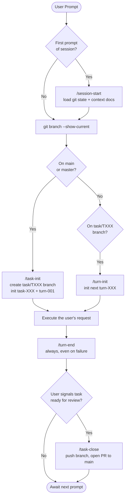

# coding-agents-config

Agentic pipeline configuration for Claude Code. Enforces a task/turn workflow with provenance tracking, branch protection, and governance rules for the AppFactory backend-generation pipeline.

## Setup

### 1. Clone the repo

```sh
git clone <repo-url> ~/coding-agents-config
```

### 2. Create symlinks (automated)

Run the setup script — it creates all symlinks and backs up any existing files:

```sh
bash scripts/setup.sh
```

<details>
<summary>Manual symlink commands</summary>

```sh
ln -s ~/coding-agents-config/skills ~/.claude/skills
ln -s ~/coding-agents-config/agents ~/.claude/agents
ln -s ~/coding-agents-config/hooks ~/.claude/hooks
ln -s ~/coding-agents-config/scripts ~/.claude/scripts
ln -s ~/coding-agents-config/CLAUDE.md ~/.claude/CLAUDE.md
ln -s ~/coding-agents-config/settings.json ~/.claude/settings.json
ln -s ~/coding-agents-config/agents ~/.codex/agents
ln -s ~/coding-agents-config/AGENTS.md ~/.codex/AGENTS.md
```

If any of these already exist, back them up first (`mv <target> <target>.bak`).
</details>

`scripts/setup.sh` also links `rules/`, `context/`, and `plugins/` into `~/.claude/` if those directories exist in the repo — they are reserved for future use and not currently checked in.

### 3. Verify

```sh
ls -la ~/.claude/skills        # should point to ~/coding-agents-config/skills
ls -la ~/.claude/hooks         # should point to ~/coding-agents-config/hooks
ls -la ~/.claude/CLAUDE.md     # should point to ~/coding-agents-config/CLAUDE.md
ls -la ~/.claude/settings.json # should point to ~/coding-agents-config/settings.json
```

## Structure

```
coding-agents-config/
├── CLAUDE.md            # Global instructions — task/turn protocol, branch rules
├── AGENTS.md             # Codex loader directive (points at ~/.claude/CLAUDE.md)
├── settings.json         # Claude Code settings (model, permissions, hooks)
├── hooks/
│   └── branch-guard.sh   # PreToolUse hook — auto-creates a task/TXXX branch off main/master
├── skills/                # Slash-command skills (24) — see Skills below
├── agents/
│   └── agent-architecture-planner.md
├── scripts/
│   ├── setup.sh           # Symlink installer
│   └── af-state.sh        # Helpers for .appfactory/memory/state.yaml
├── .appfactory/            # Task/turn tracking and pipeline state
│   ├── tasks/              # task-XXX/ directories, each with turns/turn-XXX/
│   ├── tasks_index.csv     # Registry of all tasks and their status
│   ├── specs/               # Specifications
│   ├── prompts/             # Prompt templates used while developing this repo
│   ├── memory/               # Pipeline state (state.yaml)
│   └── changelog.md
├── archive/                 # Retired first-generation DSL-to-fullstack skill set
├── docs/                    # Reference documentation
└── .github/                 # PR template and issue templates
```

## Execution Flow

CLAUDE.md enforces a strict task/turn workflow for every coding prompt: a **task** is the branch-scoped unit of work that becomes one pull request, and a **turn** is one AI execution cycle within that task.



`hooks/branch-guard.sh` is a `PreToolUse` safety net: if a write or bash tool call is about to run while still on `main`/`master`, it auto-creates the next `task/TXXX` branch before the call proceeds.

### Task/Turn Protocol Summary

| Phase | Trigger | Outputs |
|-------|---------|---------|
| **Session Start** | First prompt of the session | Git state + context docs loaded |
| **Task Init** | Current branch is `main`/`master` | `task/TXXX` branch, `task_context.md`, `task_status.json`, `task_summary.md`, `pull_request.md`, `turn-001` |
| **Turn Init** | Already on a `task/TXXX` branch | Next `turn-XXX` directory |
| **Execution** | Every coding prompt | User's request completed |
| **Turn End** | After every prompt, always | `turn_context.md`, `execution_trace.json`, `adr.md`, `manifest.json` |
| **Task Close** | User signals the task is ready for review | Finalized task artifacts, branch pushed, PR opened against `main` |

## Skills (24)

| Category | Skill | Description |
|----------|-------|-------------|
| **Session** | `session-start` | Load repository state and core pipeline context at the start of a session |
| **Task/Turn** | `task-init` | Initialize a new task branch and create task + turn-001 artifacts (run on `main`/`master`) |
| | `turn-init` | Initialize the next turn within the active task branch |
| | `turn-end` | Finalize the active turn — ADR, manifest, execution trace |
| | `task-close` | Finalize the task branch, push it, and open a pull request against `main` |
| | `branch-guard` | Create a turn-scoped branch if still on `main`/`master` |
| **AppFactory Orchestration** | `af-orchestrator` | Orchestrate the App Factory software development lifecycle |
| | `af-project-init` | Export required environment variables and bootstrap AppFactory project init |
| | `af-memory` | CRUD operations for AppFactory pipeline state (`.appfactory/memory/state.yaml`) |
| **AppFactory Backend Pipeline** | `af-be-prd-build` | Build a backend-focused PRD from a completed PRD intake worksheet |
| | `af-be-ddd-build` | Generate a backend Domain-Driven Design document from an approved PRD |
| | `af-be-ddd-analysis` | Audit a generated DDD document for quality, completeness, and PRD alignment |
| | `af-be-ddd-refactor` | Apply targeted patches to a DDD document from `af-be-ddd-analysis` findings |
| | `af-be-ddd-orchestrator` | Orchestrate the backend DDD build/analyze/refactor/test loop |
| | `af-be-ddd-dsl` | Generate a backend application DSL YAML document from a DDD document |
| | `af-be-ddd-tests` | Generate Gherkin BDD feature files from DDD and PRD specifications |
| | `af-be-plan` | Generate a step-by-step backend execution plan from the DSL and a tech stack profile |
| | `af-be-implementation` | Generate backend domain code from the execution plan and BDD feature specs |
| **Shared Utilities** | `dsl-utils/dsl-model-interpreter` | Parse and validate app-dsl YAML specifications |
| | `ui-utils/ui-implementation-language` | Declarative YAML language for UI pages, layouts, and forms |
| | `unit-tests/test-implementation-sync` | Keep unit tests synchronized with actual service/DTO implementations |
| | `e2e-tests/http-test-artifacts` | Generate `.http` request files for API endpoint testing |
| **Quality & Eval** | `af-app-check` | Audit an application for production readiness (security, database, deployment, code quality) |
| | `eval-labeler` | Label and compare model responses (Response A vs. B) for coding tasks |

## Hooks

| Hook | Trigger | Purpose |
|------|---------|---------|
| `branch-guard.sh` | `PreToolUse` (Bash and write/edit tools) | Auto-create `task/TXXX` off `main`/`master` before the tool call runs |

## Adding a new skill

Each skill lives in its own directory under `skills/` with a `SKILL.md` file that has `name` and `description` frontmatter:

```
skills/my-skill/
└── SKILL.md
```

Use an existing skill (e.g. `skills/session-start/`) as a template, and add any supporting scripts or reference docs alongside `SKILL.md`.

## Syncing across machines

Since this is a standard git repo, pull on any machine to stay current:

```sh
cd ~/coding-agents-config && git pull
```

The symlinks mean changes are picked up immediately — no reinstall needed.
