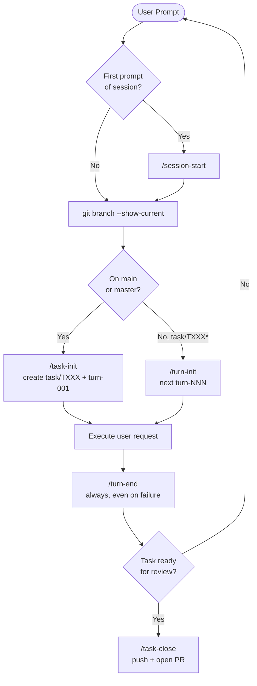

# coding-agents-config

Agentic pipeline configuration for Claude Code. Enforces turn-based workflow with provenance tracking, branch protection, and governance rules.

## Setup

### 1. Clone the repo

```sh
git clone <repo-url> ~/coding-agents-config
```

### 2. Create symlinks (automated)

Run the setup script — it creates all symlinks and backs up any existing files:

```sh
bash scripts/setup.sh
```

<details>
<summary>Manual symlink commands</summary>

```sh
for name in skills agents rules hooks context scripts plugins CLAUDE.md settings.json; do
  ln -s ~/coding-agents-config/$name ~/.claude/$name
done
ln -s ~/coding-agents-config/agents ~/.codex/agents
ln -s ~/coding-agents-config/AGENTS.md ~/.codex/AGENTS.md
```

If any of these already exist, back them up first (`mv <target> <target>.bak`).
`setup.sh` also links `CLAUDE.md` into the repo-local `.claude/` directory and skips targets that do not exist in the repo.
</details>

### 3. Verify

```sh
ls -la ~/.claude/skills        # should point to ~/coding-agents-config/skills
ls -la ~/.claude/hooks         # should point to ~/coding-agents-config/hooks
ls -la ~/.claude/agents        # should point to ~/coding-agents-config/agents
ls -la ~/.claude/CLAUDE.md     # should point to ~/coding-agents-config/CLAUDE.md
ls -la ~/.claude/settings.json # should point to ~/coding-agents-config/settings.json
```

## Structure

```
coding-agents-config/
├── CLAUDE.md           # Global instructions — task/turn protocol, branch rules
├── AGENTS.md           # Agent loader directive (points at ~/.claude/CLAUDE.md)
├── settings.json       # Claude Code settings (model, permissions, hooks, plugins)
├── agents/             # Subagent definitions
│   └── agent-architecture-planner.md
├── hooks/              # Shell hooks triggered by Claude Code events
│   └── branch-guard.sh # Auto-creates a task branch when on main/master
├── skills/             # Slash-command skills
│   ├── .system/        # Meta-skills (skill-creator, skill-installer, ...)
│   ├── session-start/  # Initialize session context
│   ├── task-init/      # Create task branch and task artifacts
│   ├── task-close/     # Finalize task, push, open PR
│   ├── turn-init/      # Create turn directory and artifacts
│   ├── turn-end/       # Finalize turn with ADR, manifest, commit
│   ├── af-*/           # App Factory pipeline skills
│   └── ...             # Other skills
├── scripts/            # Automation scripts
│   ├── setup.sh        # Symlink installer
│   └── af-state.sh     # AppFactory state.yaml helpers
├── .appfactory/        # Task/turn tracking and specs
│   ├── tasks/          # Task branches with turns
│   ├── tasks_index.csv # Task registry
│   ├── specs/          # Templates and schemas (ADR, PR, manifest, ...)
│   ├── prompts/        # Prompt templates
│   └── memory/         # Project memory
├── archive/            # Retired skills and legacy turns
├── docs/               # Reference documentation
└── .github/            # PR and issue templates
```

## Execution Flow

The pipeline enforces a task/turn workflow for all coding prompts. A **task** is a branch-scoped unit of work (`task/TXXX`) that becomes one pull request; a **turn** is one AI execution cycle within that branch.



**Hard gate:** never write code on `main` or `master`. `/task-init` must succeed first; the `branch-guard.sh` hook backs this up.

### Artifacts

Per task, under `.appfactory/tasks/task-XXX/`: `task_context.md`, `task_status.json`, `task_summary.md`, `pull_request.md`.

Per turn, under `.appfactory/tasks/task-XXX/turns/turn-XXX/`: `turn_context.md`, `execution_trace.json`, `adr.md`, `manifest.json`.

New tasks are registered as a row in `.appfactory/tasks_index.csv`. Task ids are global, turn ids reset per task; both are zero-padded to 3 digits.

### Commit format

```
AI Coding Agent Change:
- <imperative bullet>
- <imperative bullet>
```

## Skills

| Category | Skill | Description |
|----------|-------|-------------|
| **Session** | `session-start` | Load repository state and core pipeline context |
| **Task / Turn** | `task-init` | Create `task/TXXX` branch and task + turn-001 artifacts |
| | `turn-init` | Initialize the next turn in the active task |
| | `turn-end` | Finalize the turn (ADR, manifest, trace) |
| | `task-close` | Push the task branch and open a PR against main |
| | `branch-guard` | Create a branch if on main/master |
| **App Factory** | `af-orchestrator` | Orchestrate the App Factory SDLC |
| | `af-project-init` | Initialize an AppFactory project |
| | `af-memory` | Read/write pipeline state (`state.yaml`) |
| | `af-be-prd-build` | Build a backend PRD |
| | `af-be-ddd-orchestrator` | Run the DDD build → analyze → refactor → tests loop |
| | `af-be-ddd-build` | Generate a DDD document from a PRD |
| | `af-be-ddd-analysis` | Analyze a DDD for quality and PRD alignment |
| | `af-be-ddd-refactor` | Refactor a DDD from analysis findings |
| | `af-be-ddd-tests` | Generate Gherkin BDD feature specs |
| | `af-be-ddd-dsl` | Generate a domain DSL YAML from a DDD |
| | `af-be-plan` | Build a backend execution plan from DSL + tech stack |
| | `af-be-implementation` | Generate the backend from a tech stack implementation |
| | `af-app-check` | Production-readiness audit |
| **Utility** | `dsl-utils`, `ui-utils`, `unit-tests`, `e2e-tests` | Grouped helper skills (DSL interpreter, UI language, test sync, HTTP test artifacts) |
| | `eval-labeler` | Label model response evaluations from `Eval.md` files |

See `docs/skill-summary.md` for the App Factory phase-by-phase reference. Retired skills live in `archive/`.

### Meta-Skills (.system)

| Skill | Description |
|-------|-------------|
| `skill-creator` | Create new skills with SKILL.md |
| `skill-installer` | Install skills from marketplaces |
| `plugin-creator` | Scaffold plugins |
| `imagegen` | Image generation |
| `openai-docs` | OpenAI documentation lookup |

## Templates

Templates and schemas live in `.appfactory/specs/`:

| Template | Purpose |
|----------|---------|
| `adr_template.md` | Architecture Decision Record format |
| `pull_request_template.md` | PR description format |
| `manifest.schema.json` | Turn manifest JSON schema |
| `metadata_header.txt` | Source file header format |
| `branch_naming.md` | Branch naming conventions |
| `commit_message.md` | Commit message format |
| `tech-stack.template.md` | Tech stack documentation |

## Hooks

| Hook | Trigger | Purpose |
|------|---------|---------|
| `branch-guard.sh` | PreToolUse(Bash) | Auto-create a task branch when on main/master |

## Adding a new skill

Each skill lives in its own directory under `skills/` with a `SKILL.md` file:

```
skills/my-skill/
└── SKILL.md
```

The `.system/skill-creator` meta-skill can guide you through creating one — invoke it from Claude Code.

## Syncing across machines

Since this is a standard git repo, pull on any machine to stay current:

```sh
cd ~/coding-agents-config && git pull
```

The symlinks mean changes are picked up immediately — no reinstall needed.
