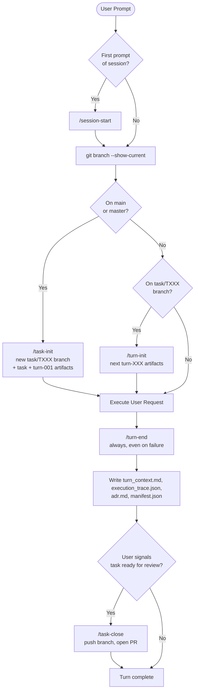

# coding-agents-config

Agentic pipeline configuration for Claude Code. Provides the App Factory (AF) SDLC skill set plus a task/turn governance layer with provenance tracking, branch protection, and ADR requirements.

## Setup

### 1. Clone the repo

```sh
git clone <repo-url> ~/coding-agents-config
```

### 2. Create symlinks (automated)

Run the setup script — it creates all symlinks and backs up any existing files:

```sh
bash scripts/setup.sh
```

<details>
<summary>Manual symlink commands</summary>

```sh
# Into ~/.claude/
ln -s ~/coding-agents-config/skills       ~/.claude/skills
ln -s ~/coding-agents-config/agents       ~/.claude/agents
ln -s ~/coding-agents-config/hooks        ~/.claude/hooks
ln -s ~/coding-agents-config/scripts      ~/.claude/scripts
ln -s ~/coding-agents-config/CLAUDE.md    ~/.claude/CLAUDE.md
ln -s ~/coding-agents-config/settings.json ~/.claude/settings.json

# Into ~/.codex/
ln -s ~/coding-agents-config/agents    ~/.codex/agents
ln -s ~/coding-agents-config/AGENTS.md ~/.codex/AGENTS.md

# Repo-local
ln -s ~/coding-agents-config/CLAUDE.md ./.claude/CLAUDE.md
```

If any of these already exist, `scripts/setup.sh` backs them up automatically (`<target>.bak`). It will also link `rules/`, `context/`, and `plugins/` into `~/.claude/` if those directories are present.
</details>

### 3. Verify

```sh
ls -la ~/.claude/skills        # should point to ~/coding-agents-config/skills
ls -la ~/.claude/agents        # should point to ~/coding-agents-config/agents
ls -la ~/.claude/hooks         # should point to ~/coding-agents-config/hooks
ls -la ~/.claude/CLAUDE.md     # should point to ~/coding-agents-config/CLAUDE.md
ls -la ~/.claude/settings.json # should point to ~/coding-agents-config/settings.json
```

## Structure

```
coding-agents-config/
├── CLAUDE.md            # Global instructions — turn protocol, branch rules
├── AGENTS.md            # Codex loader directive (points at ~/.claude/CLAUDE.md)
├── settings.json        # Claude Code settings (model, permissions, hooks)
├── hooks/
│   └── branch-guard.sh  # PreToolUse hook — auto-creates a task branch off main/master
├── agents/
│   └── agent-architecture-planner.md
├── skills/               # App Factory (af-*) skills + task/turn governance + utility skills
│   ├── session-start/    # Load repo state and pipeline context (first prompt of session)
│   ├── task-init/        # Create task branch + task/turn-001 artifacts (run on main/master)
│   ├── turn-init/        # Create the next turn's artifacts (run on a task branch)
│   ├── turn-end/         # Finalize a turn — trace, ADR, manifest (run after every prompt)
│   ├── task-close/       # Push the task branch and open a pull request
│   ├── branch-guard/     # Create a turn-scoped branch if still on main/master
│   ├── af-orchestrator/  # Orchestrates the App Factory SDLC end to end
│   ├── af-project-init/  # Bootstrap a new AppFactory project (env vars + init script)
│   ├── af-memory/        # CRUD for .appfactory/state.yaml pipeline state
│   ├── af-be-prd-build/  # Business-facing backend PRD from an intake worksheet
│   ├── af-be-ddd-build/  # PRD -> backend Domain-Driven Design document
│   ├── af-be-ddd-analysis/   # Audit a generated DDD spec for gaps/risks
│   ├── af-be-ddd-refactor/   # Patch a DDD spec from analysis findings
│   ├── af-be-ddd-dsl/    # DDD document -> backend DSL YAML
│   ├── af-be-ddd-tests/  # DDD/PRD -> Gherkin BDD feature files
│   ├── af-be-ddd-orchestrator/ # Build -> analyze -> refactor -> test loop for DDD
│   ├── af-be-plan/       # DSL + tech-stack profile -> backend execution plan
│   ├── af-be-implementation/   # Execution plan + BDD specs -> generated backend code
│   ├── af-app-check/     # Production-readiness audit (security, DB, deploy, quality)
│   ├── dsl-utils/dsl-model-interpreter/       # Parse/validate app-dsl YAML
│   ├── ui-utils/ui-implementation-language/   # Declarative YAML UI language spec
│   ├── unit-tests/test-implementation-sync/   # Keep generated tests aligned with code
│   ├── e2e-tests/http-test-artifacts/         # Generate .http files for endpoint testing
│   └── eval-labeler/     # Label/compare model responses in eval run directories
├── scripts/
│   ├── setup.sh          # Create ~/.claude and ~/.codex symlinks
│   └── af-state.sh       # Helper for reading/writing .appfactory state
├── .appfactory/           # Task/turn tracking, specs, prompts, memory
│   ├── tasks/             # task-XXX/ directories, each with turns/turn-XXX/
│   ├── specs/
│   ├── prompts/
│   ├── memory/
│   ├── changelog.md
│   └── tasks_index.csv
├── archive/               # Retired skills and superseded templates, kept for reference
├── docs/                  # Reference and migration documentation
└── .github/
    ├── PULL_REQUEST_TEMPLATE.md
    └── ISSUE_TEMPLATE/
```

## Execution Flow

`CLAUDE.md` requires this workflow to run before any coding or repo-modifying prompt:



### Turn Protocol Summary

| Phase | Trigger | Skill | Outputs |
|-------|---------|-------|---------|
| **Session Start** | First prompt of session | `session-start` | Git state + context docs loaded |
| **Task Init** | Branch is `main`/`master` | `task-init` | `task/TXXX` branch, `task-XXX/` + `turn-001/` artifacts |
| **Turn Init** | Branch is `task/TXXX` | `turn-init` | Next `turn-XXX/` artifacts |
| **Execution** | Every prompt | — | Modified files |
| **Turn End** | After every prompt, even on failure | `turn-end` | `turn_context.md`, `execution_trace.json`, `adr.md`, `manifest.json` |
| **Task Close** | User signals task is ready for review | `task-close` | Branch pushed, pull request opened |

The Hard Gate in `CLAUDE.md` blocks writing code on `main`/`master` until `task-init` has run; `hooks/branch-guard.sh` enforces this as a `PreToolUse` hook, auto-creating a task branch when needed.

## Skills

### Governance (task/turn lifecycle)

| Skill | Description |
|-------|-------------|
| `session-start` | Load repository state and core pipeline context at session start |
| `task-init` | Initialize a new task branch and create task + turn-001 artifacts (run on main/master) |
| `turn-init` | Initialize the next turn within the active task branch |
| `turn-end` | Finalize the active turn after every coding prompt, even on failure |
| `task-close` | Finalize the active task branch, push it, and open a pull request against main |
| `branch-guard` | Create a turn-scoped branch if still on main/master |

### App Factory SDLC (`af-*`)

| Skill | Description |
|-------|-------------|
| `af-orchestrator` | Orchestrates the App Factory Software Development Lifecycle |
| `af-project-init` | Export required env vars and bootstrap a new AppFactory project |
| `af-memory` | CRUD operations on `.appfactory/state.yaml` pipeline state |
| `af-be-prd-build` | Build a business-facing backend PRD from an intake worksheet |
| `af-be-ddd-build` | Generate a backend DDD document from an approved PRD |
| `af-be-ddd-analysis` | Audit a generated DDD spec for completeness and PRD alignment |
| `af-be-ddd-refactor` | Patch a DDD spec using `af-be-ddd-analysis` findings |
| `af-be-ddd-dsl` | Generate a backend DSL YAML document from a DDD document |
| `af-be-ddd-tests` | Generate Gherkin BDD feature files from DDD/PRD specs |
| `af-be-ddd-orchestrator` | Run the DDD build → analyze → refactor → test loop |
| `af-be-plan` | Generate a backend execution plan from a DSL + tech-stack profile |
| `af-be-implementation` | Generate backend domain code from the execution plan and BDD specs |
| `af-app-check` | Audit an application for production readiness before release |

### Utility skill groups

| Group | Sub-skill | Description |
|-------|-----------|--------------|
| `dsl-utils` | `dsl-model-interpreter` | Parse and validate app-dsl YAML specifications |
| `ui-utils` | `ui-implementation-language` | Declarative YAML language for UI pages, widgets, and forms |
| `unit-tests` | `test-implementation-sync` | Keep generated unit tests aligned with implementations |
| `e2e-tests` | `http-test-artifacts` | Generate `.http` request files for endpoint testing |
| `eval-labeler` | — | Label and compare model responses in eval run directories |

Retired skills (e.g. `schema-to-database`, `nestjs-crud-resource`, `code-entity-to-crud`, `project-init`) live under `archive/` for reference.

## Hooks

| Hook | Trigger | Purpose |
|------|---------|---------|
| `branch-guard.sh` | `PreToolUse` | Auto-creates a task branch instead of allowing writes on `main`/`master` |

## Adding a new skill

Each skill lives in its own directory under `skills/` with a `SKILL.md` file:

```
skills/my-skill/
└── SKILL.md
```

## Syncing across machines

Since this is a standard git repo, pull on any machine to stay current:

```sh
cd ~/coding-agents-config && git pull
```

The symlinks mean changes are picked up immediately — no reinstall needed.
