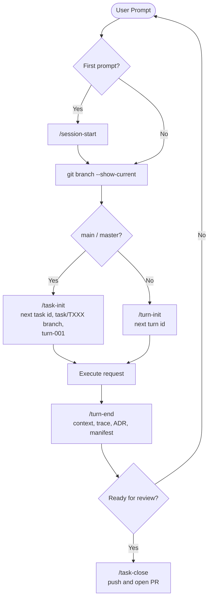

# coding-agents-config

Agentic pipeline configuration for Claude Code. Enforces turn-based workflow with provenance tracking, branch protection, and governance rules.

## Setup

### 1. Clone the repo

```sh
git clone <repo-url> ~/coding-agents-config
```

### 2. Create symlinks (automated)

```sh
bash scripts/setup.sh
```

The script links `skills`, `agents`, `rules`, `hooks`, `context`, `scripts`, `plugins`, `CLAUDE.md` and `settings.json` into `~/.claude/`, `agents` and `AGENTS.md` into `~/.codex/`, and `CLAUDE.md` into the repo-local `.claude/`. Existing files are backed up as `<target>.bak`; targets that don't exist in the repo are linked as-is.

### 3. Verify

```sh
ls -la ~/.claude/skills ~/.claude/hooks ~/.claude/agents ~/.claude/CLAUDE.md ~/.claude/settings.json
```

## Structure

```
coding-agents-config/
├── CLAUDE.md           # Global instructions: task/turn protocol, branch rules
├── AGENTS.md           # Agent loader directive (Codex)
├── settings.json       # Claude Code settings (model, permissions, hooks, plugins)
├── agents/             # Subagent definitions (agent-architecture-planner)
├── hooks/              # branch-guard.sh: auto-creates a task branch when on main/master
├── skills/             # Slash-command skills (see below)
├── scripts/            # setup.sh (symlinks), af-state.sh (pipeline state helpers)
├── .appfactory/        # Task/turn tracking, specs, prompts, memory, tasks_index.csv
├── docs/               # Reference docs and migration notes
└── archive/            # Retired skills, templates and legacy turns
```

## Execution Flow

Work is organized as **tasks** (one branch, `task/TXXX`, becoming one pull request) made of **turns** (one AI execution cycle each). All state lives under `.appfactory/tasks/task-XXX/`.



Writing code on `main`/`master` is blocked until `/task-init` succeeds. `/turn-end` always runs, even on failure.

### Artifacts

| Scope | Location | Files |
|-------|----------|-------|
| Turn | `.appfactory/tasks/task-XXX/turns/turn-XXX/` | `turn_context.md`, `execution_trace.json`, `adr.md`, `manifest.json` |
| Task | `.appfactory/tasks/task-XXX/` | `task_context.md`, `task_status.json`, `task_summary.md`, `pull_request.md` |
| Registry | `.appfactory/tasks_index.csv` | One row per task |

Commits use the format `AI Coding Agent Change:` followed by imperative bullets.

## Skills

| Category | Skill | Description |
|----------|-------|-------------|
| **Session** | `session-start` | Load repo state and pipeline context |
| **Task / Turn** | `task-init` | Create `task/TXXX` branch and task + turn-001 artifacts |
| | `turn-init` | Initialize the next turn in the active task |
| | `turn-end` | Finalize the turn (context, trace, ADR, manifest) |
| | `task-close` | Finalize the task, push, open a PR against main |
| | `branch-guard` | Create a task branch if on main/master |
| **Orchestration** | `af-orchestrator` | Orchestrate the App Factory SDLC |
| | `af-project-init` | Initialize an AppFactory project |
| | `af-memory` | Read/write pipeline state in `.appfactory/memory/state.yaml` |
| **Backend design** | `af-be-prd-build` | Build a PRD for a backend application |
| | `af-be-ddd-orchestrator` | Run the DDD build, analyze, refactor loop, and test phases |
| | `af-be-ddd-build` | Generate a Domain-Driven Design document from a PRD |
| | `af-be-ddd-analysis` | Analyze the DDD document |
| | `af-be-ddd-refactor` | Refactor the DDD document from analysis findings |
| | `af-be-ddd-dsl` | Generate a domain DSL YAML from the DDD |
| | `af-be-ddd-tests` | Generate Gherkin BDD feature files from DDD and PRD |
| **Backend build** | `af-be-plan` | Build an execution plan from the DSL and tech stack profile |
| | `af-be-implementation` | Generate the app from a tech stack implementation |
| | `af-app-check` | Production-readiness audit |
| **Utility** | `dsl-utils`, `ui-utils`, `unit-tests`, `e2e-tests` | Supporting helpers and test skills |
| | `eval-labeler` | Label and process model evaluation files |

### Meta-Skills (`skills/.system`)

`skill-creator`, `skill-installer`, `plugin-creator`, `imagegen`, `openai-docs`.

## Agents

| Agent | Purpose |
|-------|---------|
| `agent-architecture-planner` | Reads the PRD, DDD, DSL and repo to produce architecture decisions, module maps and task plans |

## Hooks

| Hook | Trigger | Purpose |
|------|---------|---------|
| `branch-guard.sh` | PreToolUse(Bash) | Auto-create a task branch when on main/master |

## Adding a new skill

Each skill lives in its own directory under `skills/` with a `SKILL.md` file:

```
skills/my-skill/
└── SKILL.md
```

The `.system/skill-creator` meta-skill can guide you through creating one — invoke it from Claude Code.

## Syncing across machines

Since this is a standard git repo, pull on any machine to stay current:

```sh
cd ~/coding-agents-config && git pull
```

The symlinks mean changes are picked up immediately — no reinstall needed.
