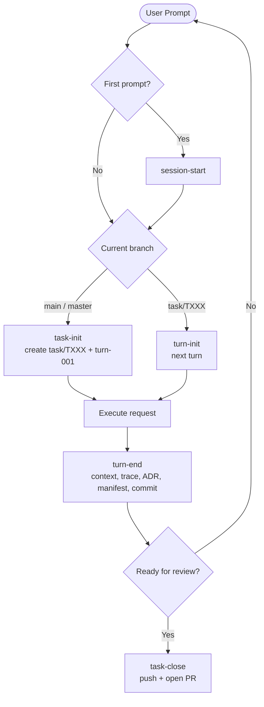

# coding-agents-config

Agentic pipeline configuration for Claude Code (and Codex). Enforces a task/turn workflow with provenance tracking, branch protection, and governance rules, and ships the App Factory (`af-*`) skills for spec-driven backend generation.

## Setup

### 1. Clone the repo

```sh
git clone <repo-url> ~/coding-agents-config
```

### 2. Create symlinks (automated)

```sh
bash scripts/setup.sh
```

The script backs up any existing files (`<name>.bak`) and links:

| Destination | Items |
|-------------|-------|
| `~/.claude/` | `skills`, `agents`, `rules`, `hooks`, `context`, `scripts`, `plugins`, `CLAUDE.md`, `settings.json` |
| `~/.codex/` | `agents`, `AGENTS.md` |
| `./.claude/` (repo-local) | `CLAUDE.md` |

### 3. Verify

```sh
ls -la ~/.claude/skills ~/.claude/hooks ~/.claude/CLAUDE.md ~/.claude/settings.json
```

Each should point into `~/coding-agents-config`.

## Structure

```
coding-agents-config/
├── CLAUDE.md        # Global instructions — task/turn protocol, branch rules
├── AGENTS.md        # Agent loader directive (loads ~/.claude/CLAUDE.md)
├── settings.json    # Claude Code settings (env, permissions, hooks, status line)
├── hooks/           # branch-guard.sh (PreToolUse on Bash)
├── skills/          # Slash-command skills (see below)
├── agents/          # Sub-agents (agent-architecture-planner)
├── scripts/         # setup.sh (symlinks), af-state.sh (pipeline state helpers)
├── docs/            # Plans, migration notes, skill summary
├── archive/         # Retired skills and legacy turns (see archive/README.md)
├── .appfactory/     # Task/turn tracking, specs, prompts, memory
└── .github/         # PR template and issue templates (bug, epic, task)
```

## Execution Flow

All coding work happens on a task branch (`task/TXXX`), never on `main`/`master`.

1. **First prompt of a session** → `session-start`.
2. **On `main`/`master`** → `task-init` resolves the next task id, creates `task/TXXX`, initializes `.appfactory/tasks/task-XXX/` and `turn-001`.
3. **On `task/TXXX`** → `turn-init` creates the next turn.
4. Execute the request.
5. **Always** run `turn-end` afterwards (even on failure).
6. When the task is ready for review → `task-close` pushes the branch and opens a PR against `main`.



### Artifacts

```
.appfactory/
├── tasks_index.csv
└── tasks/task-XXX/
    ├── task_context.md  task_status.json  task_summary.md  pull_request.md
    └── turns/turn-XXX/
        └── turn_context.md  execution_trace.json  adr.md  manifest.json
```

Commits use the format `AI Coding Agent Change:` followed by imperative bullets.

## Skills

### Workflow

| Skill | Description |
|-------|-------------|
| `session-start` | Load repository state and core pipeline context |
| `task-init` | Create the task branch and task + turn-001 artifacts |
| `task-close` | Finalize the task, push, and open a PR against `main` |
| `turn-init` | Initialize the next turn in the active task |
| `turn-end` | Finalize the turn (context, trace, ADR, manifest) |
| `branch-guard` | Create a turn-scoped branch if on main/master |

### App Factory (`af-*`)

| Skill | Description |
|-------|-------------|
| `af-orchestrator` | Orchestrate the App Factory SDLC |
| `af-project-init` | Initialize an AppFactory project |
| `af-memory` | Read/write pipeline state in `.appfactory/memory/state.yaml` |
| `af-be-prd-build` | Build a business-facing PRD |
| `af-be-ddd-build` | Generate a Domain-Driven Design doc from the PRD |
| `af-be-ddd-analysis` | Analyze the DDD document |
| `af-be-ddd-refactor` | Refactor the DDD based on analysis |
| `af-be-ddd-dsl` | Generate the backend DSL YAML from the DDD |
| `af-be-ddd-tests` | Generate Gherkin BDD feature files |
| `af-be-ddd-orchestrator` | Run build → analyze → refactor loop → tests |
| `af-be-plan` | Build a backend execution plan from DSL + tech stack profile |
| `af-be-implementation` | Generate the backend from a tech stack implementation |
| `af-app-check` | Production-readiness audit (security, DB, deployment, quality) |

### Utility

`dsl-utils`, `ui-utils`, `unit-tests`, `e2e-tests` (reference/helper skills) and `eval-labeler` (process Eval.md files into structured notes and results).

### Meta-skills (`skills/.system`)

`skill-creator`, `skill-installer`, `plugin-creator`, `imagegen`, `openai-docs`.

## Agents

| Agent | Description |
|-------|-------------|
| `agent-architecture-planner` | Reads PRD/DDD/DSL and repo structure to produce architecture decisions, module maps, and task plans |

## Hooks

| Hook | Trigger | Purpose |
|------|---------|---------|
| `branch-guard.sh` | PreToolUse(Bash) | Block writes on main/master |

## Adding a new skill

```
skills/my-skill/
└── SKILL.md
```

Use the `.system/skill-creator` meta-skill to scaffold one.

## Syncing across machines

```sh
cd ~/coding-agents-config && git pull
```

Symlinks pick up changes immediately — no reinstall needed.
