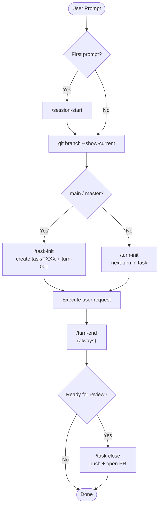

# coding-agents-config

Agentic pipeline configuration for Claude Code (and Codex). Enforces a task/turn-based workflow with provenance tracking, branch protection, and governance rules, and ships the App Factory (`af-*`) skills for spec-driven backend generation.

## Setup

### 1. Clone the repo

```sh
git clone <repo-url> ~/coding-agents-config
```

### 2. Create symlinks (automated)

```sh
bash scripts/setup.sh
```

The script backs up any existing files (`<target>.bak`) and symlinks:

| Destination | Items |
|-------------|-------|
| `~/.claude/` | `skills`, `agents`, `rules`, `hooks`, `context`, `scripts`, `plugins`, `CLAUDE.md`, `settings.json` |
| `~/.codex/` | `agents`, `AGENTS.md` |
| `./.claude/` (repo-local) | `CLAUDE.md` |

Note: `rules`, `context`, and `plugins` do not currently exist in the repo, so those links will be dangling until they are added.

### 3. Verify

```sh
ls -la ~/.claude/skills        # -> ~/coding-agents-config/skills
ls -la ~/.claude/hooks         # -> ~/coding-agents-config/hooks
ls -la ~/.claude/CLAUDE.md     # -> ~/coding-agents-config/CLAUDE.md
ls -la ~/.claude/settings.json # -> ~/coding-agents-config/settings.json
```

## Structure

```
coding-agents-config/
├── CLAUDE.md           # Global instructions — task/turn protocol, branch rules
├── AGENTS.md           # Agent loader directive (points at ~/.claude/CLAUDE.md)
├── settings.json       # Claude Code settings (model, permissions, hooks, plugins)
├── agents/             # Subagent definitions
│   └── agent-architecture-planner.md
├── hooks/
│   └── branch-guard.sh # PreToolUse hook: auto-creates a task branch when on main/master
├── skills/             # Skills (see below)
├── scripts/
│   ├── setup.sh        # Symlink installer
│   └── af-state.sh     # AppFactory state.yaml helpers (sourced by af-* skills)
├── .appfactory/        # Task/turn tracking, specs, prompts, memory
│   ├── tasks/          # task-XXX/ with turns/turn-XXX/ artifacts
│   ├── tasks_index.csv # Task registry
│   ├── specs/  prompts/  memory/  changelog.md
├── .github/            # PR template and issue templates (bug, epic, task)
├── docs/               # Reference documentation
└── archive/            # Retired skills and legacy turn data
```

## Execution Flow

Every coding prompt runs through the same lifecycle (defined in `CLAUDE.md`):

1. **First prompt of the session** — `/session-start` loads git state and the context docs.
2. **Check branch** — `git branch --show-current`.
3. **On `main`/`master`** — `/task-init` resolves the next task id, creates and switches to `task/TXXX`, and initializes `.appfactory/tasks/task-XXX/` plus `turn-001`.
4. **On `task/TXXX[-*]`** — `/turn-init` initializes the next turn in the active task.
5. **Execute** the request. Writing code on `main`/`master` is never allowed.
6. **`/turn-end`** — always runs, even on failure.
7. **`/task-close`** — when the task is ready for review: finalizes the task, pushes, and opens a PR against `main`.



### Task and turn model

- A **task** is the branch-scoped unit of work (`task/TXXX`) that becomes one pull request. Ids are global, zero-padded (`001`, `002`, ...).
- A **turn** is one AI execution cycle inside a task. Turn ids reset per task.

### Artifacts

```
.appfactory/tasks/task-XXX/
├── task_context.md  task_status.json  task_summary.md  pull_request.md
└── turns/turn-XXX/
    └── turn_context.md  execution_trace.json  adr.md  manifest.json
```

`.appfactory/tasks_index.csv` gets one row per task (id, branch, status, timestamps, PR URL, turn count). Commits use the format `AI Coding Agent Change:` followed by imperative bullets.

## Skills

| Category | Skill | Description |
|----------|-------|-------------|
| **Workflow** | `session-start` | Load repository state and core pipeline context |
| | `task-init` | Create task branch plus task and `turn-001` artifacts |
| | `turn-init` | Initialize the next turn in the active task |
| | `turn-end` | Finalize the turn (context, trace, ADR, manifest) |
| | `task-close` | Finalize the task, push, open PR against `main` |
| | `branch-guard` | Create a branch when on main/master |
| **App Factory** | `af-orchestrator` | Orchestrate the App Factory SDLC |
| | `af-project-init` | Initialize an AppFactory project |
| | `af-memory` | CRUD for pipeline `state.yaml` in `.appfactory/` |
| | `af-be-prd-build` | Build a backend PRD from a completed worksheet |
| | `af-be-ddd-build` | Generate a DDD document from an approved PRD |
| | `af-be-ddd-analysis` | Audit a DDD spec for quality and PRD alignment |
| | `af-be-ddd-refactor` | Patch a DDD spec using analysis findings |
| | `af-be-ddd-orchestrator` | Run build → analyze → refactor loop → tests |
| | `af-be-ddd-tests` | Generate Gherkin BDD feature files from DDD/PRD |
| | `af-be-ddd-dsl` | Generate a backend DSL YAML from the DDD |
| | `af-be-plan` | Build an execution plan from DSL + tech stack profile |
| | `af-be-implementation` | Generate the backend from the plan and BDD specs |
| | `af-app-check` | Production-readiness audit |
| **Utility groups** | `dsl-utils` | `dsl-model-interpreter` |
| | `ui-utils` | `ui-implementation-language` |
| | `unit-tests` | `test-implementation-sync` |
| | `e2e-tests` | `http-test-artifacts` |
| | `eval-labeler` | Label and compare model responses in eval runs |

### Meta-skills (`skills/.system`)

`skill-creator`, `skill-installer`, `plugin-creator`, `imagegen`, `openai-docs`.

## Hooks

| Hook | Trigger | Purpose |
|------|---------|---------|
| `branch-guard.sh` | PreToolUse(Bash) | On main/master, auto-create the next `task/TXXX` branch instead of allowing writes |

## Settings

`settings.json` configures the default model, a permission allow/ask/deny list (e.g. `git push` and `git commit` require confirmation; force-push to main and publishing are denied), the branch-guard hook, and enabled plugins.

## Adding a new skill

Each skill lives in its own directory under `skills/` with a `SKILL.md` (YAML frontmatter with `name` and `description`):

```
skills/my-skill/
└── SKILL.md
```

The `.system/skill-creator` meta-skill can guide you through creating one.

## Syncing across machines

```sh
cd ~/coding-agents-config && git pull
```

The symlinks mean changes are picked up immediately — no reinstall needed.
