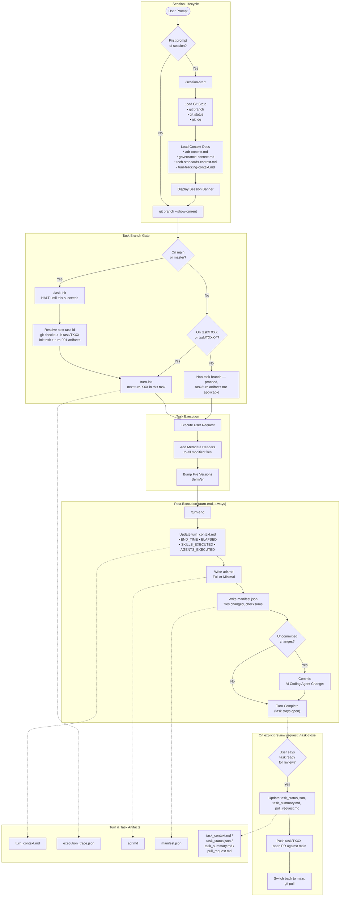

# coding-agents-config

Agentic pipeline configuration for Claude Code. Enforces turn-based workflow with provenance tracking, branch protection, and governance rules.

## Setup

### 1. Clone the repo

```sh
git clone <repo-url> ~/coding-agents-config
```

### 2. Create symlinks (automated)

Run the setup script — it creates all symlinks and backs up any existing files:

```sh
bash scripts/setup.sh
```

It links into three locations:

- `~/.claude/` — `skills`, `agents`, `rules`, `hooks`, `context`, `scripts`, `plugins`, `CLAUDE.md`, `settings.json`
- `~/.codex/` — `agents`, `AGENTS.md`
- `./.claude/` (repo-local) — `CLAUDE.md`

<details>
<summary>Manual symlink commands</summary>

```sh
ln -s ~/coding-agents-config/skills ~/.claude/skills
ln -s ~/coding-agents-config/agents ~/.claude/agents
ln -s ~/coding-agents-config/hooks ~/.claude/hooks
ln -s ~/coding-agents-config/scripts ~/.claude/scripts
ln -s ~/coding-agents-config/CLAUDE.md ~/.claude/CLAUDE.md
ln -s ~/coding-agents-config/settings.json ~/.claude/settings.json

ln -s ~/coding-agents-config/agents ~/.codex/agents
ln -s ~/coding-agents-config/AGENTS.md ~/.codex/AGENTS.md
```

If any of these already exist, back them up first (`mv <target> <target>.bak`). Note: `rules`, `context`, and `plugins` are reserved symlink targets in `scripts/setup.sh` but do not yet exist in this repo — they will be skipped or created empty as those directories are added. There is no shared top-level `templates/` directory anymore; each skill that needs one keeps its templates under `skills/<skill-name>/templates/`.
</details>

### 3. Verify

```sh
ls -la ~/.claude/skills        # should point to ~/coding-agents-config/skills
ls -la ~/.claude/agents        # should point to ~/coding-agents-config/agents
ls -la ~/.claude/hooks         # should point to ~/coding-agents-config/hooks
ls -la ~/.claude/CLAUDE.md     # should point to ~/coding-agents-config/CLAUDE.md
ls -la ~/.claude/settings.json # should point to ~/coding-agents-config/settings.json
ls -la ~/.codex/AGENTS.md      # should point to ~/coding-agents-config/AGENTS.md
```

## Structure

```
coding-agents-config/
├── CLAUDE.md           # Global instructions — task/turn protocol, branch rules
├── AGENTS.md           # Codex loader directive (reads ~/.claude/CLAUDE.md)
├── settings.json       # Claude Code settings (model, permissions, hooks)
├── package.json        # npm metadata (caveman plugin dependency)
├── agents/             # Standalone subagent definitions
│   └── agent-architecture-planner.md
├── hooks/              # Shell hooks triggered by Claude Code events
│   └── branch-guard.sh # Auto-creates task/TXXX branch when on main/master (PreToolUse hook)
├── skills/             # Slash-command skills (24), each its own SKILL.md
│   ├── .system/        # Meta-skills (skill-creator, skill-installer, plugin-creator, imagegen, openai-docs)
│   ├── session-start/  # Load repo state + context docs at session start
│   ├── task-init/      # Create task branch + task/turn-001 artifacts (from main/master)
│   ├── turn-init/      # Create next turn directory + artifacts (on a task branch)
│   ├── turn-end/       # Finalize turn: ADR, manifest, execution trace
│   ├── task-close/     # Push task branch, open PR against main
│   ├── branch-guard/   # Legacy fallback: turn/T{ID} branch if on main
│   ├── af-*/           # AppFactory backend pipeline skills (init → PRD → DDD → plan → DSL → implementation → checks)
│   ├── dsl-utils/, ui-utils/, unit-tests/, e2e-tests/  # Cross-cutting utility skill groups
│   └── ...
├── scripts/             # Automation scripts
│   ├── setup.sh         # Create symlinks into ~/.claude, ~/.codex, ./.claude
│   └── af-state.sh      # AppFactory pipeline state helper
├── .appfactory/         # Task/turn tracking and specs
│   ├── tasks/           # task-XXX/ dirs — task_context, task_status, turns/turn-XXX
│   ├── tasks_index.csv  # Registry of all tasks and their status
│   ├── specs/           # Specifications
│   ├── prompts/         # Prompt templates
│   └── memory/          # Project memory
├── archive/             # Superseded skills, templates, and summaries kept for reference
├── docs/                # Reference documentation (AppFactory migration notes, skill-summary.md, etc.)
└── .github/             # PR and issue templates
```

## Execution Flow

The agentic pipeline enforces a strict turn-based workflow for all coding tasks:



### Task/Turn Protocol Summary

| Phase | Steps | Outputs |
|-------|-------|---------|
| **Session Start** | Load git state → Load 4 context docs → Display banner (first prompt only) | Context loaded |
| **Task Gate** | Check branch → if `main`/`master`, halt and run `/task-init` (new `task/TXXX` branch, task + turn-001 artifacts) | Safe task branch |
| **Turn Init** | If on `task/TXXX`, resolve next turn id → create dir → write `turn_context.md` + `execution_trace.json` | Turn artifacts |
| **Execution** | Execute the user's request → add metadata headers → bump SemVer on modified files | Modified files |
| **Turn End** | Always runs, even on failure → update context → write `adr.md` → write `manifest.json` → commit if dirty | Turn artifacts complete |
| **Task Close** | Only when the user says the task is ready for review → finalize task artifacts → push → open PR → return to `main` | PR opened |

## Skills (24)

| Category | Skill | Description |
|----------|-------|-------------|
| **Session** | `session-start` | Load repo state and core pipeline context at the start of every session |
| **Task** | `task-init` | Create a new `task/TXXX` branch and initialize task + turn-001 artifacts (run from `main`/`master`) |
| | `task-close` | Finalize the active task branch, push it, and open a PR against `main` |
| **Turn** | `turn-init` | Initialize the next turn within the active task branch |
| | `turn-end` | Finalize the active turn — ADR, manifest, execution trace |
| | `branch-guard` | Legacy fallback: create a `turn/T{ID}` branch if still on `main`/`master` |
| **AppFactory — Init** | `af-project-init` | Export required environment variables and bootstrap an AppFactory project |
| | `af-orchestrator` | Orchestrate the full App Factory software development lifecycle |
| **AppFactory — Requirements** | `af-be-prd-build` | Build a business-facing backend PRD from an intake worksheet |
| **AppFactory — DDD** | `af-be-ddd-orchestrator` | Orchestrate the backend DDD build → analyze → refactor → test loop |
| | `af-be-ddd-build` | Generate a human-readable backend DDD document from an approved PRD |
| | `af-be-ddd-analysis` | Analyze a DDD specification for quality, completeness, and PRD alignment |
| | `af-be-ddd-refactor` | Refactor a DDD document based on analysis findings |
| | `af-be-ddd-tests` | Generate Gherkin-style BDD scenarios from DDD and PRD specifications |
| | `af-be-ddd-dsl` | Generate a backend application DSL YAML document from a DDD document |
| **AppFactory — Plan & Build** | `af-be-plan` | Generate a backend execution plan from a domain DSL and tech-stack profile |
| | `af-be-implementation` | Copy the selected tech-stack implementation and generate domain code from the plan and BDD specs |
| | `af-app-check` | Audit an application for production readiness (security, database, deployment, code quality) |
| **AppFactory — Cross-cutting** | `af-memory` | CRUD operations for AppFactory pipeline state (`state.yaml`) |
| **Utility groups** | `dsl-utils/dsl-model-interpreter` | Parse and validate app-dsl YAML specifications |
| | `ui-utils/ui-implementation-language` | Declarative YAML standard for UI pages, layouts, and widgets |
| | `unit-tests/test-implementation-sync` | Keep unit tests synchronized with actual service/DTO implementations |
| | `e2e-tests/http-test-artifacts` | Generate `.http` request files for API endpoint testing |
| **Evaluation** | `eval-labeler` | Label and score model-response evaluation runs (Response A vs. B) |

See `docs/skill-summary.md` for the AppFactory pipeline phase/step ordering and orchestration chain.

### Meta-Skills (.system)

| Skill | Description |
|-------|-------------|
| `skill-creator` | Create new skills with SKILL.md |
| `skill-installer` | Install skills from marketplaces |
| `plugin-creator` | Scaffold new Claude Code plugins |
| `imagegen` | Image generation helper skill |
| `openai-docs` | OpenAI/Codex documentation reference |

## Templates

Shared top-level templates have been retired in favor of per-skill templates under `skills/<skill-name>/templates/` (e.g. `skills/task-init/templates/task_context.md`, `skills/turn-init/templates/turn_context.md`). The earlier shared set — `adr_template.md`, `pull_request_template.md`, `manifest.schema.json`, `metadata_header.txt`, `branch_naming.md`, `commit_message.md`, `tech-stack.template.md` — is preserved for reference under `archive/templates/`.

## Hooks

| Hook | Trigger | Purpose |
|------|---------|---------|
| `branch-guard.sh` | `PreToolUse` (matcher: `Bash`, and any `write_file`/`str_replace_based_edit`/`create_file` tool call) | Auto-create the next `task/TXXX` branch when still on `main`/`master`, as a safety net alongside `/task-init` |

Note: the `hooks/branch-guard.sh` script creates `task/TXXX` branches (matching the current task model in `CLAUDE.md`), while the older `skills/branch-guard/` skill still describes creating `turn/T{ID}` branches from a prior iteration of the workflow. Prefer `/task-init` and the hook's task-branch behavior as the source of truth.

## Adding a new skill

Each skill lives in its own directory under `skills/` with a `SKILL.md` file:

```
skills/my-skill/
└── SKILL.md
```

The `.system/skill-creator` meta-skill can guide you through creating one — invoke it from Claude Code.

## Syncing across machines

Since this is a standard git repo, pull on any machine to stay current:

```sh
cd ~/coding-agents-config && git pull
```

The symlinks mean changes are picked up immediately — no reinstall needed.
