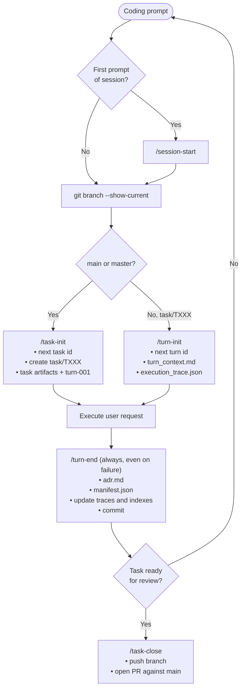

# coding-agents-config

Agentic pipeline configuration for Claude Code. Enforces a task/turn workflow with provenance tracking, branch protection, and governance rules, and ships the App Factory (`af-*`) skills for backend generation.

## Setup

### 1. Clone the repo

```sh
git clone <repo-url> ~/coding-agents-config
```

### 2. Create symlinks (automated)

Run the setup script. It creates all symlinks and backs up any existing files to `<name>.bak`:

```sh
bash scripts/setup.sh
```

It links the following:

| Destination | Items |
|-------------|-------|
| `~/.claude/` | `skills`, `agents`, `rules`, `hooks`, `context`, `scripts`, `plugins`, `CLAUDE.md`, `settings.json` |
| `~/.codex/` | `agents`, `AGENTS.md` |
| `./.claude/` (repo-local) | `CLAUDE.md` |

Items that do not exist in the repo (for example `rules`, `context`, `plugins`) are linked as-is by the script; create them first if you need them.

### 3. Verify

```sh
ls -la ~/.claude/skills        # -> ~/coding-agents-config/skills
ls -la ~/.claude/hooks         # -> ~/coding-agents-config/hooks
ls -la ~/.claude/CLAUDE.md     # -> ~/coding-agents-config/CLAUDE.md
ls -la ~/.claude/settings.json # -> ~/coding-agents-config/settings.json
```

## Structure

```
coding-agents-config/
├── CLAUDE.md           # Global instructions: task/turn protocol, branch rules
├── AGENTS.md           # Agent loader directive (points at ~/.claude/CLAUDE.md)
├── settings.json       # Claude Code settings (env, permissions, hooks)
├── agents/             # Subagent definitions
│   └── agent-architecture-planner.md
├── hooks/              # Shell hooks triggered by Claude Code events
│   └── branch-guard.sh # Auto-creates a task branch when on main/master
├── skills/             # Slash-command skills (see below)
├── scripts/            # Automation scripts
│   ├── setup.sh        # Symlink installer
│   └── af-state.sh     # App Factory pipeline state helper
├── docs/               # Reference documentation and migration notes
├── archive/            # Retired skills and the original turn templates
│   └── templates/      # adr, PR, manifest schema, commit/branch templates
└── .appfactory/        # Task/turn tracking for this repo
    ├── tasks/          # task-XXX/ with turns/turn-XXX/ artifacts
    ├── tasks_index.csv # Registry of all tasks
    ├── specs/          # Specifications
    ├── prompts/        # Prompt templates
    ├── memory/         # Project memory
    └── changelog.md
```

## Task and Turn Model

- A **task** is the branch-scoped unit of work that becomes one pull request. Branch format: `task/TXXX`; ids are global and zero-padded (`001`, `002`, ...).
- A **turn** is one AI execution cycle inside the active task. Turn ids reset per task (`turn-001`, `turn-002`, ...).
- Never write code or commit on `main`/`master`.
- Commits use the format `AI Coding Agent Change:` followed by imperative bullets.

## Execution Flow



The `hooks/branch-guard.sh` PreToolUse hook (matcher: `Bash`) is a safety net: if a guarded tool runs on `main`/`master`, it creates a task branch automatically.

### Artifacts

Per turn, under `.appfactory/tasks/task-XXX/turns/turn-XXX/`:

| File | Purpose |
|------|---------|
| `turn_context.md` | Turn metadata, timing, skills and agents executed |
| `execution_trace.json` | Structured execution trace |
| `adr.md` | Architecture Decision Record (full or minimal) |
| `manifest.json` | File manifest with checksums |

Per task, under `.appfactory/tasks/task-XXX/`: `task_context.md`, `task_status.json`, `task_summary.md`, `pull_request.md`. Each new task also appends a row to `.appfactory/tasks_index.csv`.

## Skills

### Pipeline lifecycle

| Skill | Description |
|-------|-------------|
| `session-start` | Load repository state and core pipeline context (first prompt of a session) |
| `task-init` | Create `task/TXXX` branch, task artifacts, and `turn-001` (from main/master) |
| `turn-init` | Initialize the next turn within the active task branch |
| `turn-end` | Finalize the turn: ADR, manifest, trace, commit. Always runs |
| `task-close` | Push the task branch and open a pull request against main |
| `branch-guard` | Create a turn-scoped branch if on main/master |

### App Factory (`af-*`)

| Skill | Description |
|-------|-------------|
| `af-orchestrator` | Orchestrate the App Factory software development lifecycle |
| `af-project-init` | Initialize an App Factory project (exports env vars, runs helper script) |
| `af-memory` | CRUD for pipeline state in `.appfactory/state.yaml` |
| `af-be-prd-build` | Build a backend PRD from a completed worksheet |
| `af-be-ddd-build` | Generate a Domain-Driven Design document from an approved PRD |
| `af-be-ddd-analysis` | Analyze the DDD document |
| `af-be-ddd-refactor` | Refactor the DDD document from analysis findings |
| `af-be-ddd-orchestrator` | Run the DDD build, analyze, refactor loop, then tests |
| `af-be-ddd-dsl` | Generate a backend application DSL (YAML) from the DDD document |
| `af-be-ddd-tests` | Generate Gherkin BDD feature files from DDD and PRD |
| `af-be-plan` | Generate a backend execution plan from DSL and tech stack profile |
| `af-be-implementation` | Copy the tech stack implementation and generate domain code from plan and BDD specs |
| `af-app-check` | Production-readiness audit (security, database, deployment, code quality) |

### Utilities

| Skill | Description |
|-------|-------------|
| `dsl-utils` | DSL model interpreter |
| `unit-tests` | Unit test helpers |
| `e2e-tests` | HTTP/e2e test artifacts |
| `ui-utils` | UI helpers |
| `eval-labeler` | Label and compare model-response evaluations from `Eval.md` files |

Older scaffolding skills (`schema-to-database`, `nestjs-*`, `prisma-*`, `shadcn`, etc.) live in `archive/`.

## Templates

The original turn templates are kept in `archive/templates/`: `adr_template.md`, `pull_request_template.md`, `manifest.schema.json`, `metadata_header.txt`, `branch_naming.md`, `commit_message.md`, `tech-stack.template.md`. Individual `af-*` skills carry their own `templates/` directories.

## Hooks

| Hook | Trigger | Purpose |
|------|---------|---------|
| `branch-guard.sh` | PreToolUse(Bash) | Auto-create a task branch when on main/master |

## Adding a new skill

Each skill lives in its own directory under `skills/` with a `SKILL.md` file:

```
skills/my-skill/
├── SKILL.md
└── templates/   # optional
```

## Syncing across machines

Since this is a standard git repo, pull on any machine to stay current:

```sh
cd ~/coding-agents-config && git pull
```

The symlinks mean changes are picked up immediately. No reinstall needed.
