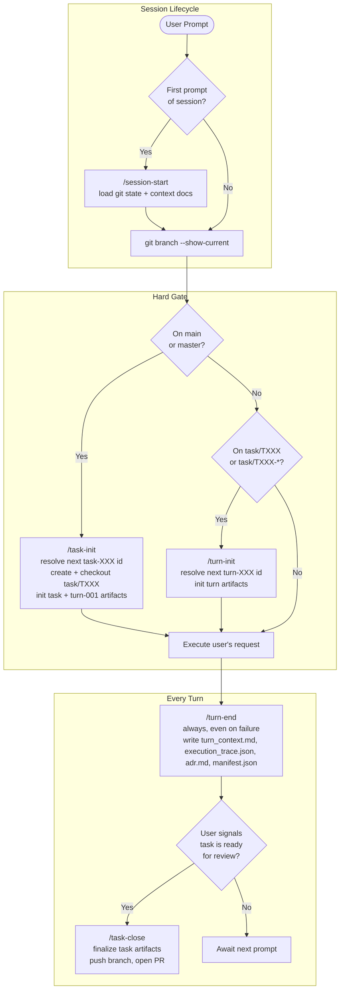

# coding-agents-config

Shared Claude Code configuration: a task/turn-based agentic pipeline with
provenance tracking and branch protection, plus the **AppFactory** skill
suite for spec-driven backend generation (PRD → DDD → DSL → plan →
implementation → checks).

## Setup

### 1. Clone the repo

```sh
git clone <repo-url> ~/coding-agents-config
```

### 2. Create symlinks (automated)

Run the setup script — it creates all symlinks and backs up any existing files:

```sh
bash scripts/setup.sh
```

<details>
<summary>Manual symlink commands</summary>

```sh
ln -s ~/coding-agents-config/skills ~/.claude/skills
ln -s ~/coding-agents-config/hooks ~/.claude/hooks
ln -s ~/coding-agents-config/scripts ~/.claude/scripts
ln -s ~/coding-agents-config/CLAUDE.md ~/.claude/CLAUDE.md
ln -s ~/coding-agents-config/settings.json ~/.claude/settings.json
```

If any of these already exist, back them up first (`mv <target> <target>.bak`).
</details>

### 3. Verify

```sh
ls -la ~/.claude/skills        # should point to ~/coding-agents-config/skills
ls -la ~/.claude/hooks         # should point to ~/coding-agents-config/hooks
ls -la ~/.claude/scripts       # should point to ~/coding-agents-config/scripts
ls -la ~/.claude/CLAUDE.md     # should point to ~/coding-agents-config/CLAUDE.md
ls -la ~/.claude/settings.json # should point to ~/coding-agents-config/settings.json
```

## Structure

```
coding-agents-config/
├── CLAUDE.md           # Global instructions — task/turn protocol, branch rules
├── AGENTS.md           # Points other CLI agents at ~/.claude/CLAUDE.md
├── settings.json        # Claude Code settings (model, permissions, hooks, plugins)
├── hooks/
│   └── branch-guard.sh  # PreToolUse hook — auto-creates a task/TXXX branch on main/master
├── agents/
│   └── agent-architecture-planner.md
├── skills/               # Slash-command skills (see below)
│   ├── .system/          # Meta-skills: skill-creator, skill-installer, plugin-creator, imagegen, openai-docs
│   ├── .nestjs/          # NestJS/Prisma scaffolding skills
│   ├── session-start/    # Load repo + pipeline context at session start
│   ├── task-init/        # Create task branch + task/turn-001 artifacts
│   ├── turn-init/        # Start the next turn on the active task branch
│   ├── turn-end/         # Finalize a turn (ADR, manifest, trace)
│   ├── task-close/       # Finalize task, push, open PR
│   ├── branch-guard/     # Branch-safety helper
│   ├── af-*/             # AppFactory backend pipeline skills
│   ├── dsl-utils/, e2e-tests/, ui-utils/, unit-tests/  # Category folders wrapping one nested skill each
│   └── eval-labeler/     # Label/compare model responses for coding tasks
├── scripts/
│   ├── setup.sh          # Creates the ~/.claude symlinks
│   └── af-state.sh       # Helpers for reading/writing .appfactory/memory/state.yaml
├── docs/                 # Migration notes, AppFactory plan, skill summary
├── archive/              # Retired/superseded skills and templates
└── .appfactory/          # Task/turn tracking produced by the pipeline itself
    ├── tasks/            # task-XXX/ directories with turns/, ADRs, manifests
    ├── specs/            # Specifications
    ├── prompts/          # Prompt templates
    ├── memory/           # state.yaml — cross-skill pipeline state
    ├── changelog.md
    └── tasks_index.csv
```

Per-skill `templates/` directories (e.g. `skills/af-be-ddd-build/templates/ddd-template.md`,
`skills/task-init/templates/`) hold the document templates each skill fills in — there is no
shared top-level `templates/` directory.

## Execution Flow

CLAUDE.md enforces a strict task/turn workflow for every coding prompt:



### Task/Turn Protocol Summary

| Phase | Skill | Trigger | Outputs |
|-------|-------|---------|---------|
| **Session Start** | `session-start` | First prompt of the session | Git state + context docs loaded |
| **Task Init** | `task-init` | Current branch is `main`/`master` | `task/TXXX` branch, `task-XXX/` + `turn-001/` artifacts, row in `tasks_index.csv` |
| **Turn Init** | `turn-init` | Current branch is `task/TXXX[-*]` | Next `turn-XXX/` artifacts |
| **Execution** | — | Every coding prompt | Modified files |
| **Turn End** | `turn-end` | After every execution, always | Updated `turn_context.md`, `execution_trace.json`, `adr.md`, `manifest.json` |
| **Task Close** | `task-close` | User says the task is ready for review | Finalized `task_status.json`/`task_summary.md`/`pull_request.md`, pushed branch, PR opened |

`hooks/branch-guard.sh` backstops this at the tool level: it fires on `PreToolUse` and
auto-creates the next `task-XXX`/`task/TXXX` branch if a write or Bash call is attempted
while still on `main`/`master`.

## Skills

### Task/Turn Lifecycle

| Skill | Description |
|-------|-------------|
| `session-start` | Load repository state and core pipeline context at session start |
| `task-init` | Initialize a new task branch and create task + turn-001 artifacts (run on `main`/`master`) |
| `turn-init` | Initialize the next turn within the active task branch |
| `turn-end` | Finalize the active turn (ADR, manifest, trace) — runs after every prompt, even on failure |
| `task-close` | Finalize the active task branch, push it, and open a PR against main |
| `branch-guard` | Branch-safety check/helper for keeping work off `main`/`master` |

### AppFactory Backend Pipeline (`af-*`)

| Skill | Description |
|-------|-------------|
| `af-orchestrator` | Orchestrates the full App Factory software development lifecycle |
| `af-project-init` | Bootstraps a new AppFactory project (env vars + helper script) |
| `af-be-prd-build` | Builds a business-facing backend PRD from an intake worksheet |
| `af-be-ddd-orchestrator` | Runs the DDD build → analyze → refactor → test loop |
| `af-be-ddd-build` | Generates a backend DDD document from an approved PRD |
| `af-be-ddd-analysis` | Audits a DDD document for quality, completeness, and PRD alignment |
| `af-be-ddd-refactor` | Patches a DDD document per `af-be-ddd-analysis` findings |
| `af-be-ddd-tests` | Generates Gherkin/BDD feature files from the DDD + PRD |
| `af-be-ddd-dsl` | Generates a backend DSL YAML from the DDD document |
| `af-be-plan` | Generates a step-by-step backend execution plan from the DSL and a tech-stack profile |
| `af-be-implementation` | Generates backend code from the execution plan and BDD specs into the target project |
| `af-app-check` | Production-readiness audit (security, database, deployment, code quality) |
| `af-memory` | CRUD access to `.appfactory/memory/state.yaml` pipeline state |

### Utility Categories

Each of these top-level folders is a category holding one nested skill:

| Folder | Nested skill | Description |
|--------|--------------|-------------|
| `dsl-utils/` | `dsl-model-interpreter` | Parse and validate `app-dsl` YAML specifications |
| `e2e-tests/` | `http-test-artifacts` | Generate `.http` request files for endpoint testing |
| `ui-utils/` | `ui-implementation-language` | Declarative YAML standard for UI pages/widgets/forms |
| `unit-tests/` | `test-implementation-sync` | Keep unit tests synchronized with implementations |

### Other

| Skill | Description |
|-------|-------------|
| `eval-labeler` | Labels/compares two model responses (A vs B) for a coding task |

### `.nestjs/` — NestJS/Prisma scaffolding

| Skill | Description |
|-------|-------------|
| `app-from-dsl` | Generate a full app from an app-dsl specification |
| `nestjs-crud-resource` | Generate a NestJS CRUD resource |
| `nestjs-prisma-resource` | Generate a NestJS CRUD resource backed by Prisma |
| `nestjs-customer-crud-scaffold` | Scaffold a NestJS customer CRUD app |
| `nestjs-observability` | Add logging/metrics/tracing to a NestJS service |
| `field-mapper-generator` | Generate field-mapping code between DTOs/entities |
| `prisma/prisma-guidelines`, `prisma/prisma-persistence` | Prisma schema and persistence-layer conventions |

### `.system/` — Meta-skills

| Skill | Description |
|-------|-------------|
| `skill-creator` | Scaffold a new skill with a `SKILL.md` |
| `skill-installer` | Install skills from marketplaces |
| `plugin-creator` | Scaffold a new Claude Code plugin |
| `imagegen`, `openai-docs` | Bundled reference/utility skills |

## Hooks

| Hook | Trigger | Purpose |
|------|---------|---------|
| `branch-guard.sh` | `PreToolUse` (Write/Bash) | Auto-create the next `task-XXX`/`task/TXXX` branch instead of allowing edits on `main`/`master` |

## Scripts

| Script | Purpose |
|--------|---------|
| `setup.sh` | Create the `~/.claude` symlinks described above |
| `af-state.sh` | Bash helpers (`af_state_*`) for reading/writing `.appfactory/memory/state.yaml` |

## Adding a new skill

Each skill lives in its own directory under `skills/` with a `SKILL.md` file:

```
skills/my-skill/
└── SKILL.md
```

Use the `.system/skill-creator` meta-skill (`skills/.system/skill-creator`) to scaffold one —
invoke it from Claude Code.

## Syncing across machines

Since this is a standard git repo, pull on any machine to stay current:

```sh
cd ~/coding-agents-config && git pull
```

The symlinks mean changes are picked up immediately — no reinstall needed.
