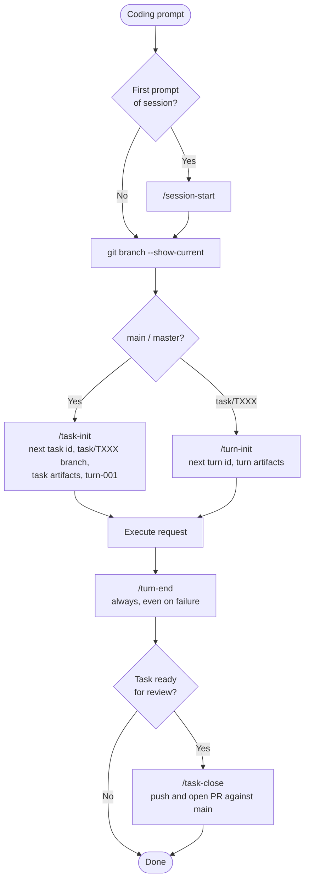

# coding-agents-config

Agentic pipeline configuration for Claude Code. Enforces turn-based workflow with provenance tracking, branch protection, and governance rules.

## Setup

### 1. Clone the repo

```sh
git clone <repo-url> ~/coding-agents-config
```

### 2. Create symlinks (automated)

```sh
bash scripts/setup.sh
```

The script backs up any existing target (`<target>.bak`) and symlinks:

| Destination | Items |
|-------------|-------|
| `~/.claude/` | `skills`, `agents`, `rules`, `hooks`, `context`, `scripts`, `plugins`, `CLAUDE.md`, `settings.json` |
| `~/.codex/` | `agents`, `AGENTS.md` |
| `./.claude/` (repo-local) | `CLAUDE.md` |

Items that don't exist in the repo yet (e.g. `rules`, `context`, `plugins`) are linked as-is by the script.

<details>
<summary>Manual symlink commands</summary>

```sh
ln -s ~/coding-agents-config/skills ~/.claude/skills
ln -s ~/coding-agents-config/agents ~/.claude/agents
ln -s ~/coding-agents-config/hooks ~/.claude/hooks
ln -s ~/coding-agents-config/scripts ~/.claude/scripts
ln -s ~/coding-agents-config/CLAUDE.md ~/.claude/CLAUDE.md
ln -s ~/coding-agents-config/settings.json ~/.claude/settings.json
```

If any of these already exist, back them up first (`mv <target> <target>.bak`).
</details>

### 3. Verify

```sh
ls -la ~/.claude/skills ~/.claude/agents ~/.claude/hooks ~/.claude/scripts
ls -la ~/.claude/CLAUDE.md ~/.claude/settings.json
```

## Structure

```
coding-agents-config/
├── CLAUDE.md           # Global instructions: task/turn protocol, branch rules
├── AGENTS.md           # Loader directive for Codex (points at ~/.claude/CLAUDE.md)
├── settings.json       # Claude Code settings (model, permissions, hooks, plugins)
├── agents/             # Subagent definitions
│   └── agent-architecture-planner.md
├── hooks/
│   └── branch-guard.sh # PreToolUse hook: auto-creates task/TXXX when on main/master
├── scripts/
│   ├── setup.sh        # Symlink installer
│   └── af-state.sh     # AppFactory state.yaml helpers used by af-* skills
├── skills/             # Skills (see below)
│   └── .system/        # Meta-skills (imagegen, openai-docs, plugin-creator, skill-creator, skill-installer)
├── .appfactory/        # Task/turn tracking for this repo
│   ├── tasks/          # task-XXX/ with turns/turn-XXX/
│   ├── tasks_index.csv # Task registry
│   ├── specs/  prompts/  memory/  changelog.md
├── .github/            # PR template and issue templates (bug, epic, task)
├── docs/               # Reference docs and migration notes
└── archive/            # Retired skills, templates and legacy turns
```

## Execution Flow

Every coding prompt runs inside a **task** (a branch, `task/TXXX`, that becomes one pull request) made of **turns** (one AI execution cycle each). Ids are zero-padded and global for tasks, per-task for turns.



**Hard gate:** no code is written on `main`/`master`. `hooks/branch-guard.sh` backs this up by auto-creating the next `task/TXXX` branch if a Bash/write tool runs there.

### Artifacts

| Scope | Location (`.appfactory/tasks/task-XXX/`) | Files |
|-------|------------------------------------------|-------|
| Task | `./` | `task_context.md`, `task_status.json`, `task_summary.md`, `pull_request.md` |
| Turn | `turns/turn-XXX/` | `turn_context.md`, `execution_trace.json`, `adr.md`, `manifest.json` |

New tasks append a row to `.appfactory/tasks_index.csv`, updated as status changes. Commits use the format `AI Coding Agent Change:` followed by imperative bullets.

## Skills

### Pipeline lifecycle

| Skill | Description |
|-------|-------------|
| `session-start` | Load repository state and core pipeline context (first prompt of a session) |
| `task-init` | Create `task/TXXX` branch plus task and turn-001 artifacts (when on main/master) |
| `turn-init` | Initialize the next turn inside the active task |
| `turn-end` | Finalize the turn: trace, ADR, manifest |
| `task-close` | Finalize the task branch, push, open a PR against main |
| `branch-guard` | Check the branch and create a task branch if on main/master |

### AppFactory (`af-*`)

| Skill | Description |
|-------|-------------|
| `af-orchestrator` | Orchestrate the App Factory SDLC |
| `af-project-init` | Export env vars and run the project initialization helper |
| `af-memory` | CRUD for pipeline state in `.appfactory/memory/state.yaml` |
| `af-be-prd-build` | Build a PRD from a completed PRD worksheet |
| `af-be-ddd-build` | Generate a Domain-Driven Design doc from an approved PRD |
| `af-be-ddd-analysis` | Audit a DDD spec for quality and PRD alignment |
| `af-be-ddd-refactor` | Apply analysis findings to the DDD spec |
| `af-be-ddd-tests` | Generate Gherkin BDD feature files from DDD and PRD |
| `af-be-ddd-orchestrator` | Run build, analyze, refactor loop (max 3 tries), then tests |
| `af-be-ddd-dsl` | Generate a backend application DSL YAML from the DDD |
| `af-be-plan` | Produce a backend execution plan from DSL and a tech stack profile |
| `af-be-implementation` | Copy a tech stack implementation and generate domain code from plan and BDD specs |
| `af-app-check` | Production-readiness audit (security, database, deployment, code quality) |

### Utilities

| Skill | Description |
|-------|-------------|
| `dsl-utils` | Contains `dsl-model-interpreter` |
| `e2e-tests` | Contains `http-test-artifacts` |
| `ui-utils` | Contains `ui-implementation-language` |
| `unit-tests` | Contains `test-implementation-sync` |
| `eval-labeler` | Label model response evaluations from `Eval.md` files |

### Meta-skills (`skills/.system`)

`skill-creator`, `skill-installer`, `plugin-creator`, `imagegen`, `openai-docs`.

## Agents

| Agent | Description |
|-------|-------------|
| `agent-architecture-planner` | Reads PRD, DDD, DSL and repo structure to produce architecture decisions, module maps and task plans (model: sonnet; read-only tools) |

## Hooks

| Hook | Trigger | Purpose |
|------|---------|---------|
| `branch-guard.sh` | PreToolUse(Bash) | When on main/master, auto-create the next `task/TXXX` branch |

## Settings highlights

`settings.json` sets the default model, an allowlist for common dev commands (git, npm/pnpm, docker, jq, etc.), a deny list (force-push to main, publish), and an ask list (`git push`, `git commit`, `sudo`, reading `.env`/SSH files). It also enables the `anthropic-agent-skills` and `caveman` plugin marketplaces.

## Adding a new skill

Each skill lives in its own directory under `skills/` with a `SKILL.md` that has YAML frontmatter (`name`, `description`):

```
skills/my-skill/
└── SKILL.md
```

The `.system/skill-creator` meta-skill can guide you through creating one.

## Syncing across machines

```sh
cd ~/coding-agents-config && git pull
```

The symlinks mean changes are picked up immediately, with no reinstall.
