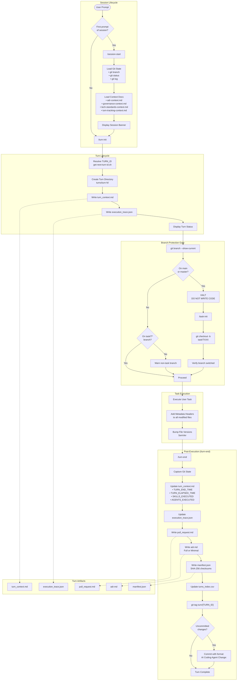

# coding-agents-config

Agentic pipeline configuration for Claude Code. Enforces turn-based workflow with provenance tracking, branch protection, and governance rules.

## Setup

### 1. Clone the repo

```sh
git clone <repo-url> ~/coding-agents-config
```

### 2. Create symlinks (automated)

Run the setup script — it creates all symlinks and backs up any existing files:

```sh
bash scripts/setup.sh
```

The script links these items:

| Destination | Items |
|-------------|-------|
| `~/.claude/` | `skills`, `agents`, `rules`, `hooks`, `context`, `scripts`, `plugins`, `CLAUDE.md`, `settings.json` |
| `~/.codex/` | `agents`, `AGENTS.md` |
| `./.claude/` (repo-local) | `CLAUDE.md` |

Items that do not exist in the repo are skipped. Existing non-symlink targets are backed up first.

<details>
<summary>Manual symlink commands</summary>

```sh
ln -s ~/coding-agents-config/skills ~/.claude/skills
ln -s ~/coding-agents-config/agents ~/.claude/agents
ln -s ~/coding-agents-config/hooks ~/.claude/hooks
ln -s ~/coding-agents-config/scripts ~/.claude/scripts
ln -s ~/coding-agents-config/CLAUDE.md ~/.claude/CLAUDE.md
ln -s ~/coding-agents-config/settings.json ~/.claude/settings.json
```

If any of these already exist, back them up first (`mv <target> <target>.bak`).
</details>

### 3. Verify

```sh
ls -la ~/.claude/skills        # should point to ~/coding-agents-config/skills
ls -la ~/.claude/hooks         # should point to ~/coding-agents-config/hooks
ls -la ~/.claude/CLAUDE.md     # should point to ~/coding-agents-config/CLAUDE.md
ls -la ~/.claude/settings.json # should point to ~/coding-agents-config/settings.json
```

## Structure

```
coding-agents-config/
├── CLAUDE.md           # Global instructions — task/turn protocol, branch rules
├── AGENTS.md           # Agent loader directive (points at ~/.claude/CLAUDE.md)
├── settings.json       # Claude Code settings (model, permissions, hooks)
├── agents/             # Subagent definitions (e.g. agent-architecture-planner)
├── hooks/              # Shell hooks triggered by Claude Code events
│   └── branch-guard.sh # Auto-creates a task branch when on main/master
├── skills/             # Slash-command skills (see Skills below)
├── scripts/            # Automation scripts
│   ├── setup.sh        # Creates symlinks into ~/.claude and ~/.codex
│   └── af-state.sh     # AppFactory state.yaml helpers
├── .appfactory/        # Task/turn tracking and project memory
│   ├── tasks/          # task-XXX/ with task artifacts and turns/turn-XXX/
│   ├── tasks_index.csv # Registry of all tasks
│   ├── specs/          # Specifications
│   ├── prompts/        # Prompt templates
│   └── memory/         # Project memory
├── archive/            # Retired skills and legacy turn history
├── docs/               # Reference documentation
└── .github/            # PR and issue templates
```

Templates live alongside the skills that use them (`skills/<skill>/templates/`).

## Execution Flow

The agentic pipeline enforces a strict turn-based workflow for all coding tasks:



### Turn Protocol Summary

| Phase | Steps | Outputs |
|-------|-------|---------|
| **Session Start** | Load git state → Load 4 context docs → Display banner | Context loaded |
| **Turn Init** | Resolve ID → Create dir → Write context + trace | `turn_context.md`, `execution_trace.json` |
| **Branch Gate** | Check branch → HALT if main → Create turn branch | Safe branch |
| **Execution** | Execute task → Add headers → Bump versions | Modified files |
| **Turn End** | Update context → Write PR → ADR → Manifest → Index → Tag | 5 artifacts complete |

## Task and Turn Model

- A **task** is the branch-scoped unit of work (`task/TXXX`) that becomes one pull request.
- A **turn** is one AI execution cycle within a task (`turn-001`, `turn-002`, ...).
- On `main`/`master`, `/task-init` creates the task branch and `turn-001`; on a task branch, `/turn-init` starts the next turn.
- `/turn-end` always runs after execution; `/task-close` runs when the task is ready for review and opens the PR.

Artifacts live under `.appfactory/tasks/task-XXX/`:

| Scope | Files |
|-------|-------|
| Task | `task_context.md`, `task_status.json`, `task_summary.md`, `pull_request.md` |
| Turn (`turns/turn-XXX/`) | `turn_context.md`, `execution_trace.json`, `adr.md`, `manifest.json` |

Commits use the `AI Coding Agent Change:` bullet format. See `CLAUDE.md` for the full rules.

## Skills

| Category | Skill | Description |
|----------|-------|-------------|
| **Session** | `session-start` | Load repo state and core pipeline context |
| **Task / Turn** | `task-init` | Create task branch plus task and turn-001 artifacts |
| | `task-close` | Finalize the task, push, and open a pull request |
| | `turn-init` | Initialize the next turn in the active task |
| | `turn-end` | Finalize turn: ADR, manifest, trace, index |
| | `branch-guard` | Create a branch if on main/master |
| **AppFactory pipeline** | `af-orchestrator` | Orchestrate the App Factory SDLC |
| | `af-project-init` | Initialize an AppFactory project |
| | `af-memory` | Read/write pipeline state in `.appfactory/memory/state.yaml` |
| | `af-be-prd-build` | Build a backend PRD |
| | `af-be-ddd-build` | Generate a DDD document from a PRD |
| | `af-be-ddd-analysis` | Analyze a DDD document |
| | `af-be-ddd-refactor` | Refactor the DDD document from analysis |
| | `af-be-ddd-orchestrator` | Run build → analyze → refactor loop → tests |
| | `af-be-ddd-tests` | Generate Gherkin BDD feature specs |
| | `af-be-ddd-dsl` | Generate domain DSL YAML from a DDD document |
| | `af-be-plan` | Generate an execution plan from DSL and tech stack |
| | `af-be-implementation` | Generate the backend from a tech stack implementation |
| | `af-app-check` | Production-readiness audit |
| **DSL / UI / tests** | `dsl-utils/dsl-model-interpreter` | Parse and validate app-dsl YAML |
| | `ui-utils/ui-implementation-language` | Declarative YAML for UI pages and widgets |
| | `unit-tests/test-implementation-sync` | Keep unit tests in sync with implementations |
| | `e2e-tests/http-test-artifacts` | Generate `.http` request files |
| **Evaluation** | `eval-labeler` | Label model response evaluations |

### NestJS skills (`skills/.nestjs/`)

`app-from-dsl`, `field-mapper-generator`, `nestjs-crud-resource`, `nestjs-customer-crud-scaffold`, `nestjs-observability`, `nestjs-prisma-resource`, `prisma/prisma-guidelines`, `prisma/prisma-persistence`.

### Meta-skills (`skills/.system/`)

`skill-creator`, `skill-installer`, `plugin-creator`, `imagegen`, `openai-docs`.

Retired skills are kept in `archive/` (see `archive/README.md`).

## Hooks

| Hook | Trigger | Purpose |
|------|---------|---------|
| `branch-guard.sh` | PreToolUse(Bash) | Auto-create a task branch when on main/master |

## Adding a new skill

Each skill lives in its own directory under `skills/` with a `SKILL.md` file:

```
skills/my-skill/
└── SKILL.md
```

The `.system/skill-creator` meta-skill can guide you through creating one — invoke it from Claude Code.

## Syncing across machines

Since this is a standard git repo, pull on any machine to stay current:

```sh
cd ~/coding-agents-config && git pull
```

The symlinks mean changes are picked up immediately — no reinstall needed.
