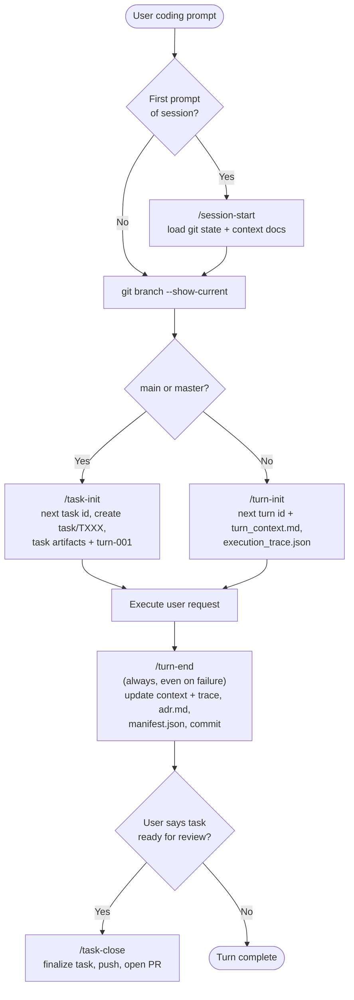

# coding-agents-config

Agentic pipeline configuration for Claude Code (and Codex). Enforces a task/turn-based workflow with provenance tracking, branch protection, and governance rules, plus the App Factory (`af-*`) skills for generating backend applications from a PRD.

## Setup

### 1. Clone the repo

```sh
git clone <repo-url> ~/coding-agents-config
```

### 2. Create symlinks (automated)

```sh
bash scripts/setup.sh
```

The script symlinks `skills`, `agents`, `rules`, `hooks`, `context`, `scripts`, `plugins`, `CLAUDE.md` and `settings.json` into `~/.claude/`, `agents` and `AGENTS.md` into `~/.codex/`, and `CLAUDE.md` into the repo-local `./.claude/`. Existing files are backed up to `<name>.bak`; items that don't exist in the repo are skipped.

### 3. Verify

```sh
ls -la ~/.claude/skills        # -> ~/coding-agents-config/skills
ls -la ~/.claude/hooks         # -> ~/coding-agents-config/hooks
ls -la ~/.claude/CLAUDE.md     # -> ~/coding-agents-config/CLAUDE.md
ls -la ~/.claude/settings.json # -> ~/coding-agents-config/settings.json
```

## Structure

```
coding-agents-config/
├── CLAUDE.md           # Global instructions — task/turn protocol, branch rules
├── AGENTS.md           # Agent loader directive (Codex)
├── settings.json       # Claude Code settings (model, permissions, hooks, plugins)
├── agents/             # Subagent definitions (agent-architecture-planner)
├── hooks/
│   └── branch-guard.sh # Auto-creates a task branch instead of editing main/master
├── skills/             # Slash-command skills (see below)
│   └── .system/        # Meta-skills (skill-creator, skill-installer, plugin-creator, ...)
├── scripts/
│   ├── setup.sh        # Symlink installer
│   └── af-state.sh     # Helpers for .appfactory/memory/state.yaml
├── .appfactory/        # Task/turn tracking, specs, prompts, memory
│   ├── tasks/          # task-XXX/ with turns/turn-XXX/ artifacts
│   ├── tasks_index.csv # Registry of tasks
│   ├── specs/  prompts/  memory/
├── docs/               # Reference docs and migration notes
└── archive/            # Retired skills, templates and legacy turns
```

## Task and Turn Model

- A **task** is a branch-scoped unit of work (`task/TXXX`) that becomes one pull request.
- A **turn** is one AI execution cycle inside the task branch. Turn ids reset per task.
- Ids are zero-padded to 3 digits. Never write code or commit on `main`/`master`.

## Execution Flow



### Artifacts

| Scope | Location | Files |
|-------|----------|-------|
| Turn | `.appfactory/tasks/task-XXX/turns/turn-XXX/` | `turn_context.md`, `execution_trace.json`, `adr.md`, `manifest.json` |
| Task | `.appfactory/tasks/task-XXX/` | `task_context.md`, `task_status.json`, `task_summary.md`, `pull_request.md` |

Commit messages use the `AI Coding Agent Change:` bullet format defined in `CLAUDE.md`.

## Skills

| Category | Skill | Description |
|----------|-------|-------------|
| **Session / Task** | `session-start` | Load repo state and core pipeline context |
| | `task-init` | Create task branch plus task and turn-001 artifacts |
| | `turn-init` | Initialize the next turn in the active task |
| | `turn-end` | Finalize the turn (trace, ADR, manifest, commit) |
| | `task-close` | Finalize the task, push, open PR against main |
| | `branch-guard` | Create a task/turn branch if on main/master |
| **App Factory pipeline** | `af-orchestrator` | Orchestrate the App Factory SDLC |
| | `af-project-init` | Initialize an AppFactory project and env vars |
| | `af-memory` | CRUD on `.appfactory/memory/state.yaml` |
| | `af-be-prd-build` | Build a PRD for a backend app |
| | `af-be-ddd-orchestrator` | Run the DDD build → analyze → refactor → tests loop |
| | `af-be-ddd-build` / `-analysis` / `-refactor` | Build, analyze and refine the DDD document |
| | `af-be-ddd-dsl` | Generate domain DSL YAML from the DDD |
| | `af-be-ddd-tests` | Generate Gherkin BDD feature files |
| | `af-be-plan` | Build an execution plan from DSL + tech stack profile |
| | `af-be-implementation` | Generate the app from a tech stack implementation |
| | `af-app-check` | Production-readiness audit |
| **Utility groups** | `dsl-utils`, `ui-utils`, `e2e-tests`, `unit-tests` | Containers for DSL interpreter, UI language, HTTP test artifacts, test/implementation sync |
| **Evaluation** | `eval-labeler` | Label model-response eval files |

### Meta-skills (`skills/.system`)

`skill-creator`, `skill-installer`, `plugin-creator`, `imagegen`, `openai-docs`.

## Hooks

| Hook | Trigger | Purpose |
|------|---------|---------|
| `branch-guard.sh` | PreToolUse(Bash) | On `main`/`master`, auto-create a task branch rather than allowing writes |

## Adding a new skill

Each skill lives in its own directory under `skills/` with a `SKILL.md` file:

```
skills/my-skill/
└── SKILL.md
```

The `.system/skill-creator` meta-skill can guide you through creating one.

## Syncing across machines

```sh
cd ~/coding-agents-config && git pull
```

Symlinks mean changes are picked up immediately — no reinstall needed.
