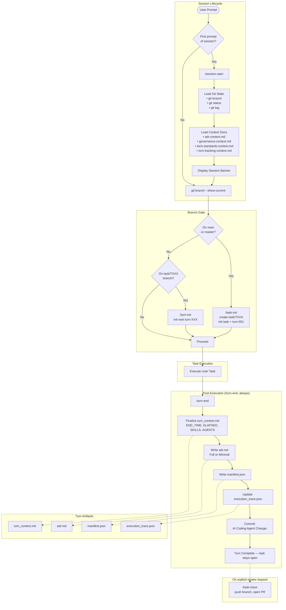

# coding-agents-config

Agentic pipeline configuration for Claude Code and Codex. Enforces a task/turn-based workflow with provenance tracking, branch protection, and governance rules, plus the App Factory (`af-*`) skill set for DSL-driven application generation.

## Setup

### 1. Clone the repo

```sh
git clone <repo-url> ~/coding-agents-config
```

### 2. Create symlinks (automated)

Run the setup script — it creates all symlinks and backs up any existing files:

```sh
bash scripts/setup.sh
```

<details>
<summary>Manual symlink commands</summary>

```sh
# Claude Code (~/.claude)
ln -s ~/coding-agents-config/skills       ~/.claude/skills
ln -s ~/coding-agents-config/agents       ~/.claude/agents
ln -s ~/coding-agents-config/hooks        ~/.claude/hooks
ln -s ~/coding-agents-config/scripts      ~/.claude/scripts
ln -s ~/coding-agents-config/CLAUDE.md    ~/.claude/CLAUDE.md
ln -s ~/coding-agents-config/settings.json ~/.claude/settings.json

# Codex (~/.codex)
ln -s ~/coding-agents-config/agents    ~/.codex/agents
ln -s ~/coding-agents-config/AGENTS.md ~/.codex/AGENTS.md

# Repo-local ./.claude
ln -s ~/coding-agents-config/CLAUDE.md ~/coding-agents-config/.claude/CLAUDE.md
```

`scripts/setup.sh` also attempts to link `rules/`, `context/`, and `plugins/` into `~/.claude/` — create those directories if you intend to use them; the script skips items whose source doesn't exist locally.

If any target already exists, the script backs it up first (`mv <target> <target>.bak`).
</details>

### 3. Verify

```sh
ls -la ~/.claude/skills        # should point to ~/coding-agents-config/skills
ls -la ~/.claude/agents        # should point to ~/coding-agents-config/agents
ls -la ~/.claude/hooks         # should point to ~/coding-agents-config/hooks
ls -la ~/.claude/CLAUDE.md     # should point to ~/coding-agents-config/CLAUDE.md
ls -la ~/.claude/settings.json # should point to ~/coding-agents-config/settings.json
ls -la ~/.codex/AGENTS.md      # should point to ~/coding-agents-config/AGENTS.md
```

## Structure

```
coding-agents-config/
├── CLAUDE.md           # Global instructions — task/turn protocol, branch rules
├── AGENTS.md           # Codex loader directive (reads ~/.claude/CLAUDE.md)
├── settings.json       # Claude Code settings (model, permissions)
├── hooks/              # Shell hooks triggered by Claude Code events
│   └── branch-guard.sh # Auto-creates a task/TXXX branch when on main/master
├── skills/             # Slash-command skills, grouped by category
│   ├── .system/         # Meta-skills (skill-creator, skill-installer, plugin-creator, imagegen, openai-docs)
│   ├── session-start/   # Initialize session, load governance/ADR/tech-standards context
│   ├── task-init/       # Create task branch + task + turn-001 artifacts (run on main/master)
│   ├── turn-init/       # Create the next turn's artifacts within the active task branch
│   ├── turn-end/        # Finalize a turn (ADR, manifest, execution trace)
│   ├── task-close/      # Push the task branch and open a pull request
│   ├── branch-guard/    # Branch-safety check/creation
│   ├── af-orchestrator/     # Orchestrates the App Factory SDLC end to end
│   ├── af-project-init/     # Initialize AppFactory project state
│   ├── af-memory/           # CRUD operations on .appfactory/memory/state.yaml
│   ├── af-app-check/        # Production-readiness audit (security, DB, deploy, quality)
│   ├── af-be-prd-build/     # Build a backend PRD from an intake worksheet
│   ├── af-be-ddd-build/     # Generate a backend DDD doc from an approved PRD
│   ├── af-be-ddd-analysis/  # Audit a DDD doc for quality/completeness
│   ├── af-be-ddd-refactor/  # Apply af-be-ddd-analysis findings to the DDD doc
│   ├── af-be-ddd-orchestrator/ # Drive the DDD build → analyze → refactor → test loop
│   ├── af-be-ddd-dsl/       # Generate a backend DSL YAML from the DDD doc
│   ├── af-be-plan/          # Generate a backend execution plan from DSL + tech-stack profile
│   ├── af-be-ddd-tests/     # Generate Gherkin/BDD feature files from DDD + PRD
│   ├── af-be-implementation/# Generate backend code from the plan + BDD specs
│   ├── dsl-utils/dsl-model-interpreter/     # Parse and validate app-dsl YAML
│   ├── ui-utils/ui-implementation-language/ # Declarative UI YAML language spec
│   ├── unit-tests/test-implementation-sync/ # Keep unit tests aligned with implementation
│   ├── e2e-tests/http-test-artifacts/       # Generate .http files for endpoint testing
│   └── eval-labeler/    # Label/score Response A vs Response B model-eval runs
├── agents/              # Agent definitions (e.g. agent-architecture-planner.md)
├── scripts/             # Automation scripts
│   ├── setup.sh          # Creates the symlinks above
│   └── af-state.sh       # Shared helpers for reading/writing .appfactory/memory/state.yaml
├── .appfactory/          # Task/turn tracking and specs (generated at runtime)
│   ├── tasks/             # task-XXX/ directories with turns/turn-XXX/ artifacts
│   ├── tasks_index.csv    # Registry of all tasks
│   ├── specs/             # PRD/DDD/DSL specification artifacts
│   ├── prompts/           # Prompt templates used by af-* skills
│   └── memory/            # state.yaml — pipeline state across skills
├── docs/                 # Reference documentation (AppFactory design, migration notes)
├── archive/              # Deprecated/superseded skills, templates, and docs kept for reference
└── .github/
    ├── PULL_REQUEST_TEMPLATE.md
    └── ISSUE_TEMPLATE/    # epic.md, task.md, bug.md
```

> Turn/task artifact templates (`task_context.md`, `turn_context.md`) now live inside the skills that use them — `skills/task-init/templates/` and `skills/turn-init/templates/` — rather than in a shared top-level `templates/` directory.

## Execution Flow

The agentic pipeline enforces a task/turn workflow for all coding tasks. A **task** is the branch-scoped unit of work that becomes one pull request; a **turn** is one AI execution cycle within that task branch.



### Task/Turn Protocol Summary

| Phase | Trigger | Steps | Outputs |
|-------|---------|-------|---------|
| **Session Start** | First prompt of session | Load git state → Load 4 context docs → Display banner | Context loaded |
| **Task Init** | Current branch is `main`/`master` | Create `task/TXXX` → init task artifacts → init `turn-001` | `task_context.md`, `task_status.json`, `task_summary.md`, `pull_request.md`, turn-001 |
| **Turn Init** | Current branch is `task/TXXX` | Resolve next turn id → create `turn-XXX/` → write context + trace | `turn_context.md`, `execution_trace.json` |
| **Execution** | Always | Execute the user's request | Modified files |
| **Turn End** | Always, even on failure | Finalize context → write ADR → write manifest → update trace → commit | `adr.md`, `manifest.json`, commit |
| **Task Close** | User signals task is ready for review | Push task branch → open PR against `main` | Pull request |

## Skills

### Task/Turn Governance

| Skill | Description |
|-------|-------------|
| `session-start` | Load repository state and core pipeline context; run at the start of every session |
| `task-init` | Initialize a new task branch (`task/TXXX`) and create task + turn-001 artifacts (run on `main`/`master`) |
| `turn-init` | Initialize the next turn within the active task branch |
| `turn-end` | Finalize the active turn — ADR, manifest, execution trace (run after every prompt) |
| `task-close` | Finalize the active task branch, push it, and open a pull request against `main` |
| `branch-guard` | Check current git branch and create a task-scoped branch if on `main`/`master` |

### App Factory (`af-*`) — DSL-driven backend generation

| Skill | Description |
|-------|-------------|
| `af-orchestrator` | Orchestrates the full App Factory software development lifecycle |
| `af-project-init` | Export required environment variables and initialize AppFactory project state |
| `af-memory` | CRUD operations on `.appfactory/memory/state.yaml` for pipeline state |
| `af-app-check` | Audit an application for production readiness (security, database, deployment, code quality) |
| `af-be-prd-build` | Build a backend PRD from a completed intake worksheet |
| `af-be-ddd-build` | Generate a backend Domain-Driven Design document from an approved PRD |
| `af-be-ddd-analysis` | Audit a generated DDD document for quality, completeness, and PRD alignment |
| `af-be-ddd-refactor` | Apply `af-be-ddd-analysis` findings to patch the DDD document |
| `af-be-ddd-orchestrator` | Orchestrate the DDD build → analyze → refactor loop → test phases |
| `af-be-ddd-dsl` | Generate a backend application DSL YAML from the DDD document |
| `af-be-plan` | Generate a backend execution plan from the DSL and a tech-stack profile |
| `af-be-ddd-tests` | Generate Gherkin/BDD feature files from the DDD and PRD specs |
| `af-be-implementation` | Generate backend domain code from the execution plan and BDD feature specs |

### Utilities

| Skill | Description |
|-------|-------------|
| `dsl-utils/dsl-model-interpreter` | Parse and validate `app-dsl` YAML specifications |
| `ui-utils/ui-implementation-language` | Declarative YAML language spec for UI pages, forms, and bindings |
| `unit-tests/test-implementation-sync` | Keep unit tests synchronized with the actual implementation |
| `e2e-tests/http-test-artifacts` | Generate `.http` request files for REST endpoint testing |
| `eval-labeler` | Label and score Response A vs Response B model-evaluation runs |

### Meta-Skills (`.system/`)

| Skill | Description |
|-------|-------------|
| `skill-creator` | Guide for creating or updating a `SKILL.md`-based skill |
| `skill-installer` | Install skills into `$CODEX_HOME/skills` from a curated list or GitHub repo |
| `plugin-creator` | Scaffold Codex plugin directories, manifests, and marketplace entries |
| `imagegen` | Generate or edit raster images (photos, illustrations, sprites, mockups) |
| `openai-docs` | Look up official OpenAI product/API documentation with citations |

## Hooks

| Hook | Trigger | Purpose |
|------|---------|---------|
| `branch-guard.sh` | PreToolUse (write/edit/bash) | If on `main`/`master`, auto-creates and switches to the next `task/TXXX` branch instead of blocking |

## Adding a new skill

Each skill lives in its own directory under `skills/` with a `SKILL.md` file:

```
skills/my-skill/
└── SKILL.md
```

Related skills can be grouped under a category directory (see `af-*`, `dsl-utils/`, `ui-utils/`, `unit-tests/`, `e2e-tests/`). The `.system/skill-creator` meta-skill can guide you through creating one — invoke it from Claude Code or Codex.

## Archive

`archive/` holds skills, templates, and docs that were superseded by the current `af-*` and task/turn skill set (e.g. the earlier `app-from-dsl`, `nestjs-crud-resource`, and `prisma-persistence` skills, and the original shared `templates/` directory). Kept for reference; not symlinked or loaded by `scripts/setup.sh`.

## Syncing across machines

Since this is a standard git repo, pull on any machine to stay current:

```sh
cd ~/coding-agents-config && git pull
```

The symlinks mean changes are picked up immediately — no reinstall needed.
