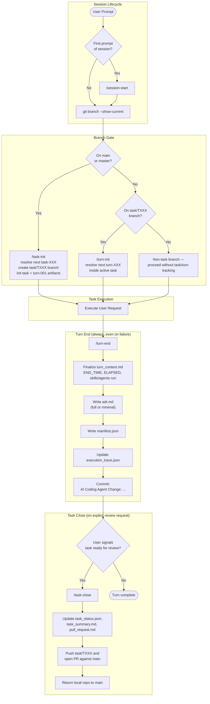

# coding-agents-config

Agentic pipeline configuration for Claude Code and Codex. Enforces a task/turn-based workflow with provenance tracking, branch protection, and governance rules, plus the App Factory skill library for DSL-driven application generation.

## Setup

### 1. Clone the repo

```sh
git clone <repo-url> ~/coding-agents-config
```

### 2. Create symlinks (automated)

Run the setup script — it creates all symlinks and backs up any existing files:

```sh
bash scripts/setup.sh
```

<details>
<summary>Manual symlink commands</summary>

```sh
# Claude Code (~/.claude/)
ln -s ~/coding-agents-config/skills ~/.claude/skills
ln -s ~/coding-agents-config/agents ~/.claude/agents
ln -s ~/coding-agents-config/rules ~/.claude/rules
ln -s ~/coding-agents-config/hooks ~/.claude/hooks
ln -s ~/coding-agents-config/context ~/.claude/context
ln -s ~/coding-agents-config/scripts ~/.claude/scripts
ln -s ~/coding-agents-config/plugins ~/.claude/plugins
ln -s ~/coding-agents-config/CLAUDE.md ~/.claude/CLAUDE.md
ln -s ~/coding-agents-config/settings.json ~/.claude/settings.json

# Codex (~/.codex/)
ln -s ~/coding-agents-config/agents ~/.codex/agents
ln -s ~/coding-agents-config/AGENTS.md ~/.codex/AGENTS.md

# Repo-local override (./.claude/)
ln -s ~/coding-agents-config/CLAUDE.md ./.claude/CLAUDE.md
```

If any of these already exist, back them up first (`mv <target> <target>.bak`). `rules/`, `context/`, and `plugins/` are optional/runtime directories — `plugins/` is gitignored and may not exist until a plugin is installed locally.
</details>

### 3. Verify

```sh
ls -la ~/.claude/skills        # should point to ~/coding-agents-config/skills
ls -la ~/.claude/hooks         # should point to ~/coding-agents-config/hooks
ls -la ~/.claude/CLAUDE.md     # should point to ~/coding-agents-config/CLAUDE.md
ls -la ~/.claude/settings.json # should point to ~/coding-agents-config/settings.json
ls -la ~/.codex/AGENTS.md      # should point to ~/coding-agents-config/AGENTS.md
```

## Structure

```
coding-agents-config/
├── CLAUDE.md            # Global instructions — task/turn protocol, branch rules
├── AGENTS.md            # Codex loader directive (reads ~/.claude/CLAUDE.md)
├── settings.json        # Claude Code settings (model, permissions, hooks, plugins)
├── hooks/                # Shell hooks triggered by Claude Code events
│   └── branch-guard.sh   # Auto-creates a task branch when on main/master
├── skills/               # Slash-command skills
│   ├── session-start/    # Load git state + context docs at session start
│   ├── task-init/        # Create task branch + task/turn-001 artifacts
│   ├── turn-init/        # Create the next turn inside the active task
│   ├── turn-end/         # Finalize a turn (ADR, manifest, trace)
│   ├── task-close/       # Push task branch and open a PR against main
│   ├── branch-guard/     # Model-invocable branch check/guard
│   ├── af-*/             # App Factory pipeline skills (see below)
│   ├── dsl-utils/, e2e-tests/, ui-utils/, unit-tests/  # Grouped utility skills
│   ├── eval-labeler/     # Label/score model-response evaluations
│   ├── .nestjs/           # (hidden) legacy NestJS/Prisma/DSL scaffolding skills
│   └── .system/           # (hidden) Codex-oriented meta-skills (skill-creator, etc.)
├── agents/               # Agent definitions
│   └── agent-architecture-planner.md
├── docs/                 # Reference and migration docs
├── archive/              # Retired skills, templates, and prior skill library
├── scripts/              # Automation scripts
│   ├── setup.sh          # Create ~/.claude and ~/.codex symlinks
│   └── af-state.sh       # App Factory state helper
├── .appfactory/          # Task/turn tracking and App Factory state
│   ├── tasks/             # task-XXX/ directories with nested turns/
│   ├── tasks_index.csv    # One row per task (branch, status, PR URL, turn count)
│   ├── specs/              # Specifications
│   ├── prompts/            # Prompt templates
│   ├── memory/              # Project memory
│   └── changelog.md        # Turn-by-turn change history
└── .github/              # PR and issue templates
```

## Execution Flow

The agentic pipeline enforces a task/turn workflow for all coding tasks. A **task** is the branch-scoped unit of work that becomes one pull request; a **turn** is one AI execution cycle within the active task branch.



### Turn Protocol Summary

| Phase | Trigger | Steps | Outputs |
|-------|---------|-------|---------|
| **Session Start** | First prompt of session | `/session-start` loads git state + context docs | Session context loaded |
| **Task Init** | On `main`/`master` | `/task-init` resolves task id, creates `task/TXXX`, seeds task + turn-001 artifacts | `task_context.md`, `task_status.json`, `task_summary.md`, `pull_request.md`, turn-001 files |
| **Turn Init** | On `task/TXXX` | `/turn-init` resolves the next turn id in the active task | `turn_context.md`, `execution_trace.json` |
| **Execution** | Every coding prompt | Execute the user's request | Modified files |
| **Turn End** | After every prompt, even on failure | `/turn-end` finalizes context, writes ADR + manifest, commits | `adr.md`, `manifest.json`, commit |
| **Task Close** | User signals task ready for review | `/task-close` updates task artifacts, pushes branch, opens PR, returns to `main` | Pull request, `tasks_index.csv` row |

## Skills

### Task/Turn Lifecycle

| Skill | Description |
|-------|-------------|
| `session-start` | Load repository git state and core pipeline context at session start |
| `task-init` | Initialize a new task branch (`task/TXXX`) and create task + turn-001 artifacts; runs when on `main`/`master` |
| `turn-init` | Initialize the next turn inside the active task branch |
| `turn-end` | Finalize the active turn (ADR, manifest, execution trace, commit); runs after every prompt |
| `task-close` | Finalize the task, push the branch, and open a pull request against `main` |
| `branch-guard` | Model-invocable check that creates a turn-scoped branch if on `main`/`master` |

### App Factory Pipeline

The `af-*` skills implement the App Factory SDLC — PRD → domain-driven design → planning → implementation → validation — orchestrated by `af-orchestrator`. See `docs/skill-summary.md` for the full phase table.

| Phase | Skill | Description |
|-------|-------|-------------|
| Initialization | `af-project-init` | Export required environment variables and invoke the project-init helper script |
| Requirements | `af-be-prd-build` | Build a business-facing backend PRD from an intake worksheet |
| Domain-Driven Design | `af-be-ddd-orchestrator` | Orchestrate the DDD build → analyze → refactor loop → test workflow |
| | `af-be-ddd-build` | Generate a human-readable backend DDD document from an approved PRD |
| | `af-be-ddd-analysis` | Audit a DDD spec for quality, completeness, and PRD alignment |
| | `af-be-ddd-refactor` | Patch a DDD spec using `af-be-ddd-analysis` findings |
| Testing | `af-be-ddd-tests` | Generate Gherkin/BDD scenarios from the DDD and PRD specs |
| Planning | `af-be-plan` | Generate a backend execution plan from a domain DSL and tech-stack profile |
| DSL Generation | `af-be-ddd-dsl` | Generate a backend DSL YAML document from the DDD document |
| Implementation | `af-be-implementation` | Copy the selected tech-stack implementation and generate domain code from the plan + BDD specs |
| Validation | `af-app-check` | Audit an application for production readiness (security, database, deployment, code quality) |
| Cross-cutting | `af-memory` | CRUD operations against `.appfactory/` pipeline state |
| Orchestration | `af-orchestrator` | Orchestrate the full App Factory SDLC across the skills above |

### Utility

| Skill | Description |
|-------|-------------|
| `dsl-utils/dsl-model-interpreter` | Parse and validate `app-dsl` YAML specifications before code generation |
| `e2e-tests/http-test-artifacts` | Generate `.http` request files from backend endpoint specs |
| `ui-utils/ui-implementation-language` | Declarative YAML standard for UI pages, layouts, forms, and bindings |
| `unit-tests/test-implementation-sync` | Keep generated unit tests synchronized with actual service/DTO implementations |
| `eval-labeler` | Label and score Response A vs. Response B model evaluations from `Eval.md` files |

### Hidden/legacy skill sets

`skills/.nestjs/` and `skills/.system/` are dot-prefixed (excluded from active skill discovery) and kept for reference: `.nestjs/` holds earlier NestJS + Prisma + DSL scaffolding skills (`app-from-dsl`, `nestjs-crud-resource`, `prisma-persistence`, etc.), and `.system/` holds Codex-oriented meta-skills (`skill-creator`, `skill-installer`, `plugin-creator`, `imagegen`, `openai-docs`). Superseded skills and their original templates also live under `archive/`.

## Templates

Each task/turn-lifecycle skill now ships its own templates rather than reading from a shared top-level directory:

| Skill | Templates |
|-------|-----------|
| `task-init` | `templates/task_context.md`, `templates/turn_context.md` |
| `turn-init` | `templates/turn_context.md` |

The earlier shared template set (`adr_template.md`, `pull_request_template.md`, `manifest.schema.json`, `metadata_header.txt`, `branch_naming.md`, `commit_message.md`, `tech-stack.template.md`) is retained for reference under `archive/templates/`.

## Hooks

| Hook | Trigger | Purpose |
|------|---------|---------|
| `branch-guard.sh` | `PreToolUse(Bash)` | If on `main`/`master`, auto-creates and switches to the next `task/TXXX` branch instead of blocking the tool call |

## Adding a new skill

Each skill lives in its own directory under `skills/` with a `SKILL.md` file:

```
skills/my-skill/
└── SKILL.md
```

`SKILL.md` needs a `name` and `description` in its frontmatter; add `scripts/`, `templates/`, or `references/` subdirectories alongside it as needed (see `skills/task-init/` for an example with both).

## Syncing across machines

Since this is a standard git repo, pull on any machine to stay current:

```sh
cd ~/coding-agents-config && git pull
```

The symlinks mean changes are picked up immediately — no reinstall needed.
