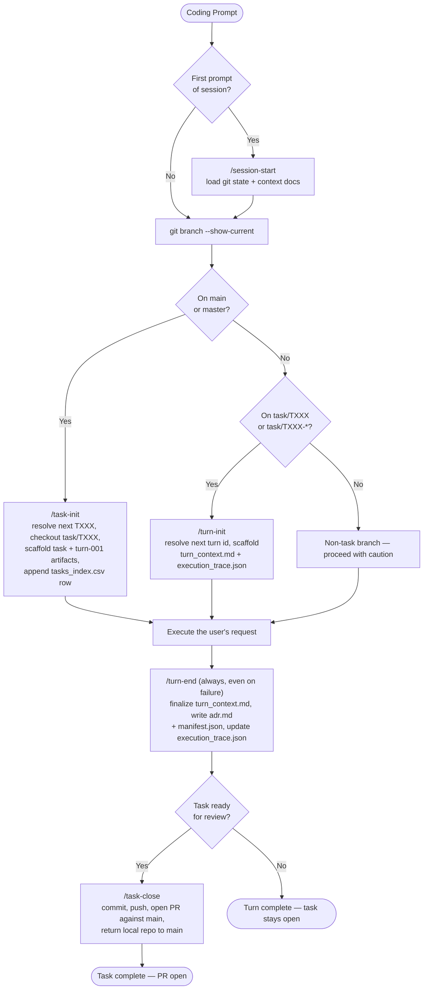

# coding-agents-config

Agentic pipeline configuration for Claude Code and Codex. Enforces a task/turn-based workflow with provenance tracking, branch protection, and governance rules, plus the "App Factory" skill library for DSL-driven application generation.

## Setup

### 1. Clone the repo

```sh
git clone <repo-url> ~/coding-agents-config
```

### 2. Create symlinks (automated)

Run the setup script — it creates all symlinks and backs up any existing files:

```sh
bash scripts/setup.sh
```

<details>
<summary>Manual symlink commands</summary>

```sh
# ~/.claude/
ln -s ~/coding-agents-config/skills       ~/.claude/skills
ln -s ~/coding-agents-config/agents       ~/.claude/agents
ln -s ~/coding-agents-config/hooks        ~/.claude/hooks
ln -s ~/coding-agents-config/scripts      ~/.claude/scripts
ln -s ~/coding-agents-config/rules        ~/.claude/rules      # reserved, not yet present
ln -s ~/coding-agents-config/context      ~/.claude/context    # reserved, not yet present
ln -s ~/coding-agents-config/plugins      ~/.claude/plugins    # reserved, not yet present
ln -s ~/coding-agents-config/CLAUDE.md    ~/.claude/CLAUDE.md
ln -s ~/coding-agents-config/settings.json ~/.claude/settings.json

# ~/.codex/
ln -s ~/coding-agents-config/agents   ~/.codex/agents
ln -s ~/coding-agents-config/AGENTS.md ~/.codex/AGENTS.md

# repo-local ./.claude/
ln -s ~/coding-agents-config/CLAUDE.md ./.claude/CLAUDE.md
```

If any of these already exist, back them up first (`mv <target> <target>.bak`). `scripts/setup.sh` does this automatically and skips targets that already point to the right place.
</details>

### 3. Verify

```sh
ls -la ~/.claude/skills        # should point to ~/coding-agents-config/skills
ls -la ~/.claude/agents        # should point to ~/coding-agents-config/agents
ls -la ~/.claude/hooks         # should point to ~/coding-agents-config/hooks
ls -la ~/.claude/CLAUDE.md     # should point to ~/coding-agents-config/CLAUDE.md
ls -la ~/.claude/settings.json # should point to ~/coding-agents-config/settings.json
```

## Structure

```
coding-agents-config/
├── CLAUDE.md           # Global instructions — task/turn protocol, branch rules
├── AGENTS.md           # Codex loader directive (points at ~/.claude/CLAUDE.md)
├── settings.json        # Claude Code settings (model, permissions, hooks, plugins)
├── hooks/
│   └── branch-guard.sh # PreToolUse hook: auto-creates task/TXXX when on main/master
├── agents/
│   └── agent-architecture-planner.md # Architecture/planning subagent for App Factory
├── skills/              # Slash-command / auto-invoked skills (see below)
├── scripts/
│   ├── setup.sh         # Creates all symlinks described above
│   └── af-state.sh      # AppFactory pipeline state helper
├── .appfactory/         # Task/turn tracking, specs, prompts, memory
│   ├── tasks/           # task-XXX/ directories with turn-XXX/ subdirectories
│   ├── specs/           # Specifications
│   ├── prompts/         # Prompt templates and worksheets
│   ├── memory/          # Project memory (state.yaml)
│   ├── tasks_index.csv  # Registry of all tasks (branch, status, PR, turn count)
│   └── changelog.md
├── docs/                 # Reference/migration documentation
├── archive/              # Superseded skills, templates, and prior skill-library docs
└── .github/
    ├── PULL_REQUEST_TEMPLATE.md
    └── ISSUE_TEMPLATE/   # epic.md, task.md, bug.md
```

## Task/Turn Protocol

Every coding prompt runs through a task/turn lifecycle. A **task** is the branch-scoped unit of work that becomes one pull request (`task/TXXX`); a **turn** is one AI execution cycle within that task branch (`turns/turn-XXX/`).



A `PreToolUse` hook (`hooks/branch-guard.sh`) backstops this at the tool level: if a `Bash` call runs while still on `main`/`master`, it auto-creates the next `task/TXXX` branch before the command executes — enforcing the hard gate in `CLAUDE.md` ("never write code while on main or master").

### Protocol skills

| Skill | Runs when | Does |
|-------|-----------|------|
| `session-start` | First prompt of a session | Loads git state, pipeline context docs, and displays a readiness banner with the next task id |
| `task-init` | Current branch is `main`/`master` | Resolves the next task id, creates `task/TXXX`, scaffolds `task_context.md`, `task_status.json`, `task_summary.md`, `pull_request.md`, and `turn-001`, and appends a row to `tasks_index.csv` |
| `turn-init` | Already on a `task/TXXX` branch | Resolves the next turn id and scaffolds `turn_context.md` + `execution_trace.json` for it |
| `turn-end` | After every coding prompt, even on failure | Finalizes `turn_context.md`, writes `adr.md` and `manifest.json`, updates `execution_trace.json`; leaves the task open |
| `task-close` | User indicates the task is ready for review | Updates task-level artifacts, commits (`AI Coding Agent Change:` format), pushes the branch, opens a PR against `main`, and returns the local repo to `main` |
| `branch-guard` | Legacy — superseded by the `hooks/branch-guard.sh` PreToolUse hook and `task-init` | Creates a `turn/T<ID>`-style branch if invoked directly; kept for backward compatibility |

## App Factory (`af-*`) skills

Skills that implement the App Factory software development lifecycle (project init → PRD → DDD → tests → plan → implementation → acceptance check), driven from DSL specs in `.appfactory/`:

| Skill | Stage | Description |
|-------|-------|--------------|
| `af-orchestrator` | Orchestration | Orchestrates the full App Factory SDLC: init, PRD, DDD, test scenarios, architecture/tech-stack selection, implementation plan, source generation, acceptance testing |
| `af-project-init` | 1. Project init | Exports required environment variables and invokes the project-init helper script |
| `af-memory` | Cross-cutting | CRUD operations on `.appfactory/memory/state.yaml` to track pipeline progress, inputs, outputs, and context across skills |
| `af-be-prd-build` | 2. PRD | Builds a business-facing backend PRD from an intake worksheet, questionnaire, or discovery notes |
| `af-be-ddd-build` | 3. DDD | Generates a backend Domain-Driven Design document from an approved PRD, following `ddd-template.md` |
| `af-be-ddd-analysis` | 3. DDD | Audits a generated DDD document for quality, completeness, and PRD alignment; reports risks and gaps |
| `af-be-ddd-refactor` | 3. DDD | Applies targeted patches to a DDD document based on `af-be-ddd-analysis` findings |
| `af-be-ddd-orchestrator` | 3. DDD | Orchestrates the DDD build → analyze → refactor loop → test phases |
| `af-be-ddd-dsl` | 3. DDD | Generates a backend DSL YAML document from a human-readable DDD document, for downstream planning/codegen |
| `af-be-ddd-tests` | 4. Tests | Generates Gherkin/BDD scenarios from DDD + PRD specs, organized by aggregate/bounded context |
| `af-be-plan` | 5–7. Plan | Generates a backend execution plan from the DSL and a selected tech-stack profile (single-turn when feasible) |
| `af-be-implementation` | 8. Implementation | Copies the selected tech-stack implementation into the target project and generates domain code from the plan + BDD specs |
| `af-app-check` | 9. Acceptance | Audits an application for production readiness (security, database, deployment, code quality) |

## Utility skill bundles

Grouped skills that hold one or more sub-skills:

| Bundle | Sub-skill | Description |
|--------|-----------|--------------|
| `dsl-utils` | `dsl-model-interpreter` | Parses and validates `app-dsl` YAML specifications (models, mappers, pages, backends, lookups) |
| `ui-utils` | `ui-implementation-language` | Declarative, framework-neutral YAML language for UI pages, layouts, widgets, forms, and API bindings |
| `e2e-tests` | `http-test-artifacts` | Generates `.http` request files for REST-client testing of backend endpoints |
| `unit-tests` | `test-implementation-sync` | Keeps generated unit tests synchronized with the service/DTO implementations they cover |

## Other skills

| Skill | Description |
|-------|--------------|
| `eval-labeler` | Processes `Eval.md` files to generate structured notes and labeled evaluation results when comparing two model responses on coding tasks |

## Agents

| Agent | Description |
|-------|--------------|
| `agent-architecture-planner` | Reads PRD, DDD, DSL, and the existing repo to produce architecture decisions, module maps, task plans, and review artifacts for downstream coding agents |

## Hooks

| Hook | Trigger | Purpose |
|------|---------|---------|
| `branch-guard.sh` | `PreToolUse(Bash)` | Auto-creates the next `task/TXXX` branch if a Bash tool call runs while on `main`/`master` |

## Templates

There is no shared root-level `templates/` directory. Each skill that needs one carries its own `templates/` folder (e.g. `skills/task-init/templates/task_context.md`, `skills/turn-init/templates/turn_context.md`, `skills/af-be-plan/templates/…`). Earlier shared templates (`adr_template.md`, `pull_request_template.md`, `manifest.schema.json`, etc.) have been superseded and now live under `archive/templates/` for reference only.

## Archive

`archive/` holds the original DSL-first skill library (`app-from-dsl`, `dsl-model-interpreter`, `prisma-persistence`, `nestjs-crud-resource`, `react-form-page`, etc.) and its design docs (`archive/README.md`, `archive/SUMMARY.md`). It predates the App Factory (`af-*`) skills and the task/turn protocol described above, and is kept for reference rather than active use.

## Adding a new skill

Each skill lives in its own directory under `skills/` with a `SKILL.md` file:

```
skills/my-skill/
└── SKILL.md
```

## Syncing across machines

Since this is a standard git repo, pull on any machine to stay current:

```sh
cd ~/coding-agents-config && git pull
```

The symlinks mean changes are picked up immediately — no reinstall needed.
