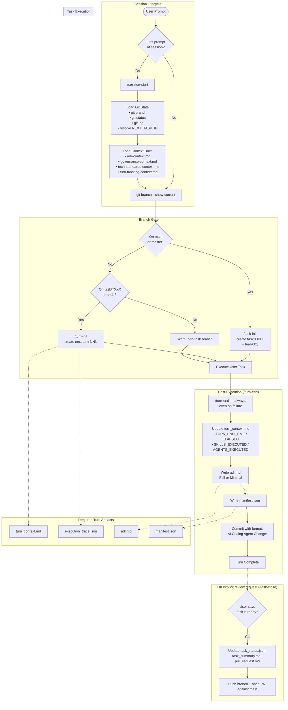

# coding-agents-config

Agentic pipeline configuration for Claude Code and Codex. Enforces a task/turn-based workflow with provenance tracking, branch protection, and governance rules, plus the AppFactory skill set for spec-to-code application generation.

## Setup

### 1. Clone the repo

```sh
git clone <repo-url> ~/coding-agents-config
```

### 2. Create symlinks (automated)

Run the setup script — it creates all symlinks and backs up any existing files:

```sh
bash scripts/setup.sh
```

<details>
<summary>Manual symlink commands</summary>

```sh
# ~/.claude/
ln -s ~/coding-agents-config/skills ~/.claude/skills
ln -s ~/coding-agents-config/agents ~/.claude/agents
ln -s ~/coding-agents-config/rules ~/.claude/rules
ln -s ~/coding-agents-config/hooks ~/.claude/hooks
ln -s ~/coding-agents-config/context ~/.claude/context
ln -s ~/coding-agents-config/scripts ~/.claude/scripts
ln -s ~/coding-agents-config/plugins ~/.claude/plugins
ln -s ~/coding-agents-config/CLAUDE.md ~/.claude/CLAUDE.md
ln -s ~/coding-agents-config/settings.json ~/.claude/settings.json

# ~/.codex/
ln -s ~/coding-agents-config/agents ~/.codex/agents
ln -s ~/coding-agents-config/AGENTS.md ~/.codex/AGENTS.md

# repo-local ./.claude/
ln -s ~/coding-agents-config/CLAUDE.md ./.claude/CLAUDE.md
```

If any of these already exist, back them up first (`mv <target> <target>.bak`). `rules`, `context`, and `plugins` are optional — `setup.sh` links them if present.
</details>

### 3. Verify

```sh
ls -la ~/.claude/skills        # should point to ~/coding-agents-config/skills
ls -la ~/.claude/agents        # should point to ~/coding-agents-config/agents
ls -la ~/.claude/hooks         # should point to ~/coding-agents-config/hooks
ls -la ~/.claude/CLAUDE.md     # should point to ~/coding-agents-config/CLAUDE.md
ls -la ~/.claude/settings.json # should point to ~/coding-agents-config/settings.json
ls -la ~/.codex/AGENTS.md      # should point to ~/coding-agents-config/AGENTS.md
```

## Structure

```
coding-agents-config/
├── CLAUDE.md           # Global instructions — task/turn protocol, branch rules
├── AGENTS.md           # Codex loader directive — points at ~/.claude/CLAUDE.md
├── settings.json       # Claude Code settings (model, permissions, hooks, plugins)
├── hooks/              # Shell hooks triggered by Claude Code events
│   └── branch-guard.sh # Auto-creates task/TXXX branch when on main/master
├── skills/              # Slash-command skills
│   ├── session-start/   # Load repo state + pipeline context (first prompt)
│   ├── task-init/       # Create task branch + turn-001 artifacts (from main/master)
│   ├── turn-init/       # Create the next turn inside the active task
│   ├── turn-end/        # Finalize a turn — ADR, manifest, commit
│   ├── task-close/      # Finalize a task, push, open PR
│   ├── branch-guard/    # Legacy turn-branch guard
│   ├── af-orchestrator/ # AppFactory pipeline orchestrator
│   ├── af-*/            # AppFactory PRD/DDD/plan/implementation/check skills
│   ├── dsl-utils/       # DSL parsing/generation helpers
│   ├── e2e-tests/       # End-to-end test generation
│   ├── unit-tests/      # Unit test generation
│   ├── ui-utils/        # UI scaffolding helpers
│   ├── eval-labeler/    # Label/score model response evaluations
│   └── .system/         # Meta-skills (skill-creator, skill-installer, plugin-creator, ...)
├── agents/              # Reusable subagent definitions
│   └── agent-architecture-planner.md
├── docs/                 # Reference documentation
│   ├── skill-summary.md              # AppFactory skill pipeline reference
│   ├── appFactory-plan.md
│   ├── app-nextjs-nestjs-prisma.md
│   └── ...
├── scripts/              # Automation scripts
│   ├── setup.sh          # Creates the symlinks above
│   └── af-state.sh       # AppFactory pipeline state helper
├── .appfactory/           # Task/turn tracking, specs, prompts, memory
│   ├── tasks/             # task-XXX/ branches with their turns/
│   ├── prompts/           # Prompt drafts and worksheets
│   ├── memory/            # Project memory
│   ├── specs/              # Specifications
│   ├── changelog.md
│   └── tasks_index.csv    # Registry of all tasks
├── archive/               # Retired skills, templates, and docs kept for reference
└── .github/                # PR/issue templates
```

## Execution Flow

The agentic pipeline enforces a task/turn workflow for every coding prompt:



### Turn Protocol Summary

| Phase | Steps | Outputs |
|-------|-------|---------|
| **Session Start** | Load git state → resolve next task id → load 4 context docs | Context loaded |
| **Branch Gate** | Check branch → `/task-init` if on main/master → `/turn-init` if on a task branch | `task/TXXX` branch, `turn_context.md`, `execution_trace.json` |
| **Execution** | Execute user task | Modified files |
| **Turn End** | Update turn context → write ADR → write manifest → commit | `adr.md`, `manifest.json`, commit |
| **Task Close** | On explicit review request: update task artifacts → push → open PR | `task_summary.md`, `pull_request.md`, PR against `main` |

## Skills

| Category | Skill | Description |
|----------|-------|--------------|
| **Session / Task / Turn** | `session-start` | Load repository state and core pipeline context (first prompt of session) |
| | `task-init` | Initialize a new task branch and create task + turn-001 artifacts (run on main/master) |
| | `turn-init` | Initialize the next turn within the active task branch |
| | `turn-end` | Finalize the active turn — ADR, manifest, commit (run after every prompt) |
| | `task-close` | Finalize the active task branch, push it, and open a PR against main |
| | `branch-guard` | Legacy guard: create a turn-scoped branch if on main/master |
| **AppFactory Pipeline** | `af-orchestrator` | Orchestrate the App Factory software development lifecycle end-to-end |
| | `af-project-init` | Export required environment variables and initialize an AppFactory project |
| | `af-be-prd-build` | Build a business-facing backend PRD from an intake worksheet |
| | `af-be-ddd-orchestrator` | Orchestrate the backend DDD workflow (build → analyze → refactor → test) |
| | `af-be-ddd-build` | Generate a human-readable backend DDD document from an approved PRD |
| | `af-be-ddd-analysis` | Analyze a DDD specification for quality, completeness, and PRD alignment |
| | `af-be-ddd-refactor` | Refactor a DDD document based on analysis findings |
| | `af-be-ddd-tests` | Generate Gherkin-style BDD scenarios from DDD and PRD specs |
| | `af-be-ddd-dsl` | Generate a backend application DSL YAML from a DDD document |
| | `af-be-plan` | Generate a backend execution plan from a domain DSL and tech-stack profile |
| | `af-be-implementation` | Generate backend application code from the execution plan and BDD specs |
| | `af-app-check` | Audit an application for production readiness (security, DB, deploy, code quality) |
| | `af-memory` | CRUD operations against `.appfactory/state.yaml` for pipeline state tracking |
| **Scaffolding / Testing** | `dsl-utils` | DSL parsing and generation helpers |
| | `ui-utils` | UI scaffolding helpers |
| | `unit-tests` | Unit test generation |
| | `e2e-tests` | End-to-end test generation |
| **Evaluation** | `eval-labeler` | Label and score model response evaluations (Response A vs Response B) |

See `docs/skill-summary.md` for the full AppFactory pipeline reference, including invocation order and orchestrator hand-offs.

### Meta-Skills (`.system`)

| Skill | Description |
|-------|-------------|
| `skill-creator` | Create new skills with a `SKILL.md` |
| `skill-installer` | Install skills from marketplaces |
| `plugin-creator` | Scaffold a new Claude Code plugin |
| `imagegen` | Generate images |
| `openai-docs` | Look up OpenAI API documentation |

## Turn Artifacts and ADR Rules

Turn context documents — ADR rules, governance rules, tech standards, and turn-tracking conventions — live under `skills/session-start/` (`adr-context.md`, `governance-context.md`, `tech-standards-context.md`, `turn-tracking-context.md`) and are loaded by `/session-start` at the beginning of every session. Retired templates (ADR, PR, manifest schema, commit message) are kept for reference under `archive/templates/`.

## Hooks

| Hook | Trigger | Purpose |
|------|---------|---------|
| `branch-guard.sh` | `PreToolUse(Bash)` | Auto-create `task/TXXX` and switch to it when a tool runs on `main`/`master` |

## AppFactory State

`.appfactory/` tracks pipeline state across skills and turns:

- `tasks/task-XXX/` — one directory per task branch, each with its numbered `turns/turn-XXX/` artifacts
- `tasks_index.csv` — registry of all tasks and their status
- `prompts/` — prompt drafts and intake worksheets
- `memory/` — project memory read/written by `af-memory`
- `specs/` — specifications
- `changelog.md` — pipeline-level changelog

## Adding a new skill

Each skill lives in its own directory under `skills/` with a `SKILL.md` file:

```
skills/my-skill/
└── SKILL.md
```

The `.system/skill-creator` meta-skill can guide you through creating one — invoke it from Claude Code.

## Syncing across machines

Since this is a standard git repo, pull on any machine to stay current:

```sh
cd ~/coding-agents-config && git pull
```

The symlinks mean changes are picked up immediately — no reinstall needed.
