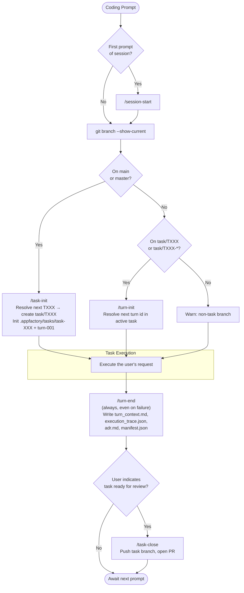

# coding-agents-config

Agentic pipeline configuration for Claude Code. Enforces a task/turn-based workflow with provenance tracking, branch protection, and governance rules, and hosts the App Factory (`af-*`) skill set for DSL-driven application generation.

## Setup

### 1. Clone the repo

```sh
git clone <repo-url> ~/coding-agents-config
```

### 2. Create symlinks (automated)

Run the setup script — it creates all symlinks and backs up any existing files:

```sh
bash scripts/setup.sh
```

<details>
<summary>Manual symlink commands</summary>

```sh
# ~/.claude/
ln -s ~/coding-agents-config/skills ~/.claude/skills
ln -s ~/coding-agents-config/agents ~/.claude/agents
ln -s ~/coding-agents-config/hooks ~/.claude/hooks
ln -s ~/coding-agents-config/scripts ~/.claude/scripts
ln -s ~/coding-agents-config/CLAUDE.md ~/.claude/CLAUDE.md
ln -s ~/coding-agents-config/settings.json ~/.claude/settings.json

# ~/.codex/
ln -s ~/coding-agents-config/agents ~/.codex/agents
ln -s ~/coding-agents-config/AGENTS.md ~/.codex/AGENTS.md

# repo-local ./.claude/
ln -s ~/coding-agents-config/CLAUDE.md ./.claude/CLAUDE.md
```

`rules/`, `context/`, and `plugins/` are also symlinked into `~/.claude/` when present in the repo; they don't currently exist here.

If any of these already exist, back them up first (`mv <target> <target>.bak`).
</details>

### 3. Verify

```sh
ls -la ~/.claude/skills        # should point to ~/coding-agents-config/skills
ls -la ~/.claude/agents        # should point to ~/coding-agents-config/agents
ls -la ~/.claude/hooks         # should point to ~/coding-agents-config/hooks
ls -la ~/.claude/CLAUDE.md     # should point to ~/coding-agents-config/CLAUDE.md
ls -la ~/.claude/settings.json # should point to ~/coding-agents-config/settings.json
```

## Structure

```
coding-agents-config/
├── CLAUDE.md           # Global instructions — task/turn protocol, branch rules
├── AGENTS.md           # Agent loader directive (points Codex at CLAUDE.md)
├── settings.json       # Claude Code settings (model, permissions, hooks)
├── package.json        # npm dependency (caveman) for local tooling
├── hooks/              # Shell hooks triggered by Claude Code events
│   └── branch-guard.sh # Blocks writes while on main/master
├── skills/             # Slash-command skills
│   ├── session-start/  # Load repo state and pipeline context
│   ├── task-init/      # Create task branch + task-001 turn artifacts
│   ├── turn-init/      # Initialize the next turn in the active task
│   ├── turn-end/       # Finalize a turn with trace, ADR, manifest
│   ├── task-close/     # Push task branch and open the pull request
│   ├── branch-guard/   # Create a task branch if on main/master
│   ├── af-*/           # App Factory pipeline skills (PRD, DDD, plan, build, test)
│   └── ...             # Testing/utility skills (see table below)
├── agents/             # Agent definitions (e.g. agent-architecture-planner.md)
├── scripts/            # Automation scripts
│   ├── setup.sh        # Creates the symlinks above
│   └── af-state.sh     # Helper for App Factory pipeline state
├── docs/               # Reference documentation (App Factory plan, migrations, skill summary)
├── archive/            # Retired skills and templates kept for reference
├── .appfactory/        # Task/turn tracking and specs
│   ├── tasks/          # task-XXX dirs, each with turns/turn-XXX
│   ├── tasks_index.csv # Registry of tasks and their status
│   ├── changelog.md    # Pipeline changelog
│   ├── specs/          # Specifications
│   ├── prompts/        # Prompt templates
│   └── memory/         # Project memory (state.yaml)
└── .github/            # GitHub workflow configuration
```

## Execution Flow

The pipeline enforces a two-level task/turn workflow: a **task** is the branch-scoped unit of work that becomes one pull request, and a **turn** is one AI execution cycle within that task.



### Task/Turn Protocol Summary

| Phase | Trigger | Skill | Outputs |
|-------|---------|-------|---------|
| **Session Start** | First prompt of session | `session-start` | Repo state + pipeline context loaded |
| **Task Init** | Branch is `main`/`master` | `task-init` | `task/TXXX` branch, `task_context.md`, `task_status.json`, turn-001 |
| **Turn Init** | Branch is `task/TXXX(-*)` | `turn-init` | Next `turns/turn-XXX/` initialized |
| **Execution** | Every coding prompt | — | Modified files |
| **Turn End** | After every execution, even on failure | `turn-end` | `turn_context.md`, `execution_trace.json`, `adr.md`, `manifest.json` |
| **Task Close** | User signals task is ready for review | `task-close` | Task branch pushed, pull request opened |

Never write code while on `main`/`master`; `branch-guard.sh` (a `PreToolUse` hook on `Bash` in `settings.json`) enforces this.

## Skills

| Category | Skill | Description |
|----------|-------|-------------|
| **Session** | `session-start` | Load repo state and core pipeline context at session start |
| **Task** | `task-init` | Initialize a new task branch and create task + turn-001 artifacts |
| | `task-close` | Finalize the active task branch, push it, and open a pull request against main |
| | `branch-guard` | Create a task-scoped branch if on main/master |
| **Turn** | `turn-init` | Initialize the next turn within the active task branch |
| | `turn-end` | Finalize the active turn after execution (always run, even on failure) |
| **App Factory — PRD/DDD** | `af-be-prd-build` | Build a backend PRD from an intake worksheet or discovery notes |
| | `af-be-ddd-build` | Generate a backend Domain-Driven Design doc from an approved PRD |
| | `af-be-ddd-dsl` | Generate a backend application DSL YAML from the DDD doc |
| | `af-be-ddd-tests` | Generate Gherkin BDD scenarios from DDD + PRD specs |
| | `af-be-ddd-analysis` | Analyze DDD output for the build/analyze/refactor loop |
| | `af-be-ddd-refactor` | Refactor DDD output based on analysis findings |
| | `af-be-ddd-orchestrator` | Orchestrate the backend DDD build → analyze → refactor → test loop |
| **App Factory — Build** | `af-be-plan` | Generate a backend execution plan from a domain DSL + tech stack profile |
| | `af-be-implementation` | Execute backend generation from the plan and BDD specs into the target project |
| | `af-project-init` | Orchestrate AppFactory project initialization (env vars + helper script) |
| | `af-orchestrator` | Orchestrate the full App Factory software development lifecycle |
| | `af-memory` | CRUD operations on `.appfactory/memory/state.yaml` pipeline state |
| | `af-app-check` | Audit an application for production readiness before release/QA/staging |
| **Testing/Utility** | `unit-tests` | Unit test generation/execution helper |
| | `e2e-tests` | End-to-end test generation/execution helper |
| | `ui-utils` | UI-related helper utilities |
| | `dsl-utils` | DSL parsing/authoring helper utilities |
| | `eval-labeler` | Process `Eval.md` files to label and score model response A/B comparisons |

Skills without a populated `SKILL.md` description (`dsl-utils`, `e2e-tests`, `ui-utils`, `unit-tests`) are documented inline in their skill directory.

## Archive

`archive/` holds retired skills and templates kept for reference (e.g. `schema-to-database`, `nestjs-crud-resource`, `code-entity-to-crud`, the old ADR/PR/manifest `templates/` set) — see `archive/README.md` and `archive/SUMMARY.md` for what moved there and why.

## Hooks

| Hook | Trigger | Purpose |
|------|---------|---------|
| `branch-guard.sh` | `PreToolUse` on `Bash` (see `settings.json`) | Blocks writes while on main/master |

## Adding a new skill

Each skill lives in its own directory under `skills/` with a `SKILL.md` file:

```
skills/my-skill/
└── SKILL.md
```

The `.system/skill-creator` meta-skill can guide you through creating one — invoke it from Claude Code.

## Syncing across machines

Since this is a standard git repo, pull on any machine to stay current:

```sh
cd ~/coding-agents-config && git pull
```

The symlinks mean changes are picked up immediately — no reinstall needed.
