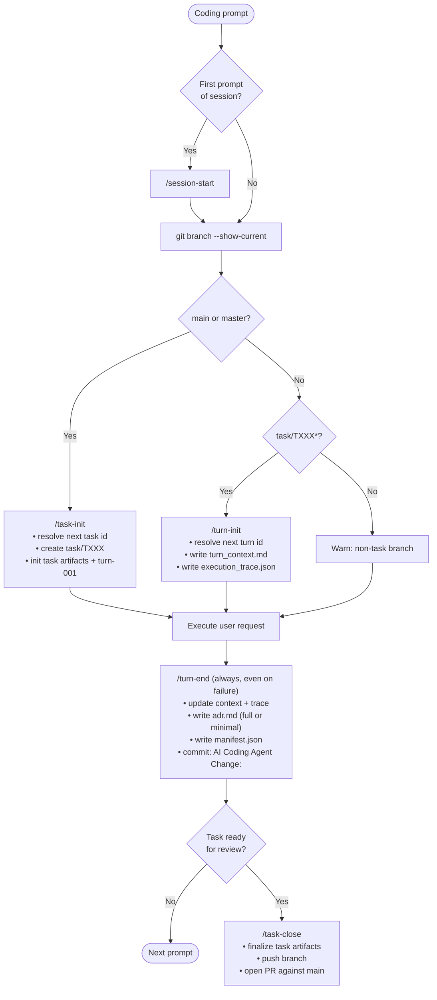

# coding-agents-config

Agentic pipeline configuration for Claude Code (and Codex). Enforces a task/turn workflow with provenance tracking, branch protection, and governance rules, and ships the App Factory (`af-*`) skills for generating backend applications from PRD, DDD, and DSL specs.

## Setup

### 1. Clone the repo

```sh
git clone <repo-url> ~/coding-agents-config
```

### 2. Create symlinks (automated)

Run the setup script — it symlinks the repo into `~/.claude/` (skills, agents, rules, hooks, context, scripts, plugins, `CLAUDE.md`, `settings.json`), `~/.codex/` (agents, `AGENTS.md`), and the repo-local `.claude/`, backing up any existing files as `*.bak`. Targets that don't exist in the repo yet (e.g. `rules`, `context`, `plugins`) are linked as-is:

```sh
bash scripts/setup.sh
```

<details>
<summary>Manual symlink commands</summary>

```sh
ln -s ~/coding-agents-config/skills ~/.claude/skills
ln -s ~/coding-agents-config/agents ~/.claude/agents
ln -s ~/coding-agents-config/hooks ~/.claude/hooks
ln -s ~/coding-agents-config/scripts ~/.claude/scripts
ln -s ~/coding-agents-config/CLAUDE.md ~/.claude/CLAUDE.md
ln -s ~/coding-agents-config/settings.json ~/.claude/settings.json
```

If any of these already exist, back them up first (`mv <target> <target>.bak`).
</details>

### 3. Verify

```sh
ls -la ~/.claude/skills        # should point to ~/coding-agents-config/skills
ls -la ~/.claude/hooks         # should point to ~/coding-agents-config/hooks
ls -la ~/.claude/agents        # should point to ~/coding-agents-config/agents
ls -la ~/.claude/CLAUDE.md     # should point to ~/coding-agents-config/CLAUDE.md
ls -la ~/.claude/settings.json # should point to ~/coding-agents-config/settings.json
```

## Structure

```
coding-agents-config/
├── CLAUDE.md           # Global instructions — task/turn protocol, branch rules
├── AGENTS.md           # Agent loader directive (points at ~/.claude/CLAUDE.md)
├── settings.json       # Claude Code settings (model, permissions, hooks, plugins)
├── agents/             # Subagent definitions
│   └── agent-architecture-planner.md
├── hooks/              # Shell hooks triggered by Claude Code events
│   └── branch-guard.sh # Auto-creates a task branch when on main/master
├── skills/             # Slash-command skills (see below)
│   └── .system/        # Meta-skills (skill-creator, skill-installer, ...)
├── scripts/            # Automation scripts
│   ├── setup.sh        # Symlink installer
│   └── af-state.sh     # AppFactory state.yaml helpers
├── .appfactory/        # Task/turn tracking and specs
│   ├── tasks/          # task-XXX/ with task artifacts and turns/turn-XXX/
│   ├── tasks_index.csv # Registry of tasks and their status
│   ├── specs/          # Specifications
│   ├── prompts/        # Prompt templates
│   └── memory/         # Pipeline state
├── archive/            # Retired skills and legacy turns (see archive/README.md)
├── docs/               # Reference documentation
└── .github/            # PR and issue templates
```

Templates for task and turn artifacts live inside the skills that use them (e.g. `skills/task-init/templates`).

## Execution Flow

Every coding prompt follows the task/turn workflow defined in `CLAUDE.md`. A **task** is a branch-scoped unit of work (`task/TXXX`) that becomes one pull request; a **turn** is one AI execution cycle within that task.



**Hard gate:** no code is written on `main`/`master`. The `branch-guard.sh` hook and `/task-init` enforce this.

### Protocol Summary

| Phase | Trigger | Outputs |
|-------|---------|---------|
| **Session Start** | First prompt of a session | Git state and context loaded |
| **Task Init** | Prompt on `main`/`master` | `task/TXXX` branch, task artifacts, `turn-001`, row in `tasks_index.csv` |
| **Turn Init** | Prompt on `task/TXXX*` | Next `turn-XXX` with `turn_context.md`, `execution_trace.json` |
| **Execution** | Always | Modified files |
| **Turn End** | After every prompt | `adr.md`, `manifest.json`, finalized context and trace, commit |
| **Task Close** | User says task is ready for review | `task_summary.md`, `pull_request.md`, pushed branch, PR |

### Artifacts

Per turn, under `.appfactory/tasks/task-XXX/turns/turn-XXX/`: `turn_context.md`, `execution_trace.json`, `adr.md`, `manifest.json`.

Per task, under `.appfactory/tasks/task-XXX/`: `task_context.md`, `task_status.json`, `task_summary.md`, `pull_request.md`.

Commit messages use the format:

```text
AI Coding Agent Change:
- <imperative bullet>
- <imperative bullet>
```

## Skills

### Workflow

| Skill | Description |
|-------|-------------|
| `session-start` | Load repository state and core pipeline context |
| `task-init` | Create the task branch and task + turn-001 artifacts |
| `task-close` | Finalize the task, push, and open a pull request |
| `turn-init` | Initialize the next turn within the active task |
| `turn-end` | Finalize the turn (ADR, manifest, commit) |
| `branch-guard` | Create a branch if on main/master |

### App Factory (`af-*`)

| Skill | Description |
|-------|-------------|
| `af-orchestrator` | Orchestrate the App Factory SDLC |
| `af-project-init` | Initialize an AppFactory project |
| `af-memory` | Read/write pipeline state in `.appfactory/memory/state.yaml` |
| `af-be-prd-build` | Build a backend PRD |
| `af-be-ddd-build` | Generate a Domain-Driven Design document from a PRD |
| `af-be-ddd-analysis` | Analyze a DDD document |
| `af-be-ddd-refactor` | Refactor a DDD document based on analysis |
| `af-be-ddd-orchestrator` | Run the build → analyze → refactor loop (max 3 tries) and test phases |
| `af-be-ddd-tests` | Generate Gherkin BDD feature files from DDD and PRD |
| `af-be-ddd-dsl` | Generate a backend application DSL YAML from a DDD document |
| `af-be-plan` | Generate an execution plan from a DSL and tech stack profile |
| `af-be-implementation` | Generate the backend from a tech stack implementation |
| `af-app-check` | Audit an application for production readiness |

### Utility

| Skill | Description |
|-------|-------------|
| `dsl-utils` | DSL model interpretation helpers |
| `ui-utils` | UI implementation language helpers |
| `unit-tests` | Test/implementation sync helpers |
| `e2e-tests` | HTTP test artifact helpers |
| `eval-labeler` | Label and evaluate model responses from Eval.md files |

### Meta-Skills (`.system`)

| Skill | Description |
|-------|-------------|
| `skill-creator` | Create new skills with SKILL.md |
| `skill-installer` | Install skills from marketplaces |
| `plugin-creator` | Scaffold plugin directories |
| `imagegen` | Generate or edit raster images |
| `openai-docs` | Look up OpenAI documentation |

Retired skills (e.g. `schema-to-database`, `code-entity-to-crud`, `nestjs-crud-resource`) are kept in `archive/`.

## Agents

| Agent | Purpose |
|-------|---------|
| `agent-architecture-planner` | Reads PRD, DDD, DSL, and repo structure to produce architecture decisions, module maps, and task plans |

## Hooks

| Hook | Trigger | Purpose |
|------|---------|---------|
| `branch-guard.sh` | PreToolUse(Bash) | Auto-create a task branch when on main/master instead of allowing writes |

## Adding a new skill

Each skill lives in its own directory under `skills/` with a `SKILL.md` file:

```
skills/my-skill/
└── SKILL.md
```

The `.system/skill-creator` meta-skill can guide you through creating one — invoke it from Claude Code.

## Syncing across machines

Since this is a standard git repo, pull on any machine to stay current:

```sh
cd ~/coding-agents-config && git pull
```

The symlinks mean changes are picked up immediately — no reinstall needed.
