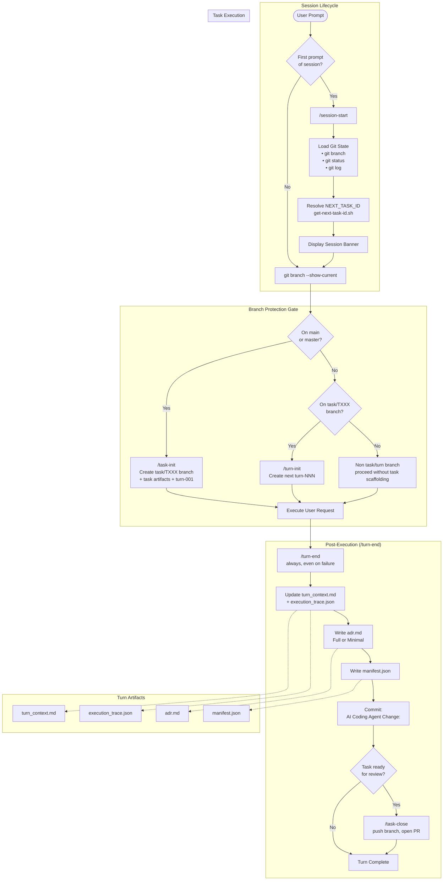

# coding-agents-config

Agentic pipeline configuration for Claude Code. Enforces turn-based workflow with provenance tracking, branch protection, and governance rules.

## Setup

### 1. Clone the repo

```sh
git clone <repo-url> ~/coding-agents-config
```

### 2. Create symlinks (automated)

Run the setup script — it creates all symlinks and backs up any existing files:

```sh
bash scripts/setup.sh
```

The script links `skills`, `agents`, `rules`, `hooks`, `context`, `scripts`,
`plugins`, `CLAUDE.md`, and `settings.json` into `~/.claude/`; links `agents`
and `AGENTS.md` into `~/.codex/`; and links `CLAUDE.md` into a repo-local
`./.claude/`. Only items that exist in this repo are linked today — `rules`,
`context`, `plugins`, and `templates` are reserved for future use.

<details>
<summary>Manual symlink commands</summary>

```sh
ln -s ~/coding-agents-config/skills ~/.claude/skills
ln -s ~/coding-agents-config/agents ~/.claude/agents
ln -s ~/coding-agents-config/hooks ~/.claude/hooks
ln -s ~/coding-agents-config/scripts ~/.claude/scripts
ln -s ~/coding-agents-config/CLAUDE.md ~/.claude/CLAUDE.md
ln -s ~/coding-agents-config/settings.json ~/.claude/settings.json
ln -s ~/coding-agents-config/agents ~/.codex/agents
ln -s ~/coding-agents-config/AGENTS.md ~/.codex/AGENTS.md
```

If any of these already exist, back them up first (`mv <target> <target>.bak`).
</details>

### 3. Verify

```sh
ls -la ~/.claude/skills        # should point to ~/coding-agents-config/skills
ls -la ~/.claude/hooks         # should point to ~/coding-agents-config/hooks
ls -la ~/.claude/agents        # should point to ~/coding-agents-config/agents
ls -la ~/.claude/CLAUDE.md     # should point to ~/coding-agents-config/CLAUDE.md
ls -la ~/.claude/settings.json # should point to ~/coding-agents-config/settings.json
```

## Structure

```
coding-agents-config/
├── CLAUDE.md           # Global instructions — task/turn protocol, branch rules
├── AGENTS.md           # Codex loader directive (reads ~/.claude/CLAUDE.md)
├── settings.json       # Claude Code settings (model, permissions, hooks)
├── package.json        # Node dependency manifest for tooling scripts
├── hooks/              # Shell hooks triggered by Claude Code events
│   └── branch-guard.sh # Auto-creates a task branch when on main/master
├── skills/              # Slash-command skills (see Skills below)
│   ├── .system/          # Vendored meta-skills (skill-creator, skill-installer, ...)
│   ├── session-start/    # Initialize session context
│   ├── task-init/        # Create a new task branch + turn-001 artifacts
│   ├── turn-init/        # Create the next turn directory and artifacts
│   ├── turn-end/         # Finalize a turn with PR, ADR, manifest
│   ├── task-close/       # Push the task branch and open a pull request
│   ├── branch-guard/     # Create a turn branch if on main/master
│   ├── af-*/             # App Factory SDLC pipeline (PRD -> DDD -> plan -> build)
│   ├── dsl-utils/        # DSL parsing/interpretation reference skills
│   ├── e2e-tests/        # End-to-end / HTTP test artifact skills
│   ├── ui-utils/         # UI implementation language reference skills
│   ├── unit-tests/       # Test/implementation sync skills
│   └── eval-labeler/     # Label and score model-response evaluation runs
├── agents/              # Agent definitions
│   └── agent-architecture-planner.md
├── scripts/             # Automation scripts
│   ├── setup.sh          # Creates the symlinks above
│   └── af-state.sh       # AppFactory .appfactory/memory/state.yaml helpers
├── .appfactory/         # Task/turn tracking and specs for this repo
│   ├── tasks/            # Task branches with turns (task-001, task-002, ...)
│   ├── tasks_index.csv   # Registry of tasks and their status
│   ├── specs/            # Specifications
│   ├── prompts/          # Prompt templates used while developing this repo
│   └── memory/           # Project memory
├── docs/                # Reference documentation (migration notes, plans, skill summary)
├── archive/             # Retired skills and templates, kept for reference
└── .github/             # PR/issue templates
```

## Execution Flow

The agentic pipeline enforces a strict task/turn workflow for all coding tasks:



### Task/Turn Protocol Summary

| Phase | Steps | Outputs |
|-------|-------|---------|
| **Session Start** | Load git state → resolve next task id → display banner | Context loaded |
| **Task Init** (on `main`/`master`) | Resolve task id → create `task/TXXX` branch → seed `turn-001` | `task_context.md`, `task_status.json`, turn-001 artifacts |
| **Turn Init** (on `task/TXXX`) | Resolve next turn id → create turn dir → write context + trace | `turn_context.md`, `execution_trace.json` |
| **Execution** | Execute the user's request | Modified files |
| **Turn End** | Update context → write ADR → write manifest → commit | `adr.md`, `manifest.json`, commit |
| **Task Close** (on request) | Push branch → open pull request → update registry | PR opened, `tasks_index.csv` updated |

## Skills

Skills live under `skills/`, one directory per skill with a `SKILL.md` file (Claude Code picks these up once `skills/` is symlinked into `~/.claude/skills`).

| Category | Skill | Description |
|----------|-------|--------------|
| **Session** | `session-start` | Load repository state and core pipeline context at the start of every session |
| **Task/Turn lifecycle** | `task-init` | Initialize a new task branch and create task + turn-001 artifacts (run when on `main`/`master`) |
| | `turn-init` | Initialize the next turn within the active task branch |
| | `turn-end` | Finalize the active turn after execution, even on failure |
| | `task-close` | Finalize the active task branch, push it, and open a pull request against `main` |
| | `branch-guard` | Check the current branch and create a turn-scoped branch if on `main`/`master` |
| **App Factory SDLC** | `af-orchestrator` | Orchestrate the App Factory software development lifecycle end to end |
| | `af-project-init` | Orchestrate AppFactory project initialization (env vars + helper script) |
| | `af-memory` | CRUD operations for AppFactory pipeline state (`.appfactory/memory/state.yaml`) |
| | `af-be-prd-build` | Build a backend-focused PRD from a completed PRD intake worksheet |
| | `af-be-ddd-build` | Generate a backend Domain-Driven Design document from an approved PRD |
| | `af-be-ddd-analysis` | Audit a generated DDD spec for quality, completeness, and PRD alignment |
| | `af-be-ddd-refactor` | Apply targeted patches to a DDD spec based on `af-be-ddd-analysis` findings |
| | `af-be-ddd-dsl` | Generate a backend DSL YAML document from a DDD document |
| | `af-be-ddd-tests` | Generate Gherkin BDD scenarios from DDD and PRD specifications |
| | `af-be-ddd-orchestrator` | Orchestrate the DDD build → analyze → refactor → test loop |
| | `af-be-plan` | Generate a backend execution plan from a domain DSL and tech stack profile |
| | `af-be-implementation` | Execute backend code generation from the execution plan and BDD specs |
| | `af-app-check` | Audit an application for production readiness (security, DB, deployment, code quality) |
| **DSL / Test / UI utilities** | `dsl-utils` (`dsl-model-interpreter`) | Parse and validate `app-dsl` YAML specifications |
| | `e2e-tests` (`http-test-artifacts`) | Generate `.http` request files for API endpoint testing |
| | `ui-utils` (`ui-implementation-language`) | Declarative YAML language for UI pages, widgets, forms, and API bindings |
| | `unit-tests` (`test-implementation-sync`) | Keep generated unit tests synchronized with actual implementations |
| **Evaluation** | `eval-labeler` | Process `Eval.md` files to label and score Response A vs Response B model outputs |

### Meta-skills (`.system/`)

Vendored, tool-agnostic meta-skills (some reference Codex rather than Claude Code by name):

| Skill | Description |
|-------|--------------|
| `skill-creator` | Guide for creating and updating skills |
| `skill-installer` | Install skills into `$CODEX_HOME/skills` from a curated list or GitHub repo |
| `plugin-creator` | Scaffold plugin directories and marketplace entries |
| `imagegen` | Generate or edit raster image assets |
| `openai-docs` | Look up official OpenAI API/model documentation |

## Templates

Templates now live alongside the skill that owns them (for example
`skills/af-be-prd-build/templates/prd-template.md`,
`skills/task-init/templates/`, `skills/turn-init/templates/`) rather than in a
shared top-level `templates/` directory. The previous shared template set —
`adr_template.md`, `pull_request_template.md`, `manifest.schema.json`,
`metadata_header.txt`, `branch_naming.md`, `commit_message.md`,
`tech-stack.template.md` — has moved to `archive/templates/` for reference.

## Hooks

| Hook | Trigger | Purpose |
|------|---------|---------|
| `branch-guard.sh` | `PreToolUse` (Bash) | Auto-creates a `task/TXXX` branch when the current branch is `main`/`master` |

## Adding a new skill

Each skill lives in its own directory under `skills/` with a `SKILL.md` file:

```
skills/my-skill/
└── SKILL.md
```

The `.system/skill-creator` meta-skill can guide you through creating one — invoke it from Claude Code.

## Syncing across machines

Since this is a standard git repo, pull on any machine to stay current:

```sh
cd ~/coding-agents-config && git pull
```

The symlinks mean changes are picked up immediately — no reinstall needed.
</content>
