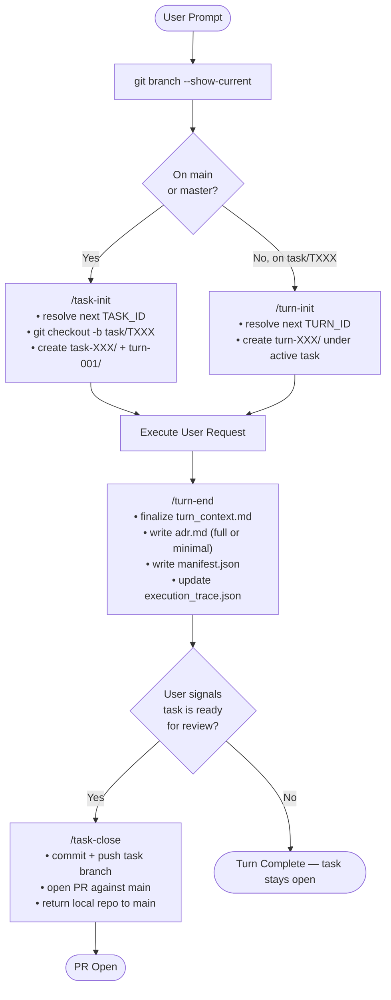

# coding-agents-config

Agentic pipeline configuration for Claude Code and Codex. Provides the **App Factory** — a set of skills and agents that run an AI-augmented software development lifecycle (PRD → DDD → BDD tests → plan → implementation) — plus a task/turn governance layer that enforces branch protection, provenance tracking, and audit artifacts for every coding session.

## Setup

### 1. Clone the repo

```sh
git clone <repo-url> ~/coding-agents-config
```

### 2. Create symlinks (automated)

Run the setup script — it creates all symlinks and backs up any existing files:

```sh
bash scripts/setup.sh
```

<details>
<summary>Manual symlink commands</summary>

```sh
# Claude Code (~/.claude/)
ln -s ~/coding-agents-config/skills   ~/.claude/skills
ln -s ~/coding-agents-config/agents   ~/.claude/agents
ln -s ~/coding-agents-config/hooks    ~/.claude/hooks
ln -s ~/coding-agents-config/scripts  ~/.claude/scripts
ln -s ~/coding-agents-config/CLAUDE.md    ~/.claude/CLAUDE.md
ln -s ~/coding-agents-config/settings.json ~/.claude/settings.json

# Codex (~/.codex/)
ln -s ~/coding-agents-config/agents   ~/.codex/agents
ln -s ~/coding-agents-config/AGENTS.md ~/.codex/AGENTS.md
```

If any of these already exist, back them up first (`mv <target> <target>.bak`). `scripts/setup.sh` also links `rules/`, `context/`, and `plugins/` into `~/.claude/` when those directories are present in the repo.
</details>

### 3. Verify

```sh
ls -la ~/.claude/skills        # should point to ~/coding-agents-config/skills
ls -la ~/.claude/hooks         # should point to ~/coding-agents-config/hooks
ls -la ~/.claude/CLAUDE.md     # should point to ~/coding-agents-config/CLAUDE.md
ls -la ~/.claude/settings.json # should point to ~/coding-agents-config/settings.json
ls -la ~/.codex/AGENTS.md      # should point to ~/coding-agents-config/AGENTS.md
```

## Structure

```
coding-agents-config/
├── CLAUDE.md            # Global instructions — task/turn protocol, branch rules, ADR requirement
├── AGENTS.md            # Codex loader directive (reads ~/.claude/CLAUDE.md)
├── settings.json        # Claude Code settings (model, permissions, hooks, plugins)
├── package.json         # Marketplace plugin dependency (caveman)
├── hooks/
│   └── branch-guard.sh  # PreToolUse hook — auto-creates a task/TXXX branch when on main/master
├── skills/              # Slash-command skills (see tables below)
├── agents/
│   └── agent-architecture-planner.md
├── scripts/
│   ├── setup.sh          # Creates the symlinks above
│   └── af-state.sh       # Bash helpers for reading/writing .appfactory/memory/state.yml
├── docs/                 # Reference and migration docs for the App Factory pipeline
├── archive/              # Retired skills and templates kept for reference (see archive/README.md)
│   └── templates/        # Legacy ADR/PR/manifest/commit-message templates
└── .appfactory/          # Task/turn tracking, specs, prompts, and pipeline memory
    ├── tasks/            # task-XXX/ directories, each with turns/turn-XXX/
    ├── tasks_index.csv   # Registry of all tasks (branch, status, PR url, turn count)
    ├── specs/            # Generated PRD/DDD/BDD specification artifacts
    ├── prompts/          # Prompt templates used by af-* skills
    └── memory/           # state.yml — cross-skill pipeline state
```

## Execution Flow

Every coding prompt runs through a task/turn protocol defined in `CLAUDE.md`:



`hooks/branch-guard.sh` is a `PreToolUse` safety net: if a Write/Edit/Bash tool call is attempted while still on `main`/`master`, it auto-creates the next `task/TXXX` branch before the tool runs, backing up the skill-driven flow above.

### Turn Protocol Summary

| Phase | Skill | Trigger | Outputs |
|-------|-------|---------|---------|
| **Session Start** | `session-start` | First prompt of the session | Git state + pipeline context loaded |
| **Task Init** | `task-init` | Current branch is `main`/`master` | `task/TXXX` branch, `task-XXX/` + `turn-001/` artifacts |
| **Turn Init** | `turn-init` | Current branch is `task/TXXX` | Next `turn-XXX/` directory + `turn_context.md`, `execution_trace.json` |
| **Turn End** | `turn-end` | After every coding prompt, even on failure | `adr.md`, `manifest.json`, updated `turn_context.md`/`execution_trace.json` |
| **Task Close** | `task-close` | User indicates the task is ready for review | Commit, push, PR against `main`, `tasks_index.csv` updated |

## Skills (24)

### Pipeline Governance

| Skill | Description |
|-------|-------------|
| `session-start` | Load repository state and core pipeline context at the start of a session. |
| `task-init` | Initialize a new task branch (`task/TXXX`) and create task + `turn-001` artifacts. Runs when on `main`/`master`. |
| `turn-init` | Initialize the next turn within the active task branch. Runs when already on a `task/TXXX` branch. |
| `turn-end` | Finalize the active turn after execution — writes the ADR and manifest. Runs after every coding prompt. |
| `task-close` | Finalize the active task branch, push it, and open a pull request against `main`. |
| `branch-guard` | Legacy branch guard that creates a `turn/T<ID>` branch off `main`/`master`; superseded by `task-init` but kept for compatibility. |

### App Factory SDLC (`af-*`)

| Skill | Description |
|-------|-------------|
| `af-orchestrator` | Orchestrates the full App Factory SDLC: project init → PRD → DDD → tests → plan → implementation → acceptance testing. |
| `af-project-init` | Orchestrates AppFactory project initialization by exporting required environment variables and invoking the init script. |
| `af-be-prd-build` | Builds a business-facing backend PRD from a completed intake worksheet or discovery notes. |
| `af-be-ddd-build` | Generates a backend Domain-Driven Design document from an approved PRD, following `ddd-template.md`. |
| `af-be-ddd-analysis` | Audits a generated DDD spec for quality, completeness, and PRD alignment; reports gaps and risks. |
| `af-be-ddd-refactor` | Applies targeted patches to a DDD spec using the findings from `af-be-ddd-analysis`. |
| `af-be-ddd-orchestrator` | Orchestrates the DDD build → analyze → refactor loop → test phases. |
| `af-be-ddd-tests` | Generates Gherkin-style BDD feature files from the DDD and PRD, organized by aggregate/bounded context. |
| `af-be-plan` | Generates a step-by-step backend execution plan from a domain DSL and a selected tech-stack profile. |
| `af-be-implementation` | Copies the selected tech-stack implementation into the target project and generates domain code from the plan + BDD features. |
| `af-memory` | CRUD operations over `.appfactory/memory/state.yml` for tracking pipeline progress and context across `af-*` skills (backed by `scripts/af-state.sh`). |

### Quality & Ops

| Skill | Description |
|-------|-------------|
| `af-app-check` | Audits an application for production readiness across security, database, deployment, and code quality — run before release or handoff to QA/staging/production. |
| `eval-labeler` | Processes `Eval.md` files to generate structured notes and labeled results when comparing two model responses on coding tasks. |

### Utility (stubs — no `SKILL.md` yet)

| Skill | Notes |
|-------|-------|
| `dsl-utils` | Placeholder for shared DSL parsing/validation helpers. |
| `e2e-tests` | Placeholder for end-to-end test scaffolding. |
| `ui-utils` | Placeholder for shared UI generation helpers. |
| `unit-tests` | Placeholder for unit test scaffolding. |

## Archive

`archive/` holds skills and templates retired from the active pipeline (legacy DSL-driven CRUD scaffolding, the original `templates/` directory, and `legacy-turns/`). See `archive/README.md` and `archive/SUMMARY.md` for the taxonomy and rationale before reviving anything from it.

## Adding a new skill

Each skill lives in its own directory under `skills/` with a `SKILL.md` file:

```
skills/my-skill/
└── SKILL.md
```

Use one of the existing `af-*` skills as a template for frontmatter (`name`, `description`, optional `triggers`/`allowed-tools`/`input-hints`/`output-artifacts`).

## Syncing across machines

Since this is a standard git repo, pull on any machine to stay current:

```sh
cd ~/coding-agents-config && git pull
```

The symlinks mean changes are picked up immediately — no reinstall needed.
