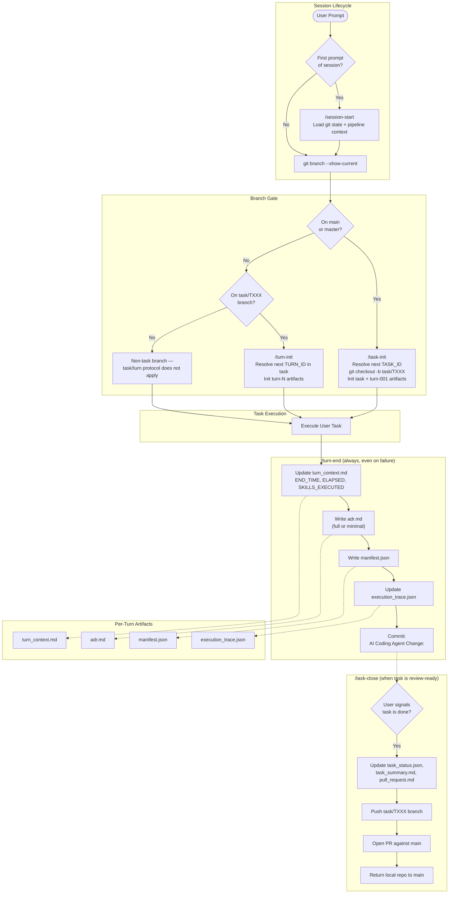

# coding-agents-config

Shared configuration for AI coding agents (Claude Code, Codex). Provides two things:

1. **Task/turn governance pipeline** — branch protection, provenance tracking, and required artifacts (ADR, execution trace, manifest, PR) for every coding session, enforced via `CLAUDE.md` and the governance skills.
2. **App Factory (`af-*`) skill set** — an AI-augmented backend SDLC: PRD → Domain-Driven Design → BDD test scenarios → execution plan → code generation → production-readiness audit.

## Setup

### 1. Clone the repo

```sh
git clone <repo-url> ~/coding-agents-config
```

### 2. Create symlinks (automated)

Run the setup script — it creates all symlinks and backs up any existing files:

```sh
bash scripts/setup.sh
```

<details>
<summary>Manual symlink commands</summary>

```sh
# ~/.claude/
ln -s ~/coding-agents-config/skills ~/.claude/skills
ln -s ~/coding-agents-config/agents ~/.claude/agents
ln -s ~/coding-agents-config/rules ~/.claude/rules
ln -s ~/coding-agents-config/hooks ~/.claude/hooks
ln -s ~/coding-agents-config/context ~/.claude/context
ln -s ~/coding-agents-config/scripts ~/.claude/scripts
ln -s ~/coding-agents-config/plugins ~/.claude/plugins
ln -s ~/coding-agents-config/CLAUDE.md ~/.claude/CLAUDE.md
ln -s ~/coding-agents-config/settings.json ~/.claude/settings.json

# ~/.codex/
ln -s ~/coding-agents-config/agents ~/.codex/agents
ln -s ~/coding-agents-config/AGENTS.md ~/.codex/AGENTS.md

# repo-local ./.claude/
ln -s ~/coding-agents-config/CLAUDE.md ./.claude/CLAUDE.md
```

`rules/`, `context/`, and `plugins/` are reserved targets in `scripts/setup.sh` — they aren't populated in this repo yet, so those symlinks may be dangling until content is added.

If any target already exists, back it up first (`mv <target> <target>.bak`); `scripts/setup.sh` does this automatically.
</details>

### 3. Verify

```sh
ls -la ~/.claude/skills        # should point to ~/coding-agents-config/skills
ls -la ~/.claude/agents        # should point to ~/coding-agents-config/agents
ls -la ~/.claude/hooks         # should point to ~/coding-agents-config/hooks
ls -la ~/.claude/CLAUDE.md     # should point to ~/coding-agents-config/CLAUDE.md
ls -la ~/.claude/settings.json # should point to ~/coding-agents-config/settings.json
ls -la ~/.codex/AGENTS.md      # should point to ~/coding-agents-config/AGENTS.md
```

## Structure

```
coding-agents-config/
├── CLAUDE.md            # Global instructions — task/turn protocol, branch rules
├── AGENTS.md            # Codex loader directive (reads ~/.claude/CLAUDE.md)
├── settings.json         # Claude Code settings (model, permissions, hooks, plugins)
├── package.json          # Marketplace/plugin dependency manifest
├── hooks/                # Shell hooks triggered by Claude Code events
│   └── branch-guard.sh   # PreToolUse hook — auto-creates a task/TXXX branch off main/master
├── skills/                # Slash-command skills (24 top-level entries)
│   ├── .system/           # Meta-skills (skill-creator, skill-installer, plugin-creator, ...)
│   ├── .nestjs/            # Reference NestJS scaffolding resources (not standalone skills)
│   ├── session-start/     # Load repo state + pipeline context at session start
│   ├── task-init/         # Create task/TXXX branch + turn-001 artifacts (run on main/master)
│   ├── turn-init/         # Create the next turn inside the active task branch
│   ├── turn-end/          # Finalize a turn: ADR, manifest, execution trace
│   ├── task-close/        # Push the task branch and open a PR against main
│   ├── branch-guard/      # Legacy/alternate guard — creates a turn-scoped branch if on main
│   ├── af-orchestrator/   # Orchestrates the App Factory SDLC end to end
│   ├── af-project-init/   # Initialize an AppFactory project (env vars + helper script)
│   ├── af-be-prd-build/   # Build a backend PRD from an intake worksheet
│   ├── af-be-ddd-build/   # Generate a backend DDD doc from an approved PRD
│   ├── af-be-ddd-analysis/ # Audit a DDD doc for quality/completeness
│   ├── af-be-ddd-refactor/ # Apply DDD analysis findings back into the DDD doc
│   ├── af-be-ddd-dsl/     # Generate a backend domain DSL YAML from a DDD doc
│   ├── af-be-ddd-tests/   # Generate Gherkin BDD scenarios from DDD + PRD
│   ├── af-be-ddd-orchestrator/ # Run the DDD build/analyze/refactor/test loop
│   ├── af-be-plan/        # Generate a backend execution plan from DSL + tech stack profile
│   ├── af-be-implementation/ # Generate backend source code from the plan + BDD specs
│   ├── af-app-check/      # Audit an app for production readiness
│   ├── af-memory/         # CRUD for AppFactory pipeline state (state.yaml)
│   ├── eval-labeler/      # Label/score model-response evaluations (Response A vs B)
│   ├── dsl-utils/         # Reference: dsl-model-interpreter resources
│   ├── e2e-tests/          # Reference: http-test-artifacts resources
│   ├── ui-utils/           # Reference: ui-implementation-language resources
│   └── unit-tests/         # Reference: test-implementation-sync resources
├── agents/                # Agent definitions
│   └── agent-architecture-planner.md
├── scripts/                # Automation scripts
│   ├── setup.sh            # Creates symlinks into ~/.claude, ~/.codex, ./.claude
│   └── af-state.sh         # AppFactory state helper
├── .appfactory/            # Task/turn tracking, specs, prompts, memory
│   ├── tasks/               # task-XXX/ directories, each with turns/turn-XXX/
│   ├── tasks_index.csv      # Registry of all tasks and their status
│   ├── changelog.md         # Reconstructed history of what each past turn changed
│   ├── specs/                # Specifications
│   ├── prompts/              # Saved prompt drafts and templates
│   └── memory/                # Project memory
├── docs/                   # Reference documentation (migration notes, plans, skill summary)
└── archive/                 # Retired skills, templates, and docs kept for reference
    ├── templates/            # Former templates/ dir (adr, PR, manifest schema, etc.)
    └── ...                   # Superseded skills (schema-to-database, shadcn, prisma-*, ...)
```

## Execution Flow

The pipeline enforces a two-tier **task → turn** workflow. A task is the branch-scoped unit of work that becomes one pull request; a turn is one AI execution cycle within that task branch.



### Task/Turn Protocol Summary

| Phase | Skill | Trigger | Outputs |
|-------|-------|---------|---------|
| **Session Start** | `session-start` | First prompt of session | Git state + context loaded |
| **Task Init** | `task-init` | Branch is `main`/`master` | `task/TXXX` branch, task artifacts, `turn-001` |
| **Turn Init** | `turn-init` | Already on `task/TXXX` | Next `turn-XXX` directory + artifacts |
| **Execution** | — | Every coding prompt | Modified files |
| **Turn End** | `turn-end` | After every prompt, even on failure | `adr.md`, `manifest.json`, updated trace/context |
| **Task Close** | `task-close` | User signals task is review-ready | Pushed branch, PR against `main`, task returned to `main` |

`hooks/branch-guard.sh` (registered as a `PreToolUse` hook in `settings.json`) is a safety net: if a write/bash tool runs while still on `main`/`master`, it auto-creates the next `task/TXXX` branch before the tool executes.

## Skills (24)

### Governance / Pipeline Lifecycle

| Skill | Description |
|-------|-------------|
| `session-start` | Load repository state and core pipeline context at the start of a session |
| `task-init` | Initialize a new `task/TXXX` branch and create task + `turn-001` artifacts (run on `main`/`master`) |
| `turn-init` | Initialize the next turn within the active task branch |
| `turn-end` | Finalize the active turn — ADR, manifest, execution trace (run after every prompt) |
| `task-close` | Finalize the active task branch, push it, and open a PR against `main` |
| `branch-guard` | Alternate guard — creates a turn-scoped branch if invoked while on `main`/`master` |

### App Factory (`af-*`) — Backend SDLC

| Skill | Description |
|-------|-------------|
| `af-orchestrator` | Orchestrates the App Factory SDLC end to end |
| `af-project-init` | Orchestrate AppFactory project initialization (env vars + helper script) |
| `af-be-prd-build` | Build a business-facing backend PRD from an intake worksheet |
| `af-be-ddd-build` | Generate a backend Domain-Driven Design document from an approved PRD |
| `af-be-ddd-analysis` | Audit a generated DDD document for quality, completeness, and PRD alignment |
| `af-be-ddd-refactor` | Apply `af-be-ddd-analysis` findings back into the DDD document |
| `af-be-ddd-dsl` | Generate a backend domain DSL YAML from a DDD document |
| `af-be-ddd-tests` | Generate Gherkin BDD feature files from DDD + PRD specifications |
| `af-be-ddd-orchestrator` | Orchestrate the DDD build → analyze → refactor → test loop |
| `af-be-plan` | Generate a backend execution plan from a domain DSL + tech stack profile |
| `af-be-implementation` | Generate backend source code from the execution plan + BDD feature specs |
| `af-app-check` | Audit an application for production readiness (security, DB, deployment, code quality) |
| `af-memory` | CRUD operations for AppFactory pipeline state (`state.yaml`) |

### Utility

| Skill | Description |
|-------|-------------|
| `eval-labeler` | Label/score model-response evaluations (Response A vs. B) from `Eval.md` files |

### Reference resource collections

`dsl-utils/`, `e2e-tests/`, `ui-utils/`, and `unit-tests/` hold supporting resources (`dsl-model-interpreter`, `http-test-artifacts`, `ui-implementation-language`, `test-implementation-sync`) rather than a top-level `SKILL.md` — they aren't directly invocable skills, and are used as reference material by other skills and agents.

### Meta-Skills (`.system/`)

| Skill | Description |
|-------|-------------|
| `skill-creator` | Create new skills with a `SKILL.md` |
| `skill-installer` | Install skills from marketplaces |
| `plugin-creator` | Scaffold new Claude Code plugins |
| `imagegen` | Image generation helper |
| `openai-docs` | OpenAI API reference lookup |

## Templates

The former `templates/` directory (`adr_template.md`, `pull_request_template.md`, `manifest.schema.json`, `metadata_header.txt`, `branch_naming.md`, `commit_message.md`, `tech-stack.template.md`) has been superseded by inline generation inside the `task-init`/`turn-init`/`turn-end`/`task-close` skill instructions, and is kept for reference under `archive/templates/`.

## Hooks

| Hook | Trigger | Purpose |
|------|---------|---------|
| `branch-guard.sh` | `PreToolUse` (Write/Edit/Bash) | Auto-create and switch to the next `task/TXXX` branch when a tool call is about to run on `main`/`master` |

## Adding a new skill

Each skill lives in its own directory under `skills/` with a `SKILL.md` file:

```
skills/my-skill/
└── SKILL.md
```

The `.system/skill-creator` meta-skill can guide you through creating one — invoke it from Claude Code.

## Archive

`archive/` holds retired skills, templates, and docs kept for reference (legacy scaffolds like `schema-to-database`, `nestjs-crud-resource`, `shadcn`, `prisma-*`, and the former `templates/` directory). See `archive/README.md` and `archive/SUMMARY.md` for details.

## Syncing across machines

Since this is a standard git repo, pull on any machine to stay current:

```sh
cd ~/coding-agents-config && git pull
```

The symlinks mean changes are picked up immediately — no reinstall needed.
