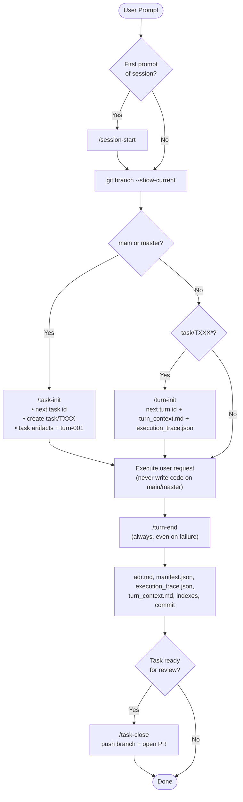

# coding-agents-config

Agentic pipeline configuration for Claude Code. Enforces a task/turn workflow with provenance tracking, branch protection, and governance rules, and bundles the App Factory (`af-*`) skills.

## Setup

### 1. Clone the repo

```sh
git clone <repo-url> ~/coding-agents-config
```

### 2. Create symlinks (automated)

Run the setup script — it creates all symlinks and backs up any existing files. It links the repo into `~/.claude/` (and `agents`/`AGENTS.md` into `~/.codex/`):

```sh
bash scripts/setup.sh
```

<details>
<summary>Manual symlink commands</summary>

```sh
ln -s ~/coding-agents-config/skills ~/.claude/skills
ln -s ~/coding-agents-config/agents ~/.claude/agents
ln -s ~/coding-agents-config/hooks ~/.claude/hooks
ln -s ~/coding-agents-config/scripts ~/.claude/scripts
ln -s ~/coding-agents-config/CLAUDE.md ~/.claude/CLAUDE.md
ln -s ~/coding-agents-config/settings.json ~/.claude/settings.json
```

If any of these already exist, back them up first (`mv <target> <target>.bak`).
</details>

### 3. Verify

```sh
ls -la ~/.claude/skills        # should point to ~/coding-agents-config/skills
ls -la ~/.claude/hooks         # should point to ~/coding-agents-config/hooks
ls -la ~/.claude/agents        # should point to ~/coding-agents-config/agents
ls -la ~/.claude/CLAUDE.md     # should point to ~/coding-agents-config/CLAUDE.md
ls -la ~/.claude/settings.json # should point to ~/coding-agents-config/settings.json
```

## Structure

```
coding-agents-config/
├── CLAUDE.md           # Global instructions — task/turn protocol, branch rules
├── AGENTS.md           # Agent loader directive
├── settings.json       # Claude Code settings (model, permissions, hooks)
├── agents/             # Subagent definitions
│   └── agent-architecture-planner.md
├── hooks/
│   └── branch-guard.sh # Prevents writes on main/master
├── skills/             # Slash-command skills (see below)
│   └── .system/        # Meta-skills (skill-creator, skill-installer, ...)
├── scripts/
│   ├── setup.sh        # Creates symlinks into ~/.claude and ~/.codex
│   └── af-state.sh     # AppFactory state.yaml helpers used by af-* skills
├── .appfactory/        # Task/turn tracking and specs
│   ├── tasks/          # task-XXX/ with turns/turn-XXX/
│   ├── tasks_index.csv # Registry of tasks
│   ├── specs/
│   ├── prompts/
│   ├── memory/
│   └── changelog.md
├── docs/               # Reference documentation
├── archive/            # Retired skills, templates, and legacy turns
└── .github/            # PR and issue templates
```

## Execution Flow

Every coding prompt runs inside a **task** (one branch, one pull request) made of **turns** (one AI execution cycle each). Task ids are global (`001`, `002`, ...); turn ids reset per task.



### Protocol Summary

| Phase | Trigger | Outputs |
|-------|---------|---------|
| **Session Start** | First prompt of a session | Git state and context loaded |
| **Task Init** | Branch is `main`/`master` | `task/TXXX` branch, task artifacts, `turn-001`, row in `tasks_index.csv` |
| **Turn Init** | Branch is `task/TXXX*` | `turn_context.md`, `execution_trace.json` for the next turn |
| **Execution** | Always | Requested changes (never on `main`/`master`) |
| **Turn End** | After every prompt | `adr.md`, `manifest.json`, updated context/trace, commit |
| **Task Close** | User says task is ready | Push + pull request against `main` |

### Artifacts

Per task (`.appfactory/tasks/task-XXX/`): `task_context.md`, `task_status.json`, `task_summary.md`, `pull_request.md`.

Per turn (`.appfactory/tasks/task-XXX/turns/turn-XXX/`): `turn_context.md`, `execution_trace.json`, `adr.md`, `manifest.json`.

Commits use the format:

```text
AI Coding Agent Change:
- <imperative bullet>
- <imperative bullet>
```

## Skills

### Pipeline skills

| Skill | Description |
|-------|-------------|
| `session-start` | Load repository state and core pipeline context |
| `task-init` | Create task branch plus task and `turn-001` artifacts |
| `turn-init` | Initialize the next turn within the active task |
| `turn-end` | Finalize the turn (ADR, manifest, trace, commit) |
| `task-close` | Push the task branch and open a pull request |
| `branch-guard` | Create a turn-scoped branch if on main/master |

### App Factory skills (`af-*`)

| Skill | Description |
|-------|-------------|
| `af-orchestrator` | Orchestrate the App Factory SDLC |
| `af-project-init` | Initialize a project and export required environment variables |
| `af-memory` | CRUD for pipeline state in `.appfactory/memory/state.yaml` |
| `af-be-prd-build` | Build a backend Product Requirements Document |
| `af-be-ddd-build` | Generate a Domain-Driven Design document from a PRD |
| `af-be-ddd-analysis` | Analyze the DDD document |
| `af-be-ddd-refactor` | Refactor the DDD document from analysis findings |
| `af-be-ddd-orchestrator` | Run the build → analyze → refactor loop, then tests |
| `af-be-ddd-tests` | Generate Gherkin BDD scenarios from DDD and PRD |
| `af-be-ddd-dsl` | Generate a backend application DSL YAML from the DDD |
| `af-be-plan` | Generate a backend execution plan from DSL and tech stack profile |
| `af-be-implementation` | Generate the backend from a tech stack implementation |
| `af-app-check` | Audit production readiness (security, DB, deployment, quality) |

### Utility skills

| Skill | Description |
|-------|-------------|
| `dsl-utils` | DSL model interpreter helpers |
| `ui-utils` | UI implementation language helpers |
| `unit-tests` | Test/implementation sync helpers |
| `e2e-tests` | HTTP test artifacts |
| `eval-labeler` | Label model response evaluations from `Eval.md` files |

### Meta-skills (`skills/.system`)

`skill-creator`, `skill-installer`, `plugin-creator`, `imagegen`, `openai-docs`.

Retired skills (e.g. `schema-to-database`, `nestjs-crud-resource`, `shadcn`) live in `archive/`.

## Hooks

| Hook | Trigger | Purpose |
|------|---------|---------|
| `branch-guard.sh` | PreToolUse(Bash) | Block writes on main/master |

## Adding a new skill

Each skill lives in its own directory under `skills/` with a `SKILL.md` file:

```
skills/my-skill/
└── SKILL.md
```

The `.system/skill-creator` meta-skill can guide you through creating one — invoke it from Claude Code.

## Syncing across machines

Since this is a standard git repo, pull on any machine to stay current:

```sh
cd ~/coding-agents-config && git pull
```

The symlinks mean changes are picked up immediately — no reinstall needed.
