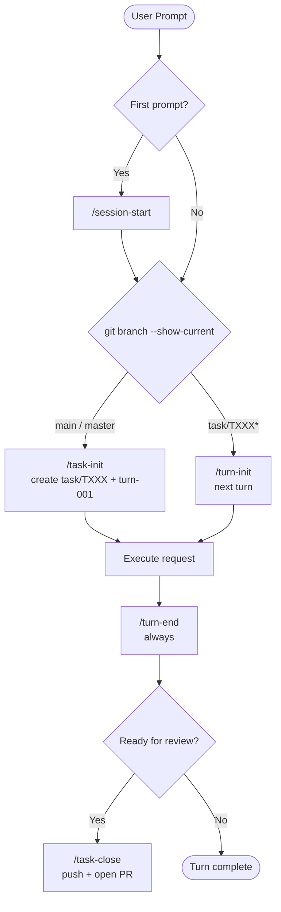

# coding-agents-config

Agentic pipeline configuration for Claude Code (and Codex). Enforces a task/turn workflow with provenance tracking, branch protection, and governance rules, and ships the App Factory (`af-*`) skills for DDD-driven backend generation.

## Setup

### 1. Clone the repo

```sh
git clone <repo-url> ~/coding-agents-config
```

### 2. Create symlinks (automated)

Run the setup script — it symlinks into `~/.claude/` and `~/.codex/` (items missing from the repo are skipped) and backs up any existing files to `*.bak`:

```sh
bash scripts/setup.sh
```

<details>
<summary>Manual symlink commands</summary>

```sh
for item in skills agents rules hooks context scripts plugins CLAUDE.md settings.json; do
  [ -e ~/coding-agents-config/$item ] && ln -s ~/coding-agents-config/$item ~/.claude/$item
done
# Codex
ln -s ~/coding-agents-config/agents ~/.codex/agents
ln -s ~/coding-agents-config/AGENTS.md ~/.codex/AGENTS.md
```

If any of these already exist, back them up first (`mv <target> <target>.bak`).
</details>

### 3. Verify

```sh
ls -la ~/.claude/skills        # should point to ~/coding-agents-config/skills
ls -la ~/.claude/hooks         # should point to ~/coding-agents-config/hooks
ls -la ~/.claude/agents        # should point to ~/coding-agents-config/agents
ls -la ~/.claude/CLAUDE.md     # should point to ~/coding-agents-config/CLAUDE.md
ls -la ~/.claude/settings.json # should point to ~/coding-agents-config/settings.json
```

## Structure

```
coding-agents-config/
├── CLAUDE.md           # Global instructions — task/turn protocol, branch rules
├── AGENTS.md           # Codex loader directive (loads ~/.claude/CLAUDE.md)
├── settings.json       # Claude Code settings (model, permissions, hooks, plugins)
├── agents/             # Subagent definitions
│   └── agent-architecture-planner.md
├── hooks/
│   └── branch-guard.sh # Auto-creates a task branch when editing on main/master
├── skills/             # Slash-command skills (see below)
├── scripts/
│   ├── setup.sh        # Symlink installer
│   └── af-state.sh     # Helpers for .appfactory/memory/state.yaml
├── .appfactory/        # Task/turn tracking and specs
│   ├── tasks/          # task-XXX/ with turns/turn-XXX/
│   ├── tasks_index.csv # Registry of tasks
│   ├── specs/          # Specifications
│   ├── prompts/        # Prompt templates
│   ├── memory/         # Pipeline state (state.yaml)
│   └── changelog.md
├── .github/            # PR template and issue templates (bug, epic, task)
├── archive/            # Retired skills and legacy turns
└── docs/               # Reference documentation
```

## Task and Turn Model

- A **task** is the branch-scoped unit of work that becomes one pull request. Branch format: `task/TXXX`.
- A **turn** is one AI execution cycle within the active task branch. Turn ids reset per task.
- Ids are zero-padded to 3 digits (`001`, `002`, ...).
- Never write code or commit on `main`/`master`.

Per coding prompt (see `CLAUDE.md` for the authoritative rules):

1. First prompt of the session: `/session-start`
2. Check the branch (`git branch --show-current`)
3. On `main`/`master`: `/task-init` (resolve next task id, create `task/TXXX`, initialize `turn-001`)
4. On `task/TXXX*`: `/turn-init` (initialize next turn)
5. Execute the request
6. Always `/turn-end` (even on failure)
7. When ready for review: `/task-close` (push and open the PR)



### Artifacts

Per turn, under `.appfactory/tasks/task-XXX/turns/turn-XXX/`:
`turn_context.md`, `execution_trace.json`, `adr.md`, `manifest.json`.

Per task, under `.appfactory/tasks/task-XXX/`:
`task_context.md`, `task_status.json`, `task_summary.md`, `pull_request.md`.

New tasks append a row to `.appfactory/tasks_index.csv`; the row is updated as status changes.

### Commit message format

```text
AI Coding Agent Change:
- <imperative bullet>
- <imperative bullet>
```

## Skills

### Pipeline

| Skill | Description |
|-------|-------------|
| `session-start` | Load repository state and core pipeline context |
| `task-init` | Create task branch plus task and `turn-001` artifacts |
| `turn-init` | Initialize the next turn within the active task |
| `turn-end` | Finalize the turn (ADR, manifest, trace, commit) |
| `task-close` | Finalize the task branch, push, and open a PR against `main` |
| `branch-guard` | Create a branch if on main/master |

### App Factory (`af-*`)

| Skill | Description |
|-------|-------------|
| `af-orchestrator` | Orchestrate the App Factory SDLC |
| `af-project-init` | Initialize an AppFactory project |
| `af-memory` | CRUD for pipeline state in `.appfactory/memory/state.yaml` |
| `af-be-prd-build` | Build a business-facing backend PRD |
| `af-be-ddd-build` | Generate a Domain-Driven Design document from an approved PRD |
| `af-be-ddd-analysis` | Analyze the DDD document |
| `af-be-ddd-refactor` | Refactor the DDD based on analysis |
| `af-be-ddd-tests` | Generate Gherkin BDD feature files from DDD and PRD |
| `af-be-ddd-dsl` | Generate the backend application DSL YAML from the DDD |
| `af-be-ddd-orchestrator` | Run build → analyze → refactor loop → tests |
| `af-be-plan` | Produce a backend execution plan from DSL and tech stack profile |
| `af-be-implementation` | Copy a tech stack implementation and generate domain code |
| `af-app-check` | Audit production readiness (security, DB, deployment, quality) |

### Utilities

| Skill | Description |
|-------|-------------|
| `dsl-utils` | `dsl-model-interpreter` |
| `ui-utils` | `ui-implementation-language` |
| `unit-tests` | `test-implementation-sync` |
| `e2e-tests` | `http-test-artifacts` |
| `eval-labeler` | Label model response evaluations from `Eval.md` files |

### Hidden groups

- `skills/.nestjs/` — `app-from-dsl`, `field-mapper-generator`, `nestjs-crud-resource`, `nestjs-customer-crud-scaffold`, `nestjs-observability`, `nestjs-prisma-resource`, `prisma`
- `skills/.system/` — `skill-creator`, `skill-installer`, `plugin-creator`, `imagegen`, `openai-docs`

## Agents

| Agent | Purpose |
|-------|---------|
| `agent-architecture-planner` | Reads PRD, DDD, DSL, and repo structure to produce architecture decisions, module maps, and task plans |

## Hooks

| Hook | Trigger | Purpose |
|------|---------|---------|
| `branch-guard.sh` | PreToolUse(Bash) | Auto-create a task branch when on main/master |

## Adding a new skill

Each skill lives in its own directory under `skills/` with a `SKILL.md` file:

```
skills/my-skill/
└── SKILL.md
```

The `.system/skill-creator` meta-skill can guide you through creating one.

## Syncing across machines

```sh
cd ~/coding-agents-config && git pull
```

The symlinks mean changes are picked up immediately — no reinstall needed.
