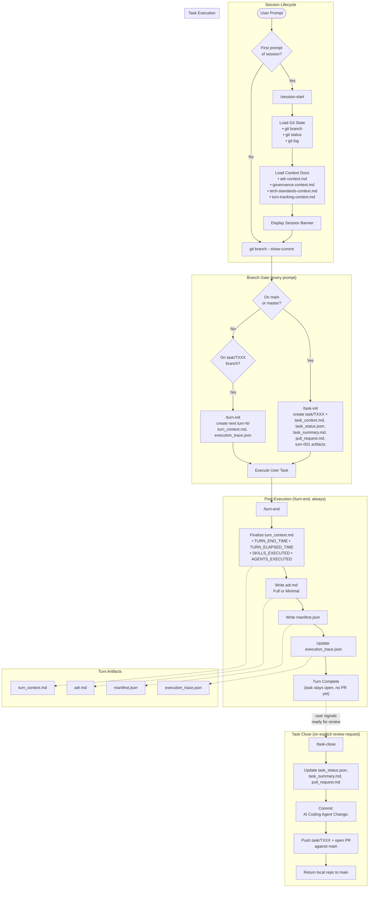

# coding-agents-config

Agentic pipeline configuration shared by Claude Code and Codex. Enforces a task/turn-based workflow (App Factory) with provenance tracking, branch protection, and governance rules.

## Setup

### 1. Clone the repo

```sh
git clone <repo-url> ~/coding-agents-config
```

### 2. Create symlinks (automated)

Run the setup script — it creates all symlinks and backs up any existing files:

```sh
bash scripts/setup.sh
```

The script links into `~/.claude/`, `~/.codex/`, and a repo-local `./.claude/`:

<details>
<summary>Manual symlink commands</summary>

```sh
# ~/.claude/
ln -s ~/coding-agents-config/skills ~/.claude/skills
ln -s ~/coding-agents-config/agents ~/.claude/agents
ln -s ~/coding-agents-config/hooks ~/.claude/hooks
ln -s ~/coding-agents-config/scripts ~/.claude/scripts
ln -s ~/coding-agents-config/CLAUDE.md ~/.claude/CLAUDE.md
ln -s ~/coding-agents-config/settings.json ~/.claude/settings.json
# rules/, context/, plugins/ are also linked if present in the repo

# ~/.codex/
ln -s ~/coding-agents-config/agents ~/.codex/agents
ln -s ~/coding-agents-config/AGENTS.md ~/.codex/AGENTS.md

# repo-local ./.claude/
ln -s ~/coding-agents-config/CLAUDE.md ./.claude/CLAUDE.md
```

If any of these already exist, back them up first (`mv <target> <target>.bak`).
</details>

### 3. Verify

```sh
ls -la ~/.claude/skills        # should point to ~/coding-agents-config/skills
ls -la ~/.claude/hooks         # should point to ~/coding-agents-config/hooks
ls -la ~/.claude/CLAUDE.md     # should point to ~/coding-agents-config/CLAUDE.md
ls -la ~/.claude/settings.json # should point to ~/coding-agents-config/settings.json
ls -la ~/.codex/AGENTS.md      # should point to ~/coding-agents-config/AGENTS.md
```

## Structure

```
coding-agents-config/
├── CLAUDE.md             # Global instructions — task/turn protocol, branch rules
├── AGENTS.md             # Codex loader directive (points at CLAUDE.md)
├── settings.json         # Claude Code settings (model, permissions, hooks, plugins)
├── package.json          # Declares the caveman plugin dependency
├── hooks/
│   └── branch-guard.sh   # PreToolUse hook — auto-creates task/TXXX if on main/master
├── skills/               # Slash-command skills (see Skills below)
│   ├── .system/          # Meta-skills (skill-creator, skill-installer, imagegen, ...)
│   ├── .nestjs/          # Disabled/staged NestJS scaffolding skills
│   ├── session-start/    # Load repo + pipeline context at session start
│   ├── task-init/        # Create task/TXXX branch and task-level artifacts
│   ├── turn-init/        # Create the next turn directory within a task
│   ├── turn-end/         # Finalize a turn (ADR, manifest, execution trace)
│   ├── task-close/       # Push task branch and open PR against main
│   ├── branch-guard/     # Legacy turn-scoped branch guard
│   ├── af-*/             # App Factory SDLC skills (PRD, DDD, plan, implementation, ...)
│   ├── dsl-utils/        # DSL parsing/validation skills
│   ├── ui-utils/         # UI DSL skills
│   ├── unit-tests/       # Test/implementation sync skills
│   ├── e2e-tests/        # HTTP test artifact generation
│   └── eval-labeler/     # Label and compare model responses
├── agents/               # Standalone agent definitions
│   └── agent-architecture-planner.md
├── scripts/
│   ├── setup.sh          # Creates the symlinks above
│   └── af-state.sh       # Helpers for .appfactory/memory/state.yaml
├── docs/                 # Reference documentation (migration notes, plans, skill summary)
├── archive/              # Deprecated skills and templates, kept for reference
│   └── templates/        # Former top-level templates/ dir (adr, PR, manifest schema, ...)
├── .appfactory/          # Task/turn tracking and pipeline state
│   ├── tasks/            # task-XXX/ dirs with turns/, task_status.json, pull_request.md
│   ├── tasks_index.csv   # Registry of all tasks and their status
│   ├── changelog.md
│   ├── specs/            # Specifications
│   ├── prompts/          # Prompt drafts used to build/update skills
│   └── memory/           # Pipeline state (state.yaml)
└── .github/
    └── PULL_REQUEST_TEMPLATE.md
```

> `templates/`, `plugins/`, and most of the app-generation skills documented in earlier
> versions of this README (`schema-to-database`, `nestjs-*`, `app-from-dsl`, etc.) have
> moved to `archive/` in favor of the App Factory (`af-*`) skill set below.

## Execution Flow

The agentic pipeline enforces a task/turn-based workflow for all coding tasks. A **task**
is the branch-scoped unit of work that becomes one pull request (`task/TXXX`); a **turn**
is one AI execution cycle within the active task branch.



### Task/Turn Protocol Summary

| Phase | Skill | Trigger | Outputs |
|-------|-------|---------|---------|
| **Session Start** | `session-start` | First prompt of session | Context loaded, banner displayed |
| **Task Init** | `task-init` | Branch is `main`/`master` | `task/TXXX` branch, task artifacts, turn-001 |
| **Turn Init** | `turn-init` | Already on `task/TXXX` | Next `turn-N/`, `turn_context.md`, `execution_trace.json` |
| **Execution** | — | Every prompt | Modified files |
| **Turn End** | `turn-end` | Always, even on failure | `adr.md`, `manifest.json`, finalized trace |
| **Task Close** | `task-close` | User signals ready for review | Commit, push, PR against `main` |

`branch-guard.sh` (a `PreToolUse` hook) is the safety net: if a coding agent skips
`task-init` and tries to write on `main`/`master` anyway, it auto-creates the next
`task/TXXX` branch before the write proceeds.

## Skills

Skills live under `skills/`. Most are organized by pipeline stage rather than as a flat
list; `af-*` skills implement the App Factory software development lifecycle end to end.

| Category | Skill | Description |
|----------|-------|-------------|
| **Session** | `session-start` | Load repo state and pipeline context docs at session start |
| **Task** | `task-init` | Create `task/TXXX` branch and initialize task + turn-001 artifacts |
| | `task-close` | Finalize the task, push the branch, open a PR against `main` |
| **Turn** | `turn-init` | Create the next turn directory and initial artifacts |
| | `turn-end` | Finalize a turn (ADR, manifest, execution trace) |
| | `branch-guard` | Legacy turn-scoped branch guard (superseded by the `hooks/branch-guard.sh` hook) |
| **App Factory SDLC** | `af-orchestrator` | Orchestrate the full App Factory SDLC (init → PRD → DDD → tests → plan → implementation) |
| | `af-project-init` | Initialize AppFactory project env vars and state |
| | `af-memory` | CRUD operations on `.appfactory/memory/state.yaml` pipeline state |
| | `af-be-prd-build` | Build a backend PRD from an intake worksheet |
| | `af-be-ddd-build` | Generate a backend Domain-Driven Design doc from an approved PRD |
| | `af-be-ddd-analysis` | Audit a generated DDD doc for quality and completeness |
| | `af-be-ddd-refactor` | Apply targeted patches to a DDD doc from analysis findings |
| | `af-be-ddd-dsl` | Generate a backend DSL YAML from a DDD doc |
| | `af-be-ddd-orchestrator` | Orchestrate the DDD build/analyze/refactor/test loop |
| | `af-be-ddd-tests` | Generate Gherkin BDD scenarios from DDD/PRD specs |
| | `af-be-plan` | Generate a backend execution plan from a DSL + tech stack profile |
| | `af-be-implementation` | Generate backend domain code from the execution plan |
| | `af-app-check` | Audit an application for production readiness |
| **DSL/UI utils** | `dsl-utils/dsl-model-interpreter` | Parse and validate app-dsl YAML specifications |
| | `ui-utils/ui-implementation-language` | Declarative YAML standard for UI pages/widgets/forms |
| **Testing** | `unit-tests/test-implementation-sync` | Keep unit tests synchronized with implementations |
| | `e2e-tests/http-test-artifacts` | Generate `.http` request files for API endpoint testing |
| **Eval** | `eval-labeler` | Label and compare model responses (Response A vs. B) for coding tasks |

### Meta-Skills (`.system`)

| Skill | Description |
|-------|-------------|
| `skill-creator` | Guide for creating or updating skills |
| `skill-installer` | Install skills from a curated list or GitHub repo |
| `plugin-creator` | Scaffold plugin directories with a `.codex-plugin/plugin.json` manifest |
| `imagegen` | Generate or edit raster images |
| `openai-docs` | Look up OpenAI product/API documentation |

### Disabled (`.nestjs`)

A staged set of NestJS/Prisma scaffolding skills (`app-from-dsl`, `nestjs-crud-resource`,
`nestjs-prisma-resource`, `nestjs-observability`, `field-mapper-generator`,
`nestjs-customer-crud-scaffold`, `prisma-persistence`, `prisma-guidelines`) — kept under a
dot-prefixed directory so they don't load by default.

## Templates (archived)

The turn-lifecycle templates below moved to `archive/templates/`:

| Template | Purpose |
|----------|---------|
| `adr_template.md` | Architecture Decision Record format |
| `pull_request_template.md` | PR description format |
| `manifest.schema.json` | Turn manifest JSON schema |
| `metadata_header.txt` | Source file header format |
| `branch_naming.md` | Branch naming conventions |
| `commit_message.md` | Commit message format |
| `tech-stack.template.md` | Tech stack documentation |

## Hooks

| Hook | Trigger | Purpose |
|------|---------|---------|
| `branch-guard.sh` | `PreToolUse` (write/edit/bash tools) | Auto-create `task/TXXX` if on `main`/`master` |

## Adding a new skill

Each skill lives in its own directory under `skills/` with a `SKILL.md` file:

```
skills/my-skill/
└── SKILL.md
```

The `.system/skill-creator` meta-skill can guide you through creating one — invoke it from Claude Code or Codex.

## Syncing across machines

Since this is a standard git repo, pull on any machine to stay current:

```sh
cd ~/coding-agents-config && git pull
```

The symlinks mean changes are picked up immediately — no reinstall needed.
