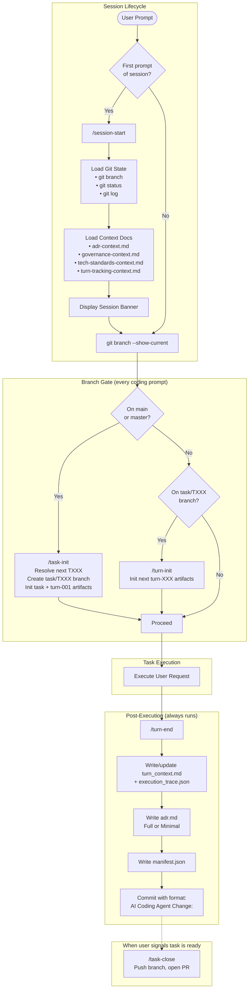

# coding-agents-config

Agentic pipeline configuration for Claude Code. Enforces turn-based workflow with provenance tracking, branch protection, and governance rules, plus the App Factory skill library for DSL-driven application generation.

## Setup

### 1. Clone the repo

```sh
git clone <repo-url> ~/coding-agents-config
```

### 2. Create symlinks (automated)

Run the setup script — it creates all symlinks and backs up any existing files:

```sh
bash scripts/setup.sh
```

It links `skills`, `agents`, `hooks`, `scripts`, `CLAUDE.md`, and `settings.json` into `~/.claude/`, links `agents` and `AGENTS.md` into `~/.codex/`, and links `CLAUDE.md` into a repo-local `./.claude/`. (`rules`, `context`, and `plugins` are also declared as link targets for future use; they are only linked once those directories exist in this repo.)

<details>
<summary>Manual symlink commands</summary>

```sh
ln -s ~/coding-agents-config/skills ~/.claude/skills
ln -s ~/coding-agents-config/agents ~/.claude/agents
ln -s ~/coding-agents-config/hooks ~/.claude/hooks
ln -s ~/coding-agents-config/scripts ~/.claude/scripts
ln -s ~/coding-agents-config/CLAUDE.md ~/.claude/CLAUDE.md
ln -s ~/coding-agents-config/settings.json ~/.claude/settings.json
ln -s ~/coding-agents-config/agents ~/.codex/agents
ln -s ~/coding-agents-config/AGENTS.md ~/.codex/AGENTS.md
```

If any of these already exist, back them up first (`mv <target> <target>.bak`).
</details>

### 3. Verify

```sh
ls -la ~/.claude/skills        # should point to ~/coding-agents-config/skills
ls -la ~/.claude/agents        # should point to ~/coding-agents-config/agents
ls -la ~/.claude/hooks         # should point to ~/coding-agents-config/hooks
ls -la ~/.claude/scripts       # should point to ~/coding-agents-config/scripts
ls -la ~/.claude/CLAUDE.md     # should point to ~/coding-agents-config/CLAUDE.md
ls -la ~/.claude/settings.json # should point to ~/coding-agents-config/settings.json
```

## Structure

```
coding-agents-config/
├── CLAUDE.md           # Global instructions — task/turn protocol, branch rules
├── AGENTS.md           # Codex agent loader directive
├── settings.json       # Claude Code settings (model, permissions, hooks)
├── package.json        # npm metadata (caveman plugin dependency)
├── hooks/              # Shell hooks triggered by Claude Code events
│   └── branch-guard.sh # Auto-creates a task/TXXX branch when on main/master
├── agents/             # Agent definitions
│   └── agent-architecture-planner.md
├── skills/             # Slash-command skills
│   ├── .system/        # Meta-skills (skill-creator, skill-installer, plugin-creator, imagegen, openai-docs)
│   ├── session-start/  # Initialize session context
│   ├── task-init/      # Create a new task branch + turn-001 artifacts
│   ├── turn-init/       # Initialize the next turn within the active task
│   ├── turn-end/        # Finalize a turn (context, trace, ADR, manifest)
│   ├── task-close/      # Push the task branch and open a pull request
│   ├── branch-guard/    # Create a task branch if on main/master
│   ├── af-*/            # App Factory SDLC skills (see below)
│   ├── dsl-utils/       # DSL parsing utilities
│   ├── e2e-tests/       # E2E/HTTP test artifact generation
│   ├── ui-utils/        # UI DSL standard
│   ├── unit-tests/      # Unit test/implementation sync
│   └── eval-labeler/    # Model response evaluation labeling
├── scripts/             # Automation scripts
│   ├── setup.sh         # Creates the symlinks above
│   └── af-state.sh      # Helpers for reading/writing .appfactory/memory/state.yaml
├── .appfactory/         # Task/turn tracking, App Factory specs and memory
│   ├── tasks/            # task-XXX/ directories, each with turns/turn-XXX/
│   ├── tasks_index.csv   # Registry of all tasks
│   ├── specs/            # App Factory specifications
│   ├── prompts/          # Prompt templates
│   ├── memory/           # Pipeline state (state.yaml)
│   └── changelog.md      # Project changelog
├── docs/                # Reference documentation (App Factory design, migration notes)
├── archive/             # Deprecated/superseded skills, kept for reference
└── .github/             # Issue and pull request templates
```

## Execution Flow

The agentic pipeline enforces a strict task/turn workflow for all coding tasks:



### Turn Protocol Summary

| Phase | When | Steps | Outputs |
|-------|------|-------|---------|
| **Session Start** | First prompt of session | Load git state → load 4 context docs → display banner | Context loaded |
| **Task Init** | Current branch is `main`/`master` | Resolve next task id → create `task/TXXX` → init task + `turn-001` artifacts | `.appfactory/tasks/task-XXX/*`, `turns/turn-001/*` |
| **Turn Init** | Current branch is `task/TXXX` | Resolve next turn id → init turn artifacts | `turns/turn-XXX/*` |
| **Execution** | Every coding prompt | Execute the user's request | Modified files |
| **Turn End** | After every prompt, even on failure | Update context/trace → write ADR → write manifest → commit | `turn_context.md`, `execution_trace.json`, `adr.md`, `manifest.json` |
| **Task Close** | User signals task ready for review | Push task branch → open PR against `main` | Pull request |

## Skills

### Task/Turn Lifecycle

| Skill | Description |
|-------|-------------|
| `session-start` | Load repository state and core pipeline context at session start |
| `task-init` | Initialize a new task branch and create task + `turn-001` artifacts |
| `turn-init` | Initialize the next turn within the active task branch |
| `turn-end` | Finalize the active turn (context, trace, ADR, manifest, commit) |
| `task-close` | Finalize the active task, push it, and open a pull request |
| `branch-guard` | Create a task branch when a coding prompt lands on `main`/`master` |

### App Factory (`af-*`) — DSL-driven application generation

| Skill | Description |
|-------|-------------|
| `af-orchestrator` | Orchestrates the App Factory software development lifecycle end to end |
| `af-project-init` | Orchestrates AppFactory project initialization (env vars + helper script) |
| `af-memory` | CRUD operations against `.appfactory/memory/state.yaml` pipeline state |
| `af-app-check` | Audits an application for production readiness (security, DB, deployment, quality) |
| `af-be-prd-build` | Builds a backend PRD from an intake worksheet or discovery notes |
| `af-be-ddd-build` | Generates a backend Domain-Driven Design document from an approved PRD |
| `af-be-ddd-analysis` | Audits a generated DDD document for quality, completeness, and PRD alignment |
| `af-be-ddd-refactor` | Applies `af-be-ddd-analysis` findings back into the DDD document |
| `af-be-ddd-dsl` | Generates a backend application DSL YAML document from the DDD document |
| `af-be-ddd-orchestrator` | Orchestrates the backend DDD build → analyze → refactor → test loop |
| `af-be-ddd-tests` | Generates Gherkin/BDD feature files from the DDD and PRD specs |
| `af-be-plan` | Generates a backend execution plan from the domain DSL and a tech stack profile |
| `af-be-implementation` | Generates backend domain code from the execution plan and BDD specs |

### Utility & Testing

| Skill | Description |
|-------|-------------|
| `dsl-utils / dsl-model-interpreter` | Parses and validates app-dsl YAML specifications |
| `e2e-tests / http-test-artifacts` | Generates `.http` files for REST client endpoint testing |
| `ui-utils / ui-implementation-language` | Declarative YAML standard for UI pages, widgets, forms, and bindings |
| `unit-tests / test-implementation-sync` | Keeps unit tests synchronized with service/DTO implementations |
| `eval-labeler` | Labels/scores Response A vs Response B model evaluations from `Eval.md` runs |

### Meta-Skills (`.system`)

| Skill | Description |
|-------|-------------|
| `skill-creator` | Create new skills with a `SKILL.md` |
| `skill-installer` | Install skills from marketplaces |
| `plugin-creator` | Scaffold new Claude Code plugins |
| `imagegen` | Image generation helper |
| `openai-docs` | OpenAI API reference lookup |

Deprecated and superseded skills (earlier CRUD/scaffolding generators, legacy turn artifacts) are kept under `archive/` for reference rather than active use.

## Hooks

| Hook | Trigger | Purpose |
|------|---------|---------|
| `branch-guard.sh` | `PreToolUse(Bash)` | If on `main`/`master`, auto-creates and switches to the next `task/TXXX` branch instead of blocking the tool call |

## Adding a new skill

Each skill lives in its own directory under `skills/` with a `SKILL.md` file:

```
skills/my-skill/
└── SKILL.md
```

The `.system/skill-creator` meta-skill can guide you through creating one — invoke it from Claude Code.

## Syncing across machines

Since this is a standard git repo, pull on any machine to stay current:

```sh
cd ~/coding-agents-config && git pull
```

The symlinks mean changes are picked up immediately — no reinstall needed.
