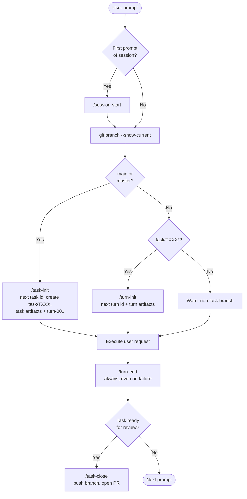

# coding-agents-config

Agentic pipeline configuration for Claude Code. Enforces turn-based workflow with provenance tracking, branch protection, and governance rules.

## Setup

### 1. Clone the repo

```sh
git clone <repo-url> ~/coding-agents-config
```

### 2. Create symlinks (automated)

Run the setup script — it creates all symlinks and backs up any existing files (`<target>.bak`):

```sh
bash scripts/setup.sh
```

It links into three locations:

| Destination | Linked items |
|-------------|--------------|
| `~/.claude/` | `skills`, `agents`, `rules`, `hooks`, `context`, `scripts`, `plugins`, `CLAUDE.md`, `settings.json` |
| `~/.codex/` | `agents`, `AGENTS.md` |
| `./.claude/` (repo-local) | `CLAUDE.md` |

Items that don't exist in the repo (e.g. `rules`, `context`) are linked as dangling symlinks; they are placeholders.

### 3. Verify

```sh
ls -la ~/.claude/skills        # -> ~/coding-agents-config/skills
ls -la ~/.claude/agents        # -> ~/coding-agents-config/agents
ls -la ~/.claude/hooks         # -> ~/coding-agents-config/hooks
ls -la ~/.claude/CLAUDE.md     # -> ~/coding-agents-config/CLAUDE.md
ls -la ~/.claude/settings.json # -> ~/coding-agents-config/settings.json
```

## Structure

```
coding-agents-config/
├── CLAUDE.md           # Global instructions — task/turn protocol, branch rules
├── AGENTS.md           # Agent loader directive (points Codex at CLAUDE.md)
├── settings.json       # Claude Code settings (model, permissions, hooks, plugins)
├── agents/             # Subagent definitions
│   └── agent-architecture-planner.md
├── hooks/              # Shell hooks triggered by Claude Code events
│   └── branch-guard.sh # Auto-creates task/TXXX branch when on main/master
├── skills/             # Slash-command skills (see below)
│   └── .system/        # Meta-skills (skill-creator, skill-installer, ...)
├── scripts/
│   ├── setup.sh        # Symlink installer
│   └── af-state.sh     # AppFactory state helpers (.appfactory/memory/state.yaml)
├── .appfactory/        # Task/turn tracking and specs
│   ├── tasks/          # task-XXX/ with turns/turn-XXX/ artifacts
│   ├── tasks_index.csv # Registry of all tasks
│   ├── changelog.md
│   ├── specs/          # Specifications
│   ├── prompts/        # Prompt templates
│   └── memory/         # Pipeline state
├── .github/            # PR template and issue templates (bug, epic, task)
├── docs/               # Reference documentation
└── archive/            # Retired skills kept for reference
```

Lifecycle templates (task/turn context, ADR, PR, manifest) live inside the skills that use them, e.g. `skills/task-init/templates/`.

## Execution Flow

Work is organised into **tasks** (one branch `task/TXXX`, one pull request) made of **turns** (one AI execution cycle). Ids are zero-padded: tasks are global (`001`), turns reset per task.



`hooks/branch-guard.sh` backs this up: it runs before Bash tool calls and, if the current branch is `main`/`master`, auto-creates the next `task/TXXX` branch. Never write code on `main`/`master`.

### Protocol summary

| Phase | Skill | Outputs |
|-------|-------|---------|
| Session start | `session-start` | Git state and pipeline context loaded (first prompt only) |
| Task init | `task-init` | `task/TXXX` branch, `task_context.md`, `task_status.json`, `task_summary.md`, `pull_request.md`, row in `tasks_index.csv`, `turn-001` |
| Turn init | `turn-init` | Next `turn-XXX/` with `turn_context.md`, `execution_trace.json` |
| Turn end | `turn-end` | `adr.md`, `manifest.json`, updated context/trace; commit as `AI Coding Agent Change:` |
| Task close | `task-close` | Branch pushed, pull request opened against `main` |

Artifacts live under `.appfactory/tasks/task-XXX/` (task level) and `.appfactory/tasks/task-XXX/turns/turn-XXX/` (turn level). Every turn needs `turn_context.md`, `execution_trace.json`, `adr.md` and `manifest.json`.

## Skills

### Workflow

| Skill | Description |
|-------|-------------|
| `session-start` | Load repository state and core pipeline context |
| `task-init` | Create task branch plus task and `turn-001` artifacts |
| `turn-init` | Initialize the next turn in the active task |
| `turn-end` | Finalize the turn: ADR, manifest, trace, commit |
| `task-close` | Finalize the task, push, open a PR against `main` |
| `branch-guard` | Create a task branch if on main/master |

### App Factory (`af-*`)

| Skill | Description |
|-------|-------------|
| `af-orchestrator` | Orchestrate the App Factory SDLC |
| `af-project-init` | Initialize an AppFactory project (env vars + helper script) |
| `af-memory` | CRUD for pipeline state in `.appfactory/memory/state.yaml` |
| `af-be-prd-build` | Build a backend PRD from a completed worksheet |
| `af-be-ddd-build` | Generate a Domain-Driven Design document from the PRD |
| `af-be-ddd-analysis` | Analyze the DDD document |
| `af-be-ddd-refactor` | Refactor the DDD based on analysis |
| `af-be-ddd-tests` | Generate Gherkin BDD feature files from DDD and PRD |
| `af-be-ddd-orchestrator` | Run build → analyze → refactor loop → tests (max 3 tries) |
| `af-be-ddd-dsl` | Generate a backend domain DSL (YAML) from the DDD |
| `af-be-plan` | Produce a backend execution plan from DSL + tech stack profile |
| `af-be-implementation` | Copy a tech stack implementation and generate domain code |
| `af-app-check` | Production-readiness audit (security, database, deployment, code quality) |

### Utilities

| Skill | Description |
|-------|-------------|
| `dsl-utils` | DSL model interpreter |
| `ui-utils` | UI implementation language |
| `unit-tests` | Test/implementation sync |
| `e2e-tests` | HTTP test artifacts |
| `eval-labeler` | Label and process model-response evaluations |

### Meta-skills (`skills/.system`)

`skill-creator`, `skill-installer`, `plugin-creator`, `imagegen`, `openai-docs`.

Older code-generation skills (NestJS/Prisma CRUD, React forms, schema-to-database, etc.) are kept in `archive/`.

## Agents

| Agent | Purpose |
|-------|---------|
| `agent-architecture-planner` | Reads PRD, DDD, DSL and repo structure to produce architecture decisions, module maps and task plans |

## Hooks

| Hook | Trigger | Purpose |
|------|---------|---------|
| `branch-guard.sh` | PreToolUse(Bash) | On main/master, auto-create the next `task/TXXX` branch |

## Adding a new skill

Each skill lives in its own directory under `skills/` with a `SKILL.md` file:

```
skills/my-skill/
└── SKILL.md
```

The `.system/skill-creator` meta-skill can guide you through creating one — invoke it from Claude Code.

## Syncing across machines

Since this is a standard git repo, pull on any machine to stay current:

```sh
cd ~/coding-agents-config && git pull
```

The symlinks mean changes are picked up immediately — no reinstall needed.
